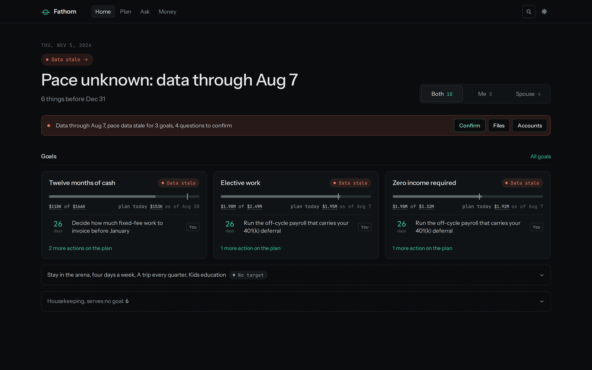
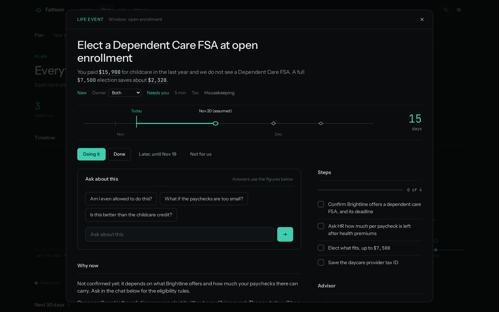
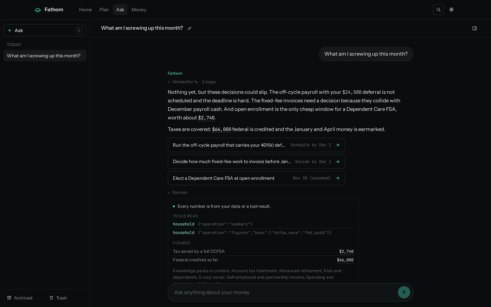
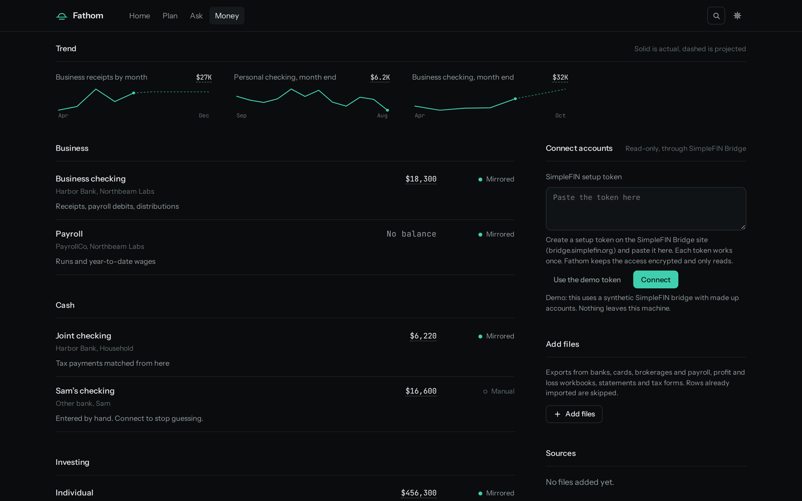
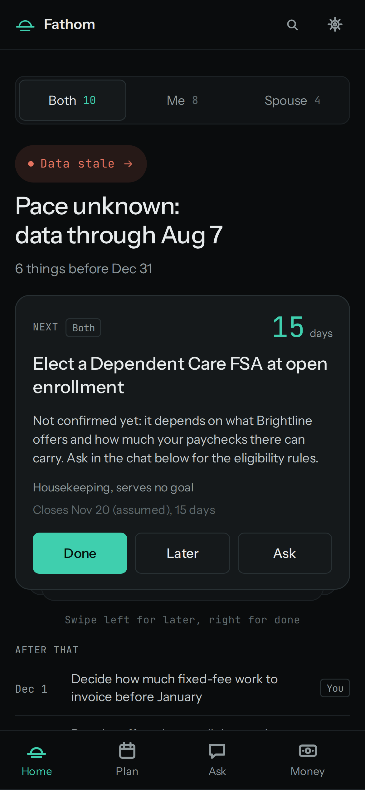

# Fathom

A year-round financial co-pilot for households of independent professionals: it tells you when
it's covered, and when something needs you before a window closes.



Home starts from your goals. Each one shows whether you are on pace, and the actions that move it
carry a deadline and an owner, so the owner and the spouse both know whose turn it is.

## Plan and a recommendation

Fathom watches the calendar, income changes and life events, and turns each trigger into a
recommendation with a why-now, a window, the household's own figures and a short checklist. For
decisions with tradeoffs, war games put you on the curve and you pick the point.



## Ask, with every figure sourced

Ask questions about your own money in plain language. Answers stream in, grounded in your stored
data and the knowledge packs that apply to your household, and every figure links to where it
came from.



## Money

Accounts connect read-only through SimpleFIN or come in as uploaded exports. Fathom shows balances,
monthly trends and freshness, so a stale or missing account is a visible gap, not a silent one.



## The monthly brief

On the 1st, one email answers one question: am I missing something? Either it's covered, or here
are the few things that need you, with what changed and what Fathom checked.


## On the phone

The same app works at phone width and installs to the home screen.



## Boundaries

Fathom is advisory only: it never files taxes, moves money or picks securities. Account access is
read-only. Every figure comes from deterministic code or stored data and carries its provenance;
the model never states a number on its own. Fathom is self-hosted as one container on your own
network, and this repository only ever holds synthetic demo data. You can also connect your own AI
over MCP with read-only keys, and hand a human advisor or your tax preparer a packet with every
figure's source.

## Quick start

Node 24 or later, on synthetic demo data with no secrets:

```bash
npm ci && npm start
# open http://127.0.0.1:8080/
```

To test delivery for a configured household, run
`FATHOM_LIVE_EMAIL=1 npm run email:test -- --household <id>`.

## Docs

1. [Development](docs/development.md): running, configuring, testing, deploying and operating.
2. [Architecture](docs/architecture.md): how the pieces fit together.
3. [Product definition](docs/vision-v2.md), with a Status section for built versus deferred.
4. [Known limits](docs/known-limits.md).
5. [Releasing](docs/releasing.md).

The clickable design mock lives in [`mock-v2/`](mock-v2/).

Status: build phase.
