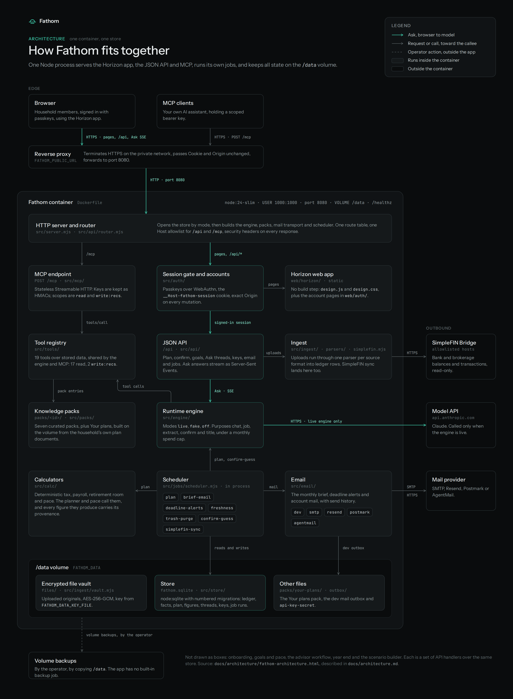

# Fathom architecture



Diagram source: [architecture/fathom-architecture.html](architecture/fathom-architecture.html).
Regenerate the image with `node scripts/screenshots.mjs --port <n>` (see [development.md](development.md)).

## Overview

Fathom is one Node process in one container. It serves the Horizon app, the JSON API and MCP, runs
its own jobs, and keeps every piece of state on the `/data` volume.

1. A reverse proxy in front terminates HTTPS for the `FATHOM_PUBLIC_URL` host and forwards plain
   HTTP to port 8080. Browsers and MCP clients both arrive this way.
2. `src/server.mjs` opens the store by its mode, builds the runtime engine, the live pack view, the
   mail transport and the scheduler, then hands every request to the router in `src/api/router.mjs`.
3. The router applies the session gate in `src/auth/` first: passkeys over WebAuthn, the
   `__Host-fathom-session` cookie, and an exact Origin on every mutation. On a real store
   everything sits behind that gate except `/healthz`, the sign-in and enrollment pages, and the
   public `/api/auth` routes for the session check, sign-in, enrollment and recovery. `/api`
   requests then pass the Host allowlist.
4. `POST /mcp` skips the session gate and takes a bearer key instead. Its tools come from the same
   registry in `src/tools/` that the engine uses, limited by the key's scopes.
5. The API reads and writes the store. Ask streams its answer as Server-Sent Events from the engine
   (`src/engine/`), which runs `live`, `fake` or `off` and grounds its answers in tools over the
   stored data and the knowledge packs.
6. Calculators in `src/calc/` produce every figure deterministically, called by the planner and
   pace, and each figure keeps its provenance. The model never states a number it did not get from
   a calculator or the store.
7. Ingest (`src/ingest/`) turns uploads into ledger rows through one parser per format, keeps the
   originals in the encrypted vault, and runs the read-only SimpleFIN sync.
8. The in-process scheduler (`src/jobs/scheduler.mjs`) runs `plan`, `brief-email`,
   `deadline-alerts`, `freshness`, `trash-purge`, `confirm-guess` and `simplefin-sync`. Mail leaves
   through `src/email/` on the configured transport.
9. `/data` holds `fathom.sqlite`, the vault's `files/`, the Your plans pack and the key secret.
   Backing it up is the operator's job; the app has no backup job of its own.

This is the architecture every build item works against. The first part is frozen: change it only
by agreement across items. The rest describes the running app and is updated as items land.
Known limits from merged pull requests are in [`known-limits.md`](known-limits.md).

## Request and job flow

```
browser or MCP client
        |  HTTP (pages, /api, POST /mcp)
        v
   src/server.mjs
        |-- /mcp: bearer keys only
        |-- session gate (real store: __Host-fathom-session cookie, exact Origin on mutations)
        |-- router (JSON, uploads, SSE for Ask)
        |-- scheduler tick (in process)
                |-- plan, brief-email, deadline-alerts
                |-- freshness, trash-purge, confirm-guess, simplefin-sync
                        |
                        v
              runtime engine (purpose + model)
                        |
                        v
                 SQLite + encrypted vault
```

An upload commits rows, then the scheduler is asked to plan and to guess confirm answers. A nightly tick does the same plan, and on its own cadence sends the brief and deadline mail. Ask streams through the engine, then replaces the draft with the grounded HTML stored on the thread.

## Where each subsystem is written

1. Store and migrations: Store.
2. Ingest and vault: Ingest.
3. Confirm queue and revise: Confirm queue, and the confirm routes under API.
4. Planner, figures and provenance: Planner.
5. Scheduler and jobs: Jobs.
6. Engine gateway: Frozen architecture, Engine gateway, and Runtime engine.
7. Chat, streaming and grounding: Chat over the data.
8. Ask conversations: The `live` key, Ask threads.
9. MCP and keys: MCP server.
10. Packs and Your plans: Live pack state, Your plans.
11. Email: Email.
12. Accounts, passkeys and sessions: Accounts and sessions, Platform database.
13. Onboarding: Onboarding.
14. Goals: Goals and the tradeoff curve.
15. Advisor: Advisor workflow.
16. Year end: Year end.
17. Bank connections: SimpleFIN connections.
18. UI shell, keyboard, phone, demo, tests: UI shell, Keyboard registry and switcher, Phone layout, Demo mode, Testing and real-mode smoke.

## Frozen architecture

### 1. Stack

Node 24 ESM (`.mjs`), no TypeScript, no frontend build step. SQLite through the built-in
`node:sqlite` (`DatabaseSync`). Minimal dependencies, all exact pins in `package.json`: the engine runtime uses the Anthropic and
MCP SDKs and Ajv, and `@playwright/test` is the dev dependency. Unit tests run with `node --test`
over every module's test directory (`npm test`), end-to-end tests with Playwright.

### 2. Layout

| Path | Owner and purpose |
|---|---|
| `package.json` | Scripts `start`, `test`, `seed:demo`, `e2e`, `e2e:smoke` (names are frozen), plus `plan` (`npm run plan`, one planning run over the real store), `confirm:guess` (`npm run confirm:guess`, one run of the `confirm-guess` job: engine guesses for pending confirm questions) and `user:invite` (`npm run user:invite -- <email> --admin`, the first admin's invitation; see Accounts and sessions). |
| `src/server.mjs` | HTTP entry: store mode rules, then serves the UI, `/shared/` and the API. |
| `src/config.mjs` | `loadConfig(env)`: every environment key, paths only. |
| `src/store/` | `db.mjs` plus `migrations/NNN-name.sql`. Owned by the foundation item. |
| `src/scenario/build.mjs` | Store to CONTRACT.md scenario object (`buildScenario`). |
| `src/api/` | Router, handlers, HTTP guards, static serving, the live answerer and its fake answer source. |
| `src/auth/` | Accounts: the auth store (users, memberships, invitations, operators, passkeys, tokens, sessions, challenges, rate limits; it opens `platform.sqlite`, never the financial store), the WebAuthn service and the auth, admin and operator handlers. |
| `src/platform/` | The platform database: `db.mjs` (`openPlatform`, `createInstance`, `store_identity` DDL), `ready.mjs` (startup refusals), `migrate.mjs` (the offline account migration), `snapshot.mjs` (encrypted source snapshots and rollback) and `migrations/`. |
| `src/shared/` | Browser-safe logic used by the server and the UI (`rules.mjs`, `tokens.mjs`). |
| `src/tools/` | Tool registry shared by the chat engine and the MCP server. |
| `src/calc/` | Deterministic calculators (tax, payroll, retirement room, cash). |
| `src/ingest/`, `src/ingest/parsers/` | File ingest pipeline and one parser per source format. |
| `src/engine/` | Engine gateway (model calls, on/off, spend cap). |
| `src/packs/` | Knowledge pack loading and activation. |
| `src/mcp/` | MCP server over the tool registry. |
| `src/jobs/` | In-process scheduler and proactive jobs. |
| `src/email/` | Email transports, send history and the monthly brief. |
| `web/` | The Horizon UI (`index.html`, `core/core.js`, `horizon/design.js`, `horizon/design.css`) and the account pages (`auth/index.html`, `auth/auth.js`, `auth/auth.css`). |
| `demo/` | Synthetic demo scenario, seed and ledger. |
| `packs/<id>/` | Pack content. |
| `e2e/` | Playwright specs. |
| `Dockerfile` | The one image. |
| `docs/architecture.md` | This file. |

`mock-v2/` stays untouched as the design reference.

### 3. Money

Money is a JS number in dollars rounded to cents everywhere: `Math.round(x * 100) / 100` on every
write (`cents()` in `src/store/db.mjs`). Store columns are `REAL`. Display formatting lives in
`src/shared/tokens.mjs` (`money(n, {k, sign, cents})`). The model never states a number it did not
get from a calculator or from stored data, and every displayed figure carries its provenance.

### 4. UI

`web/` keeps the mock's `api` surface (CONTRACT.md "Core API") so the Horizon design changes
minimally. Data comes from `GET /api/scenario` (the CONTRACT.md scenario shape plus `live`) and
actions POST to the API; each action response carries the fresh scenario. There is no review
harness bar in the product. The demo build is a synthetic store seeded to the November state.

Home (`#/home`, the default route; `#/brief` is an alias that core normalizes to `home`, so
older email links keep working) is goals first. Its headline and health chip come from
`scenario.pace.rollup`; each goal with a target gets a card with its pace chip, a bar of actual
against target with a plan-today tick, and its next open action. Stale or otherwise unknown
pace is never shown as on pace: the chip says "Data stale" or "Pace unknown". Every live goal
gets a card (see "Suggested targets"), with a suggested target when it has none; actions that
serve no goal sit in a housekeeping row. An owner filter (Both, Me, Spouse) narrows every
action list, and one data-health line (data through date, stale accounts or goals, Confirm
questions, failed files) replaces the Confirm banner and nav badge. On a phone the first card
is the single next thing, with Done, Later and Ask and a swipe (right is Done, left is Later)
shared with the Confirm deck through `web/horizon/screens/swipe.js`, then the next three. The
health chip opens the pace board at `#/pace`: monthly ahead-or-behind bars per series (observed
months filled, projected months dashed, a "data ends" marker), the retirement, tax and income
meters or the reason each is missing, and a freshness note. Every dollar figure on both pages
is a `pace.*` figure with its provenance popover. The view model is the pure module
`web/horizon/screens/home-model.js`. Domain cards (Covered), What changed and the monthly email
note moved to Plan, whose timeline also draws past What-changed events.

Owners and goal links come from the recs themselves (`loadLinkedRecs`): every rec has an
`owner`, `serves` (its open goals) and `housekeeping`. The housekeeping row lists housekeeping
recs that are not done, dismissed or hidden, so under Both its count equals
`live.housekeeping`. The spouse is a filter, not yet the signed-in member: Me shows owners you
and both, Spouse shows spouse and both, Both shows every action. Health is per goal and the
household headline is derived from it; goals without targets are not counted.

Navigation is four tabs, Home, Plan, Ask and Money, plus a gear for Settings; there is no More
menu. Every route maps to one tab or to the gear (`TAB_OF` in `web/horizon/design.js`), and the
lit tab comes from the current route, or for `#/rec/<id>` from the page under the dialog. Home
holds Home, the pace board, Goals and Confirm (reached from goal cards and the data-health line).
Plan holds Plan, Year end and Advisor. Ask holds conversations, Decide (the What-if view,
`#/wargame`) and Packs. Money (`#/money`) holds an overview, Accounts, P&L (`#/pnl`, each business and household spending) and Files (`#/add`). The
gear opens `#/settings`, which lists Connect, Engine, Email, Setup (real stores only), and on a
real store the signed-in line, Account and, for admins, Household. Plan, Ask and Money show a
sub-nav of their views at the top of each of those pages. The Money overview spells out the
data-health line one part per row and then renders the same account mirror as `#/accounts`
(`accountsBody()`). Desktop shows the four tabs in the header with search and the gear at the
right; at 720px and below they move to a fixed bottom bar while search and the gear stay in the
top bar. `g o` opens Money and `g s` opens Settings.

### 5. Facts

A store table of `{key, value JSON, src, asOf, confirmed}` (table `facts`, with provenance
columns). Frozen fact keys:

| Key | Type |
|---|---|
| `household.state` | string, for example "VA" |
| `household.filingStatus` | string: "mfj", "single", ... |
| `household.dependents` | int |
| `household.expectingChild` | bool |
| `household.dependentAges` | int[] |
| `income.w2` | bool |
| `income.sCorp` | bool |
| `income.selfEmployed` | bool |
| `income.partnership` | bool |
| `income.agiEstimate` | number |
| `benefits.hsa` | bool |
| `benefits.employer401k` | bool |
| `retirement.solo401k` | bool |
| `retirement.ira` | bool |
| `retirement.backdoorRothCandidate` | bool |
| `accounts.has529` | bool |
| `giving.charitable` | bool |
| `giving.annualEstimate` | number |

New keys may be added, never renamed.

### 6. Pack manifest

`packs/<id>/manifest.json`:

```
{ id, name, version, taxYear, reviewed: "YYYY-MM-DD", curator, covers: [...],
  appliesWhen: Rule, suggestWhen?: Rule, whatIf: { prompt },
  entries: [ { file, title, cites: [ { label, url } ] } ] }
```

Rule grammar:

```
Rule = { all: [Rule] } | { any: [Rule] } | { not: Rule }
     | { fact, op: 'eq'|'ne'|'gt'|'gte'|'lt'|'lte'|'in'|'exists', value? }
```

`src/packs` exports `loadPacks(dirs[])`, `evaluate(rule, facts)`, `activePacks(packs, facts)`
returning `[{pack, status: 'active'|'suggested'|'available', why}]`, and `packContext(active)`
returning a stable string for prompt caching. A private "Your plans" pack lives in the data volume
at `$FATHOM_DATA/packs/your-plans/` in the same format.

### 7. Parser interface

`src/ingest/parsers/<id>.mjs` exports `{id, label, sourceKind, sniff(file) -> 0..1,
parse(file) -> {rows, warnings, period: {from, to}}}` where `file = {name, bytes: Uint8Array, mime}`.

`sourceKind` is one of `bank_csv`, `card_csv`, `aggregator_csv`, `brokerage_positions`,
`pnl_workbook`, `tax_payments`, `balances`, `paystub`, `tax_doc`, `statement`, `notes`, `other`.

Row kinds:

| Kind | Fields | Store table |
|---|---|---|
| transaction | `account: {inst, mask, name?, kind?}, date, amount, description, category?, externalId?` | `transactions` |
| balance | `account, date, amount` | `balances` |
| position | `account, asOf, symbol, name, quantity, price, value, costBasis?` | `positions` |
| pnl_line | `entity, period: 'YYYY-MM', category, amount` | `pnl_lines` |
| tax_payment | `jurisdiction, taxYear, date, amount, kind` | `tax_payments` |
| document | `docType, taxYear?, fields` | `documents` |
| snapshot | `account, asOf` (a statement's holdings list, even empty: the account's complete holdings on that date) | none (drives position removal) |
| fact | `key, value` | `facts` |

Each row carries a `locator` (row number or cell) from the parser; the pipeline adds
`{fileId, parser}`, stored as the `file_id`, `parser` and `locator` provenance columns.
`src/ingest/dedupe.mjs` exports `dedupeKey(row)` (stored in `transactions.dedupe_key`, unique).
Account masks are the last 4 digits only; full account numbers are never stored (a CHECK
constraint on `accounts.mask` enforces exactly four digits or NULL).

### 8. Tool interface

Shared by the chat engine and the MCP server. `src/tools/index.mjs` exports `tools`, a registry
of `{name, description, inputSchema (JSON Schema), scope: 'read'|'write:recs', handler(args, ctx)}`
with `ctx = {db, now}`, plus `getTool(name)`, `callTool(name, args, ctx)` (validates args against
`inputSchema`) and `ToolError` with `code` `'bad_input'` or `'not_found'`. The recommendation write scope,
`write:recs`, covers recommendation status (`set_recommendation_status`) and action owner
(`set_recommendation_owner`).

| Tool | Scope | Input | Output |
|---|---|---|---|
| `household_summary` | read | none | `{facts, verdictLevel, needsYouCount, statusCounts, dataThrough, clock}` |
| `get_facts` | read | `keys?: string[]` | `[{key, value, src, asOf, confirmed}]` |
| `list_accounts` | read | none | `[{id, inst, mask, name, owner, kind, mirror, note, balance, asOf}]` |
| `query_transactions` | read | `accountId?, from?, to?, minAmount?, maxAmount?, category?, text?, limit? (1..200, default 50)` | `{rows: [{id, accountId, date, amount, description, category}], truncated, total}` |
| `list_positions` | read | `accountId?` | `[{accountId, symbol, name, quantity, price, value, costBasis, asOf}]` |
| `pnl_by_month` | read | `entity?, from?: 'YYYY-MM', to?` | `{rows: [{period, category, amount}], totals: {period: n}}` |
| `list_recommendations` | read | `status?: string or string[]` | live recs, never hidden, each with `owner`, `ownerOverride`, `goalKinds`, `serves: [{id, title, origin}]` and `housekeeping` |
| `get_recommendation` | read | `id` | the live rec, linked the same way |
| `list_deadlines` | read | `from?, to?` | `[{date, label, title, recId, hard}]` sorted by date |
| `list_goals` | read | none | goals |
| `get_figures` | read | `keys?: string[]` | `[{key, v, kind, label, source: {id, label, asOf}}]` |
| `packs_status` | read | none | `[{id, name, status, why}]` |
| `advisor_status` | read | none | `{advisor, nextCheckin: {date, time, lengthMin, label} or null, waiting: [{recId, title, sentOn}], reviewed: [{recId, title, sentOn, verdict, note, reviewedOn, recordedOn}], history (closed reviews with closedOn, closedReason), packets: [{id, date, recIds}]}` (see "Advisor workflow") |
| `set_recommendation_status` | write:recs | `id, status: doing, done, dismissed, snoozed or proposed, wake?` | the linked rec; writes `rec_events` attributed to the signed-in person or key creator |
| `set_recommendation_owner` | write:recs | `id, owner: you, spouse, both, advisor or automatic` | the linked rec; sets `owner` and `owner_override = 1`, writes `rec_events` action `set_owner`, actor `tool`, from and to the current status |
| `list_packs` | read | none | `[{id, name, status, why, version, taxYear, reviewed, covers, entries: [{file, title}]}]` sorted by id |
| `get_pack_entry` | read | `packId, file` (the manifest file or the entry id) | `{packId, packName, file, id, title, markdown, citations: [{label, url}], version, taxYear, reviewed}`; any loaded pack, active or not |
| `search_pack_entries` | read | `query (2..200 chars), packId?, limit? (1..20, default 10)` | `{results: [{packId, file, id, title, score, snippet}], total, truncated}` over active packs only (the query is not echoed) |

The pack tools (`src/tools/packs.mjs`) load packs from `ctx.packDirs`, else the repo `packs/` plus
`<ctx.dataDir>/packs/your-plans` when it exists. Status is what the owner sees in the UI, not the
facts alone. A manifest pack links to a `packs_state` row by the row's `def.manifest` (a manifest
id), else by the row id (`manifestIdOf` in `src/packs/index.mjs`, shared with the live pack view).
A linked pack reads `packStatus(base, {active, exploring})` from
`src/shared/rules.mjs`, where `base` is the row's `def.status` when it is a string, else the status
from `activePacks(packs, facts)`, and `active` and `exploring` are the row's columns (a non-null
`active` wins; `exploring` shows when the pack is not active). `why` is `Turned on by the owner.` or
`Turned off by the owner.` when `active` is set, else the row's `def.why` with scenario tokens
resolved to plain text, else the activation reason. A pack with no linked row keeps the
facts-derived status and reason. Name, version, tax year, review date and entries always come from
the manifest files. `search_pack_entries` reads only packs whose status is `active`. Search terms are the lowercase alphanumeric runs of two or more characters in the
query; an entry matches when every term appears in its title or body; score is 5 per title
occurrence plus 1 per body occurrence; order is score descending, then pack id, then entry id.

Tool outputs resolve scenario tokens to plain text and expose masks only.

The planned deterministic tool layer is specified in [ask-tools.md](ask-tools.md): the figure
envelope and references, `calculate`, the spending, cash flow, net worth, tax, room, obligation and
access tools, the write tools that give the agent parity with every mutating route, the model's
routing rules, and the ordered tickets that build them. Until a ticket there merges, this table is
the tool interface.

`src/engine/tools.mjs` `createRegistryServer` consumes this registry. Input schemas must compile
under strict Ajv, so no union types (`type` arrays); use `anyOf`. `ctx.now` may be a Date, an ISO
string or epoch ms, and the store clock decides "today" when set.

### 9. Engine gateway

`src/engine` exports `createEngine({mode: 'live'|'fake'|'off', ledger, capUsd, credential})` with
`call({purpose: 'chat'|'job'|'extract'|'confirm'|'title', system, messages, tools?, maxTokens})` and a chat
runner on the Claude Agent SDK. `extract`, `confirm` and `title` are one structured Messages API round (a JSON
schema); `title` names Ask threads on `TITLE_MODEL` (`claude-haiku-5-5`), every other purpose runs
on `DEFAULT_MODEL` (`claude-opus-5-5`), and the conservative estimate for an unknown cost uses the
purpose's model. Prices live in `src/engine/pricing.mjs` with the date they were verified on the
pricing page; Haiku 5.5 has a base row for prompts up to 100,000 tokens (input plus cache read plus
cache write) and a long row above that. It checks on/off and month-to-date spend below the cap BEFORE every model
call (throws `EngineOffError` or `BudgetExceededError`) and records cost to the ledger after.
Ledger adapter: `{monthSpendUsd(yyyymm), record({ts, purpose, costUsd, model, tokens})}` over the
`spend_ledger` table (`yyyymm` stored as `'YYYY-MM'`). Default cap 200 USD (`settings.cap`).
`FATHOM_ENGINE=fake` in tests.

### 10. Config

Read from the environment by `src/config.mjs` (`loadConfig(env = process.env)`); paths only, no
secrets are read there.

| Key | Default | Meaning |
|---|---|---|
| `FATHOM_DATA` | `./data` (gitignored) | Data directory; holds `fathom.sqlite` and `platform.sqlite`. |
| `FATHOM_BACKUP_KEY_FILE` | unset | Path to a private file holding a 32-byte key. Read only by `scripts/migrate-platform.mjs` and `scripts/source-snapshot.mjs`, which encrypt source snapshots with it; the server never reads it. |
| `FATHOM_PLATFORM_KEY_FILE` | unset | Path to a private file holding the 32-byte platform key that wraps household data keys (`loadPlatformKey`, `platformKeyFromEnv` in `src/platform/backup-key.mjs`). Read by no server path yet; for offline tooling and the MT-03 cutover. |
| `FATHOM_PORT` | `8080` | HTTP port. |
| `FATHOM_HOST` | `127.0.0.1` (the image sets `0.0.0.0`) | Bind address. |
| `FATHOM_DEMO` | unset (auto) | `1` demo store required, `0` real store required, unset follows the store (a new store is demo). |
| `FATHOM_ENGINE` | `fake`, or `off` when `FATHOM_DEMO=0` | `live`, `fake` or `off`. |
| `FATHOM_CLOCK` | unset | ISO date that overrides "today" (`settings.clock`) for demos and tests. Never written to the store. |
| `FATHOM_FAKE_STREAM_MS` | `25` | Fake engine only: milliseconds between streamed answer chunks (0 to 1000). |
| `FATHOM_CLAUDE_CREDENTIAL_FILE` | unset | Path to the mounted Claude credential. |
| `FATHOM_DATA_KEY_FILE` | unset | Path to the raw file encryption key. |
| `FATHOM_EMAIL_TRANSPORT` | `dev` | `dev`, `smtp`, `resend`, `postmark` or `agentmail` (see Email). |
| `FATHOM_EMAIL_FROM` | unset (`dev` uses `fathom@example.invalid`) | Sender address; for `agentmail` the inbox id. Not with `FATHOM_EMAIL_FROM_FILE`. |
| `FATHOM_EMAIL_FROM_FILE` | unset | Path to a file holding the sender address. Not with `FATHOM_EMAIL_FROM`. |
| `FATHOM_EMAIL_TO` | unset (`dev` uses `owner@example.invalid`) | Recipient addresses, comma separated. Not with `FATHOM_EMAIL_TO_FILE`. |
| `FATHOM_EMAIL_TO_FILE` | unset | Path to a file of recipient addresses (comma or newline separated). Not with `FATHOM_EMAIL_TO`. |
| `FATHOM_EMAIL_CREDENTIAL_FILE` | unset | Path to the mounted email credential (API key or SMTP password); must not be readable by other users; mount the secret with mode 0400 or 0440 (with fsGroup) or 0600. Required by every transport but `dev`. |
| `FATHOM_EMAIL_SMTP_USER` | unset | SMTP user name for `smtp`. |
| `FATHOM_EMAIL_SMTP_HOST` | `smtp.gmail.com` | SMTP host for `smtp`. |
| `FATHOM_EMAIL_SMTP_PORT` | `465` | `465` (TLS) or `587` (STARTTLS, TLS required); anything else is a config error. |
| `FATHOM_LIVE_EMAIL` | unset | `1` lets `npm run email:test` send a real email (see Email); read only by that script. |
| `FATHOM_PUBLIC_URL` | unset | The origin people and MCP clients reach this server at. Required on a real store (startup refuses a missing or invalid one); optional on a demo. `https://` with a DNS host name at the root, or `http://localhost:<port>` for local tests only (no bypass flag); IP literals, paths, credentials, queries and fragments refuse to start. It is the WebAuthn relying party (its host name is the RP ID, its origin the expected origin), the exact `Origin` every real-store mutation must carry, the base of emailed links, and with `/mcp` appended the MCP URL `GET /api/mcp` advertises. Its host is allowed on `/mcp` and every `/api` route. |
| `FATHOM_ALLOWED_HOSTS` | unset | Comma separated extra `Host` names allowed on `/mcp` and every `/api` route: `host` (any port) or `host:port`. |
| `FATHOM_TRUSTED_PROXIES` | none (`[]`, no proxies trusted) | Comma separated CIDRs (explicit IPv4 or IPv6 ranges, such as `10.0.0.0/8` or `fd00::/8`) of the reverse proxies whose `X-Forwarded-For` the rate limits may read. Anything that is not a valid CIDR refuses to start with a fixed message. Empty means the socket address is the client. |
| `FATHOM_SIMPLEFIN_ALLOWED_HOSTS` | `bridge.simplefin.org,beta-bridge.simplefin.org` | Comma separated host names the SimpleFIN client may call (no scheme, port or path; anything else refuses to start). Claim and access URLs on any other host are refused. |
| `FATHOM_LIVE` | unset | Read only by `npm run smoke:live`. `1` plus `FATHOM_CLAUDE_CREDENTIAL_FILE` runs the opt-in live engine smoke. |
| `FATHOM_SMOKE_BASE_URL` | unset | With `BASE_URL`, points Playwright smoke at a server you already started. |
| `FATHOM_SMOKE_TARGET` | `demo` | `real` runs the signed-out `@auth-smoke` checks, or with a storage state swaps scenario assertions for shell, empty-state and provenance checks; it aborts any app request that is not GET or HEAD. |
| `FATHOM_SMOKE_STORAGE_STATE` | unset | Path to a Playwright storage-state file with a signed-in session for the supplied smoke server; becomes `use.storageState`. Refused without `FATHOM_SMOKE_BASE_URL` or `BASE_URL`. |

## Store

`src/store/db.mjs` exports `openDb(path)` (WAL, foreign keys on, busy timeout 5000 ms),
`migrate(db)` returning `{applied: [ids]}`, `listTables(db)`, `getSetting(db, key, fallback)`,
`setSetting(db, key, value)` (JSON values), `MIGRATIONS_DIR`, `tx(db, fn)`, `cents(n)`,
`readStoreMode(file)` and `createStoreFile(file, init)`. The store is the source of truth for all
live state. All SQL uses prepared statements with bound parameters.

### Store mode rules

The store's mode is recorded once, at creation, in `settings.mode` (`'demo'` or `'real'`); it is
never inferred from what the store contains.

1. No `fathom.sqlite` in `FATHOM_DATA`: the server creates it (built in a temporary file and
   renamed into place). The mode is `demo` and the demo is seeded, unless `FATHOM_DEMO=0`, in
   which case the mode is `real` and the scenario is empty but valid.
2. The file exists: its mode is read without changing it. A file with no mode row (for example
   created by another tool) is `real`. `FATHOM_DEMO=1` against a real store and `FATHOM_DEMO=0`
   against a demo store both refuse to start with a clear error and leave the file unchanged.
3. A demo store is never reseeded on restart: its state persists.
4. `npm run seed:demo` rebuilds a demo store or creates a missing one, and refuses a real store
   (exit 1, data untouched). `POST /api/demo/reset` does the same rebuild in place and is a 404
   unless the store's mode is `demo`.
5. Real household data lives only in the data volume, never in the repository.

### Tables

Money columns are dollars rounded to cents; JSON columns hold JSON text. The provenance columns
`file_id` (references `files.id`), `parser` and `locator` are on every data-derived table:
`accounts`, `transactions`, `balances`, `positions`, `pnl_lines`, `tax_payments`, `documents`,
`facts`, `figures` (and `recs`).

| Table | Columns |
|---|---|
| `schema_migrations` | `id` PK, `name`, `applied_at` |
| `settings` | `key` PK, `value` JSON, `updated_at`. Keys: `mode`, `engine` `{on}`, `cap` `{usd}` (default 200), `clock`, `timezone` (IANA zone for job schedules, default `America/New_York`), `onboarding` `{done, step}`, `wargame.picks` `{salary, deferral}`, `seeded` `{at, scenario_sha}`, `packs.generation` (integer, bumped by every Your plans build), `yourPlans` `{builtAt, entries, dropped, sources: [file names]}` (the last build) |
| `content` | `key` PK, `value` JSON, `src`, `updated_at`. Narrative sections with no data table yet: `meta` (product, household, dataThrough), `names`, `law`, `pct`, `series`, `verdict`, `domains`, `curve`, `wargame`, `ask`, `advisor`, `connect`, `engine.chat`, `onboarding`, `email` |
| `files` | `id` PK, `name`, `mime`, `size`, `sha256` (unique when set), `source_kind`, `uploaded_at`, `stored_path`, `status` (an ingest status, `pending` while routing), `note` (`limit_exceeded` for a `too_large` file), `parser`, `counts` JSON, `source_id`, `header_signature`, `period_from`, `period_to`, `coverage` JSON (the slots a workbook authoritatively covers) |
| `sources` | `id` PK, `label`, `as_of`, `kind`, `last_ingest_at`, `note` |
| `facts` | `key` PK, `value` JSON, `src`, `as_of`, `confirmed`, provenance, `updated_at` |
| `accounts` | `id` PK, `inst`, `mask` (4 digits or NULL), `name`, `owner`, `kind`, `mirror`, `note`, `fig_key`, provenance, `sort`, `source_id`, `identity` (unique when set: `inst|mask:<mask>`, `inst|name:<name>` or `source:<hash>`) |
| `transactions` | `id` PK, `account_id`, `date`, `amount`, `description`, `category`, `external_id`, `dedupe_key` unique, `occurrence`, provenance |
| `balances` | `id` PK, `account_id`, `date`, `amount`, `dedupe_key` (unique when set), provenance; unique (`account_id`, `date`) |
| `positions` | `id` PK, `account_id`, `as_of`, `symbol`, `name`, `quantity`, `price`, `value`, `cost_basis`, `dedupe_key` (unique when set), provenance |
| `pnl_lines` | `id` PK, `entity`, `period` `'YYYY-MM'`, `category`, `amount`, `dedupe_key` (unique when set), `source_slot`, provenance |
| `tax_payments` | `id` PK, `jurisdiction`, `tax_year`, `date`, `amount`, `kind` (the row's payment kind), `dedupe_key` (unique when set), `source_slot`, `payer`, `date_precision`, `tax_year_basis`, `recipient` (withholding: `owner`, `spouse` or `unknown`, the last segment of its `wh:` slot; NULL for workbook rows), provenance |
| `documents` | `id` PK, `doc_type`, `tax_year`, `fields` JSON (extracted values only; a `notes` document holds the reference `{ref, sha256, chars, lines}`, never the text), `dedupe_key` (unique when set), provenance |
| `figures` | `key` PK, `v`, `src` (references `sources.id`), `kind` in a, p, e, m, `label`, provenance, `updated_at` |
| `recs` | `id` PK, `def` JSON (the CONTRACT rec minus live fields), `status`, `waiting_on`, `wake`, `tasks_done` JSON, `window_close` ISO date, `window_label`, `pack_id`, `sort`, `updated_at`, provenance, `owner` (`you`, `spouse`, `both`, `advisor` or `automatic`, default `you`), `owner_override` (0 or 1: 1 once the owner set it), `goal_kinds` JSON array of goal topics (default `[]`); see "Rec owner and goal links" |
| `rec_events` | `id` PK, `rec_id`, `ts`, `action`, `arg`, `from_status`, `to_status`, `actor` (`ui`, `tool`, ...) |
| `conversations` | `key` PK (an Ask thread `ask:<12 lowercase hex>` or `pack:<id>`), `created_at`, `last_at` (newest message time, else `created_at`), and for Ask threads `title` (NULL until named), `title_source` (NULL, `auto` or `manual`), `archived_at`, `trashed_at` (migration 008; app clock ISO times), `rec_id` (the rec a thread was asked from, a context reference, never a foreign key) and `rec_detached_at` (set by Start over) (migration 016) |
| `messages` | `id` PK, `conversation_key`, `role` in me, fathom, advisor, claude, `text` (token-bearing HTML), `refs` JSON, `notice`, `ts`, `provenance` JSON or NULL (migration 006; see "Answer provenance") |
| `goals` | `id` PK, `def` JSON, `sort`, `origin` (`seed` or `owner`), `archived_at`, `created_at`, `updated_at` (migration 012), `done_at` (migration 026: app clock ISO time a goal was marked done); see "Goals and the tradeoff curve" |
| `deadlines` | `id` PK, `date`, `label`, `title`, `rec_id`, `hard` |
| `events` | `id` PK, `date` (label as in the scenario), `kind`, `title`, `body`, `sort` |
| `packs_state` | `id` PK, `def` JSON (the pack with its base status, plus an optional `manifest` tag naming the repo pack manifest the row stands for, and on demo rows a `label` keeping the demo name; migration 005 tags the demo rows with `manifest`, migration 006 adds `label`, real rows link by their own id), `active` (NULL means no override), `exploring`, `what_if_asked`, `what_if_done`, `unhid` JSON, `sort`, `updated_at` |
| `decisions` | `id` PK, `title`, `status` in open, decided, upcoming, `wargame`, `rec_id`, `opens_on`, `when_label`, `note`, `decided_line`, `sort` |
| `jobs` | `id` PK, `name`, `cadence`, `does`, `cost`, `next_label`, `last_label`, `enabled`, `sort` |
| `job_runs` | `id` PK, `job_id`, `started_at`, `finished_at`, `status` (`running`, `ok`, `skipped` or `error`), `cost_usd`, `note` (counts JSON only), `period_key`, `trigger` (`scheduled`, `manual` or `ingest`), `duration_ms`, `error_class` (an error code or class name, never a message); unique (`job_id`, `period_key`) where `period_key` is set |
| `job_lock` | `id` PK (always 1), `holder`, `expires_at`: the scheduler lease |
| `email_sends` | `id` PK, `ts`, `kind` in brief, alert, test, `subject`, `status` in sent, failed, `error_code`, `transport`, `recipients` (a count), `message_id`, `job_run_id`. No bodies and no addresses. |
| `deadline_alerts` | `key`, `threshold` (14, 7 or 1), `deadline_date`, `sent_at`, `send_id`; PK (`key`, `threshold`) |
| `api_keys` | `id` PK, `name`, `key_hash`, `scopes` JSON, `created_at`, `last_used_at`, `revoked_at`, `user_id` (the creator's platform user id, no foreign key; NULL for keys made before accounts). A key whose creator is not an active member of the served household fails closed (`creatorActive` in `src/mcp/keys.mjs`). `/mcp` keys stay in the financial store until a later package. |
| `store_identity` | `id` PK (always 1), `household_id` (the platform household this store serves), `platform_operation` (the operation that bound it, NULL for a synthetic demo binding). Migration 022 and the offline migration create it with identical DDL. |
| `spend_ledger` | `id` PK, `ts`, `yyyymm` `'YYYY-MM'`, `purpose`, `cost_usd` (full precision), `model`, `tokens` JSON (usage counts only, never prompt text) |
| `superseded_rows` | `id` PK, `table_name`, `dedupe_key`, `row` JSON (the archived row), `file_id`, `superseded_by` (references `files.id`), `reason` (`revised`, `removed`, `older_snapshot`, `alias_merged`, `duplicate_confirmed`, `duplicate_cross_format`, `duplicate`, `summarized`), `at`, `survivor_key` (for `duplicate_confirmed`, the dedupe key of the row it was confirmed against) |
| `confirm_items` | `id` PK, `kind`, `subject`, `question`, `options` JSON `[{id, label}]`, `context` JSON, `status` in pending, answered, `answer`, `file_id`, `created_at`, `answered_at`; unique (`kind`, `subject`) |
| `confirm_undo` | `item_id` PK (references `confirm_items.id`, cascade delete), `ingest_epoch` (the epoch when the answer was recorded), `changes` JSON `[{table, op, rowid, before, after}]` (the answer's change log, row images as JSON text), `created_at`, `used_at` (set when a later import or planning run re-applied the answer). One row per revisable answer (migration 009). |
| `confirm_guesses` | `item_id` PK (references `confirm_items.id`, cascade delete), `option_id` (NULL when the engine gave no valid guess), `reason`, `model`, `ts`. One row per question sent to the engine, so none is sent twice (migration 009). |
| `account_holders` | `account_id` PK (references `accounts.id`, cascade delete), `holder` (the holder or owner name the source itself carries, as written), `file_id`, `locator`, `created_at`. The first source to name a holder wins (migration 017). |
| `confirm_auto` | `item_id` PK (references `confirm_items.id`, cascade delete), `rule` (`cross_format_duplicate`, `holder_match` or `shared_mask`), `evidence` JSON `{text, basis, ancestors, refs?}` (`basis` the answered item ids the rule used, `ancestors` their transitive closure), `created_at`. One row per answer Fathom recorded itself; written inside the captured answer, so reverting the answer deletes it (migration 017). |
| `confirm_auto_declined` | `item_id` PK (references `confirm_items.id`, cascade delete), `at`. Set when any answer to the item is reopened or revised: Fathom never answers it automatically again (migration 017). |
| `simplefin_snapshots` | `sf_key` PK (references `simplefin_accounts.sf_key`, cascade delete), `snapshot` JSON `{inst, name, mask, maskSure, balance, balanceDate, from, to, count, recent}` (what the last sync saw of the bridge account; the 3 latest postings; no account or connection ids), `at`. Gives a pending `account_match` card its SimpleFIN side (migration 017). |
| `ingest_epoch` | `id` PK (always 1), `n`. Bumped by triggers on every `files` insert and update (migration 009); readers treat a missing row as 0. |
| `column_mappings` | `signature` PK (header signature), `mapping` JSON, `src`, `created_at`, `uses` |
| `entity_aliases` | `alias` PK (normalized alias name), `entity` (canonical display name), `created_at` |
| `held_facts` | `id` PK, `hold` (`employer:<employerKey>`), `key`, `value` JSON, `file_id`, `parser`, `locator`, `confidence`, `created_at` |
| `simplefin_connection` | `id` PK (always 1), `access_blob` (the SimpleFIN access URL encrypted with the data key, base64; never plaintext), `connected_at`, `last_sync_at`, `status` (`ok`, `reconnect` or `error`), `error_code`, `messages` JSON (sanitized bridge messages from the last sync), `accounts` (count). Migration 014. |
| `simplefin_accounts` | `sf_key` PK (hash of the bridge connection and account ids), `account_id` (the Fathom account it writes into), `candidate_id` (the imported account a pending match question asks about), `status` (`mapped` or `pending_match`), `name`, `backfilled` (1 once it imported under the full first window), `created_at`. Migration 014. |
| `yearend_marks` | (`tax_year`, `item_key`) PK, `reason`, `marked_at`. The owner's "not needed this year" marks on expected year-end documents (migration 013). |
| `yearend_packets` | `id` PK, `tax_year`, `generated_at`, `counts` JSON, `bytes`. One row per accountant packet generated (migration 013). |
| `advisor_reviews` | `id` PK, `rec_id` (references `recs.id`; NULL only for a demo item outside the plan), `title` (the rec title when sent), `sent_at`, `verdict` NULL (waiting), confirmed or vetoed, `note` (escaped owner text, at most 1000 characters before escaping), `reviewed_on` (the advisor's date), `recorded_at`, `grounding_hash` (the planner's hash for the rec when the verdict was recorded), `closed_at`, `closed_reason` (`sent again`, `inputs changed`); at most one open row per rec (migration 011) |
| `advisor_checkin` | `id` PK (always 1), `date`, `time` (`HH:MM` or NULL), `length_min`, `updated_at`. The owner-set next check-in (migration 011). |
| `advisor_packets` | `id` PK (`advpkt-` and 16 hex), `created_at`, `clock` (the scenario date it was built for), `rec_ids` JSON, `stored_path` (encrypted under the data key, `files/<id>.bin`), `bytes`, `sha256` (migration 011) |
| `planner_recs` | `rec_id` PK (references `recs.id`), `trigger_id`, `grounding_hash`, `prose_src` in model, template, `first_run`, `last_run` (reference `job_runs.id`), `retired_at`, `retired_reason`, `retired_from`, `held_from`. Bookkeeping for planner-owned recs (migration 007). |

Migration 002 (`002-ingest.sql`) adds the ingest columns above (`files.parser` through
`files.coverage`, `accounts.source_id` and `identity`, `transactions.occurrence`, every
`dedupe_key` and `source_slot`, `tax_payments.payer`, `date_precision` and `tax_year_basis`) and
the tables `superseded_rows`, `confirm_items`, `column_mappings`, `entity_aliases` and
`held_facts`. `demo/seed.mjs` clears them with the rest of the store. Migration 003
(`003-ingest-recipients.sql`) adds `tax_payments.recipient`, and migration 004
(`004-ingest-survivor.sql`) adds `superseded_rows.survivor_key`. Migration 005 (`005-pack-manifest.sql`)
tags the seven manifest-backed demo pack rows with `def.manifest` in demo stores only (see
"Live pack state"). Migration 006 (`006-chat.sql`) adds `messages.provenance` and, in demo stores
only, sets `def.label` to the demo name on those tagged rows and adds the synthetic fact
`income.agiEstimate` when absent.

Migration 007 (`007-planner.sql`) creates `planner_recs` and adds a `src` column to `events`, `deadlines` and `decisions`; the planner writes its rows with `src = 'planner'` and replaces only those.

Migration 008 (`008-jobs-email.sql`) adds the scheduler columns `job_runs.period_key`, `trigger`,
`duration_ms` and `error_class` with the partial unique index on (`job_id`, `period_key`) (rows
with no period key, such as the planner's own runs, may repeat), and the tables `job_lock`,
`email_sends` and `deadline_alerts`. The new tables have no foreign keys, so the demo seed clears
them freely. In a demo store only (`settings.mode` is `demo`) it also deletes the five retired mock
jobs (`sync`, `sweep`, `triggers`, `brief`, `packet`) and their `job_runs` rows, because the demo now
seeds the scheduler's jobs and there is one jobs list.

Migration 009 (`009-confirm-deck.sql`) creates `confirm_undo`, `confirm_guesses` and
`ingest_epoch` with the two `files` triggers that bump the epoch (see "Confirm queue").

Migration 011 (`011-advisor.sql`) creates `advisor_reviews`, `advisor_checkin` and
`advisor_packets` (see "Advisor workflow"). The demo seed fills the first two from the scenario.
It backfills `advisor_reviews` from an existing store's rec defs (`def.advisor`) and the advisor
content row's `reviewed` items outside the plan, so an upgrade keeps every pending review and
verdict; the content row's `next` label shows until the owner sets a check-in.

Migration 013 (`013-yearend.sql`) creates `yearend_marks` and `yearend_packets` (see "Year end").

Migration 014 (`014-simplefin.sql`) creates `simplefin_connection` and `simplefin_accounts` (see "SimpleFIN connections").

Migration 015 (`015-rec-doing-status.sql`) merges the `accepted` rec status into `doing`. The `recs`
CHECK lists the statuses, so the table is rebuilt without `accepted`; a migration with a `-- REBUILDS_TABLE`
line runs with foreign keys off and must pass
`PRAGMA foreign_key_check` before it commits (`migrate()` in `db.mjs`). Stored `accepted` recs become
`doing`, and `rec_events` rows are rewritten: action `accept` reads as `start`, statuses `accepted` as `doing`.
`planner_recs.held_from` and `retired_from` follow, and a stored Ask proposal (`messages.provenance`
`proposal.action`) that offered `accept` now offers `start`. Recorded tool-call arguments in message
provenance are a log and keep their original text.

Rec actions and their buttons: `start` "Doing it" (-> `doing`), `complete` "Done" (-> `done`),
`snooze` "Later" (-> `snoozed`, with a wake label), `dismiss` "Not for us" (-> `dismissed`) and `reopen`
(Reopen, Wake now or Restore, by state). The keys in the Plan list and the rec dialog are D, E, L and
Shift+X. The `accept` action no longer exists; the MCP `set_recommendation_status` enum drops
`accepted` with it, a change to that external tool contract.

Migration 017 (`017-confirm-context.sql`) creates `account_holders`, `confirm_auto`,
`confirm_auto_declined` and `simplefin_snapshots` (see "Confirm queue"). It adds tables only: a
new column on `accounts` or `confirm_items` would make every stored undo log, which holds
whole-row images, fail its revert.

Migration 018 (`018-accounts.sql`) created `households`, `users`, `passkeys`, `auth_tokens`,
`auth_sessions`, `auth_challenges` and `auth_rate_limits` in the financial store, and added
`api_keys.user_id` (existing keys keep NULL); migration 022 moved them out (below). It changes no household data table. The household row is created lazily by the
auth store before the first user, so the demo seed's empty-store check and clear order are
unchanged (see Accounts and sessions).

Migration 020 (`020-auth-token-add-passkey.sql`, `-- REBUILDS_TABLE`) rebuilds `auth_tokens` so its
purpose CHECK allows `add-passkey` besides `invite` and `recovery`. Rows, the primary key, the
cascade foreign key to `users`, `UNIQUE (user_id, purpose)`, the `auth_tokens_expiry` index and the
`auth_challenges.token_hash` reference are preserved; `foreign_key_check` is clean before commit.

Migration 022 (`022-platform-identity.sql`, `-- REBUILDS_TABLE`) ends accounts in the financial store.
It creates `store_identity` if absent, then rebuilds `api_keys` without the `users` foreign key (every
column, row and the `api_keys_user` index stay) and drops `auth_challenges`, `auth_sessions`,
`auth_tokens`, `passkeys`, `auth_rate_limits`, `users` and `households`. A guard aborts it, keeping
every row, unless `store_identity` has a row or the store never held a user, passkey, token or
session. The offline migration (see Platform database) copies the account rows to `platform.sqlite`
and writes `store_identity` before this migration may run. A new demo store gets its identity from
`createInstance`; a demo store from before the platform gets a synthetic platform at startup.

Migration 019 (`019-rec-owner-goal-links.sql`) adds `recs.owner`, `recs.owner_override` and
`recs.goal_kinds` with `ALTER TABLE ADD COLUMN` (constant defaults and CHECKs, no rebuild).
The backfill is deterministic: a planner rec (in `planner_recs`) takes its trigger's static
`goalKinds` and `owner`, a demo seed rec (parser `demo-seed`, not planner) takes the demo
scenario's, anything else keeps the defaults (housekeeping, owner `you`). SQL cannot run a
trigger's `ownerFor`, so a contextual owner (for example the spouse's solo plan) settles at the next
planning run, which applies it because `owner_override` stays 0. Statuses, defs, tasks, events,
planner bookkeeping and advisor rows are untouched. `test/store-rec-owner-migration.test.mjs`
checks the SQL against the trigger modules and the demo scenario.

### Adding a migration

1. Add `src/store/migrations/NNN-name.sql` with the next number (three digits, no gaps, lowercase
   name with dashes). Never edit a migration that has shipped.
2. Write plain SQL. `migrate()` runs each file once, in numeric order, inside its own transaction,
   and records it in `schema_migrations`; a failure rolls that file back and stops startup.
3. `GET /healthz` reports the latest applied id as `schema`.
4. Add the new tables and columns to the table list above (`test/docs.test.mjs` checks every table
   is named here) and, if the demo should populate them, extend `demo/seed.mjs` (its clear order
   lists children before parents).

## Scenario builder

`buildScenario(db, {clock, engineMode?, packs?})` in `src/scenario/build.mjs` returns the CONTRACT.md scenario with
live state merged in, plus `live`. It only reads.

1. Clock: `clock` (from `FATHOM_CLOCK`) overrides `settings.clock`; otherwise today is the current
   UTC date. `meta.clock` and `meta.clockLabel` (for example "Tue, Jan 5, 2027") come from it.
2. Recs: `rec.status`, `rec.wake`, `rec.waitingOn` and `rec.tasks[].done` are live. Windows are
   stored as a close date plus label; `window.days` is the close date minus the clock in whole days.
   Hidden recs are included with status `hidden`; the UI and tools never list them. There is no
   `statusByDemo` in the output (the seed resolves it for November).
3. Packs: `packs[].status` is the base status from the pack definition and `live.packs[id]` carries
   the overrides. The client computes the CONTRACT `api.packs()` status from both, exactly as the
   mock does (`packStatus()` in `src/shared/rules.mjs`): active when `live.active` (or, when it is
   null, the base status is active), else exploring after a what-if, else available for a base
   active pack turned off, else the base status.
4. Decide: per decision the builder returns the derived `status` and an explanation `line` ('' for
   open and upcoming ones). A stored decided decision keeps `decided_line`, else its war game's
   stored `decided` text, else "when. note". An open or upcoming decision whose linked rec is done
   reads decided with "Marked done on your plan.", and one whose rec is dismissed reads "Set aside
   on your plan.". An upcoming decision with `opens_on` on or before the clock reads open; one with
   no `opens_on` is dependency driven and stays upcoming. War-game status: open if any decision
   naming it is open, else decided if any is decided, else upcoming. War-game `decided` is the
   stored text when a stored decided decision names it, else the line of the first derived decided
   decision.
5. Engine: `mode` is the configured `FATHOM_ENGINE` mode (`live`, `fake` or `off`; the API passes
   `config.engine` as `buildScenario(db, {clock, engineMode})`, null when not given), so the Engine
   screen shows "Off in configuration" and Paused when the mode is off even with the switch on;
   `budget.monthly` is `settings.cap.usd` (default 200); `budget.used` is the sum of
   `spend_ledger.cost_usd` for the clock's month; jobs come from `jobs`; `chat` from content;
   `ledger` is the latest 8 spend rows, newest first, as `[{id, ts, purpose, model, cost}]` (`ts`
   a display label, no token or prompt fields).
6. Derived provenance figures, registered at build time and never stored:
   `wg.salary.<pointId>.x|y` and `wg.deferral.<optionId>.amount|tax2026|tax2027|net|decCash|need|gap`
   (kind m, source `wargame-model`, "War-game model, from your plan");
   `series.<key>.<index>` (the point's kind, source the series `src` or `plan`; a real store's series carry `imported: true` and src `balances`, the "Account balances you uploaded" built-in source);
   `engine.budget.used` (a, `spend-ledger`), `engine.budget.monthly` (p, `settings`),
   `engine.budget.left` (e, `spend-ledger`), `engine.job.<jobId>.cost` (e, `job-estimates`,
   "Per-run cost estimate") and `engine.ledger.<id>.cost` (a, `spend-ledger`, label
   `<purpose>, <ts label>`) for each listed ledger row. Built-in sources cover these ids when the
   store has no row for them.
7. Ingest freshness: `live.ingest` is `ingestState(db, {clock})` from `src/ingest/freshness.mjs`.
   Each account gains `asOf` (its last data date, or ''), `fresh` (`fresh`, `stale` or `unknown`)
   and `sourceId` (its ingest source id, or null); demo accounts read '', `unknown` and null.
   `imported` is false only for demo seeded accounts; the UI renders every other account's name,
   institution, owner and note as plain escaped text, never through token resolution.
   `domains` pass through `applyFreshness`: a stale ingest source appends "<label> data is <n>
   days old. Export a fresh copy." to its domain's note, moves a `covered` domain to `waiting`, and
   adds the domain (status `waiting`) when the store has none with that id.

### Engine models

`engine.models` is `[{purpose, model}]` for chat, job, extract, title and confirm, read from
`modelFor(purpose)` in `src/engine/pricing.mjs` (the same function the engine calls), so the Engine
screen shows the configured model per purpose in demo and real mode. `engine.chat` stays a demo-only
content row (a note); an empty store serves it blank.

### The `live` key

```
live = {
  mode: 'demo' | 'real',
  demo: 'november' | 'fresh',          // see the live.demo rule below; the UI forces onboarding on 'fresh'
  engine: boolean,                      // settings.engine.on, default true
  onboardStep: int,
  picks: { salary: int, deferral: int },  // war-game selections; default the current/recommended point
  conversations: { <key>: [ { id, role, text, refs, ts, notice, provenance } ] },
  threads: [ thread ],                  // every Ask thread, archived and trashed included, newest lastAt first
  askStarters: [ { id, q } ],           // Ask starter questions whose condition holds, pinned order
  packs: { <id>: { active: boolean | null, exploring: boolean, whatIfDone: boolean } },
  yourPlans: { sources: [ { fileId, name, docType } ], files: [ { id, name } ], built: settings.yourPlans | null },
  clock: 'YYYY-MM-DD',
  heard: { sections: [ { id, title, items: [ heard item ] } ], deadlines: int, pending: int, empty: boolean },  // see Onboarding below
  housekeeping: int,                    // recs with housekeeping true that are not hidden, done or dismissed
  ingest: {
    pending: int,                       // pending confirm items
    items: [ confirm item ],            // pending items, shape below, plus fileName (string or null) and
                                        // guess (null or {option, label, reason, model, ts})
    files: [ file ],                    // latest 50 files
    sources: [ { id, label, kind, asOf, lastIngestAt, cadence, state, ageDays, howTo } ],
    accounts: { <accountId>: { asOf, fresh, sourceId } },
    staleNotes: [ { domain, text } ],
    formats: [ how-to entry ]
  }
}
```

`yourPlans.sources` are the plan and benefits documents (a text-only document row is named
`document-<id>` with `fileId` null); `files` are the stored files a build can read (text or PDF).

Conversation keys are Ask threads (`ask:<id>`, threads asked from a rec included) or `pack:<id>`;
every stored conversation is present. No conversation is keyed by a rec id. Message `id` is a
string (`m<rowid>`), `text` is token-bearing HTML source (paragraphs as `<p>...</p>`; resolve it
with `api.t` at read time), `refs` are rec ids, `ts` is a display label such as "Nov 5, 9:04 AM",
`notice` is true for every notice the answerer stores instead of an answer (engine off, off by
configuration, over the cap, model error). `provenance` is the stored answer provenance or null
(owner messages, notices and seeded messages). Neither the demo seed nor the planner writes a
conversation for a rec; the rec dialog shows the rec summary as its lede.

### Ask threads

Ask is many conversations. A thread is a `conversations` row keyed `ask:<id>`, `<id>` 12 lowercase
hex characters; URLs and the thread routes use the bare `<id>` (anything else is 404). Thread JSON
is `{id, key, title, titleSource, createdAt, lastAt, archivedAt, trashedAt, recId, recDetachedAt,
turns}`: `title` is the stored title or null (the UI shows "New conversation"), `titleSource` null,
`auto` or `manual`, `recId` the rec the thread was asked from or null, `recDetachedAt` the time
Start over detached it from that rec's dialog or null, `turns` the count of owner messages. A thread is active, archived (`archivedAt`), or in Trash
(`trashedAt`, which wins; trash keeps `archivedAt` so restore returns the thread where it was).
Asking in an archived thread unarchives it; asking in a trashed one is 409. Threads trashed 30 or
more days before the app clock are deleted with their messages (`purgeTrash`) by the daily `trash-purge` job (03:00); reads and server
starts purge nothing. Migration 010 moves the old single `ask`
conversation, when it has messages, into one thread with the same messages.

Rec context: a question asked from a rec dialog is an Ask thread whose `recId` names the rec
(`POST /api/threads` with `recId`). `recForKey(scenario, key)` (`src/api/questions.mjs`) is the one
context lookup: a rec id resolves to that rec, an Ask thread to the rec its `recId` names in
`live.threads`, anything else (no rec, a rec no longer in the scenario, `pack:<id>`) to null. The
answerer, `findQuestion`, `matchQuestion` and the fake answer source read it, so a rec thread gets
the rec as conversation context (`get_recommendation`), the rec in its refs, the rec's own `qa`
questions and the same scoped action tools as other Ask threads. A hidden rec still
resolves. `POST /api/ask` refuses a key that is neither an Ask thread nor `pack:<id>` (400). Start
over (`POST /api/recs/:id/start-over`) sets `recDetachedAt` on every attached thread of the rec;
the thread keeps its messages, title, `recId` and list place in Ask.

Migration 016 (`016-rec-threads.sql`) adds `rec_id` and `rec_detached_at` and moves every
conversation keyed by a rec id (any key not `ask:%` and not `pack:%`) into a new `ask:<12 hex>`
thread with `rec_id` = the old key, `created_at` kept, `last_at` = the old `last_at`, else the
newest message time, else `created_at`, and every message moved unchanged. One with an owner
message stays active with a NULL title (named after its next answer). One with messages but no
owner message (the opening summary copy the seed and planner used to write) is archived and
detached at migration time, titled "Opening summary" (`auto`, never sent for naming). One with no
messages is deleted. Any failure, including a key collision, rolls the migration back.

Horizon: the rec dialog shows the newest (`lastAt`) thread of the rec that is neither trashed nor
detached (`api.recThread`), with Open in Ask (`#/ask/<id>`) and Start over; with none it shows a
fresh composer and the rec's question chips, and asking creates a new thread with `recId`. Asks from
the dialog show the same pending and streaming block as the Ask page. In the Ask list and the thread
header a thread whose rec exists and is visible carries a context chip with the rec title, linking
to `#/rec/<id>`; a thread whose rec is gone shows none.

Naming (`src/api/threads.mjs`): after a reply is stored, a thread with no title source and at least
one owner message followed by a reply (a notice counts) is named once, so a thread has its title
after its first answer. The engine gets one
`title` call whose fixed system text holds no household data and whose one user message is this
thread's non-notice messages as plain text, newest last, at most 12 messages and 6000 characters.
The model title is trimmed, loses one pair of quotes and a trailing period, and is refused when
empty, over 60 characters or 8 words, with a line break, control character, `< > { }` or backtick,
or any digit, currency or percent sign, or spelled-out number or money word, or when none of its
non-function words (lowercased, with a plural `s`/`es` and a possessive `'s` folded) appears in
the thread's messages, owner or reply. Each refusal adds one to its reason code (`not_text`,
`empty`, `too_long`, `markup`, `too_many_words`, `number`, `money_word`, `off_topic`,
`unparsable`, `call_failed`) in the `ask.titleRejects` setting and logs the code, never the
title. Engine off, over the cap, any error or a refused title uses the fallback: the first owner
message as plain text (figure tokens removed, other tokens resolved, tags stripped, entities
decoded) cut to 48 characters at a word boundary. A thread still carrying that fallback gets one
more title call after its second completed turn. The fake engine returns the fallback as its
title. The first write only lands while `title_source` is NULL and the retry only while the
fallback is unchanged, so an owner rename (`manual`, 1 to 60 characters, digits allowed) always
wins. Titles render escaped.

`live.askStarters` lists, in this order and only when its condition holds: `attention` "What needs
my attention right now?" (a visible rec proposed or doing), `taxes` "How are our tax
payments tracking this year?" (any tax payment), `scorp` "How is the S corp doing this year?" (fact
`income.sCorp` true or any P&L line), `yearend` "What should we do before the year ends?" (always).

### The `live.demo` rule

`live.demo` is `november` when onboarding is done, or when the store is real and `hasData`
(`EXISTS (SELECT 1 FROM files) OR EXISTS (SELECT 1 FROM accounts)`); otherwise `fresh`. A real store
that already holds data is a returning owner and lands in the app, not first-run onboarding. Demo
stores follow onboarding alone.

### Onboarding

Onboarding is goals first. The steps keep the numbers 0 to 6 (`POST /api/onboarding` and the stored
`onboarding` setting are unchanged), and the rail shows three labelled steps, Goals, Curve and Tell
us, each headed "Step N of 3":

1. Step 0, Sign in (demo only, below).
2. Step 1, Goals: "What is the money for?". Four starter cards ("A cash cushion", "Work less, on our
   terms", "Kids and family", "Pay less tax, without stress") toggle with a tap, Space or Enter, and
   "Write your own" adds the owner's own titles. The primary button creates each selected goal
   through `POST /api/goals` with its sub line as the note and its horizon, and no target or target
   date (Fathom asks for one later). A starter whose title (trimmed, case-insensitive) matches a
   non-archived goal is shown preselected and is never created again; other non-archived goals are
   listed as "Already your goals". Nothing deletes or archives a goal. The pure logic (`STARTERS`,
   `existingStarterIds`, `otherGoals`, `goalsToCreate`, `inviteLine`) lives in
   `web/horizon/screens/onboard-model.js`. An "Add your spouse" line links an admin on a real store
   to `/admin/users` (Settings, Household), explains the invite on the demo, and is hidden for
   anyone else.
3. Step 2, Where on the curve: the priority sliders, saved through `POST /api/curve`.
4. Step 3, Tell us: the note (below), file uploads, and the connections block (SimpleFIN and the
   accounts already in Fathom).
5. Step 4, Here is what we heard (Confirm, below), and step 5, Building your year, which finishes
   (step 6) on Home. The rail shows complete on both.

Home on any store with no open goals (none non-archived and not done) renders the same Goals block
inside the normal shell, in place of the head and the goal cards (the data-health line stays), with
the primary button "Save goals"; once goals exist Home is unchanged.

Sign in. A real store signs people in before the app loads, on the account pages (see Accounts and
sessions), so it skips step 0 (the first step is 1) and shows the signed-in email in the page
header; Settings shows it too, with Account and, for admins, Household. The demo build has no accounts
and shows step 0 as a line, "Reached through your private network", with a note that the demo
signs no one in.

Tell us. The text is saved by `POST /api/onboarding/notes` (`src/api/onboarding-handlers.mjs`) as a
file named `Setup notes <date>.md` (type `text/markdown`) through `ingestFile`, exactly the path of
an uploaded notes file: the bytes are stored encrypted in the vault, the notes parser writes the
`notes` document row (a reference, never the text), and with the engine on `extractDocument` reads
the redacted text, writes facts with provenance (`file_id`, parser `extract-notes`, locator) and
goal documents, and asks a `fact_check` Confirm card for a fact below the confidence floor. With
the engine off only the parser's deterministic path runs: the note is stored and the file waits
with status `needs_extraction` (retried from Confirm, Waiting files, once the engine is on);
nothing is extracted and nothing is invented. The same text saved twice is a `duplicate`. A
successful import triggers the plan and confirm-guess jobs, like an upload. The response carries
`understood` from `understoodOf` (`src/onboarding/heard.mjs`):
`{fileId, status, engineOn, waiting, facts: [{key, label, value, confirmed}], goals: [{title, when}], asked}`,
the stored rows that file wrote and the open questions it raised; the page shows it after the
save. A returning owner reaches onboarding again as Setup in Settings (real stores only): the route
`#/onboarding` is allowed on a real store after first run, lands on step 1 (Goals) with the existing
goals preselected, shows Back to the app, and finishing returns to the brief. Setup only adds: it
never deletes goals, notes or files.

Confirm ("Here is what we heard"). `live.heard` is `deriveHeard(db, {clock})`: stored facts (filing
status, state, dependents and ages, expecting a child, income types, benefits, giving), entities
(the P&L entities) and accounts counted by kind, plus the count of deadlines in
the next twelve months and of open Confirm questions. A heard item is
`{id, key?, label, value, prov, confirmed, asked, edit: {route, step?, label}}`. `prov` names the
file the value came from (`From <file name>`), the planner, or the owner's own answer ("confirmed by
you"). `edit` is the Confirm deck when a question about that item is open, Accounts for accounts
and entities, and Tell us ("Correct in notes") otherwise, because a corrected note supersedes an
unconfirmed fact and raises a check against a confirmed one. A value of the wrong type is not
shown. `onboarding.heard` in the content table is no longer read. File-sourced text (file, entity
and account names) is rendered escaped, never as tokens or markup.

Seams. In `pOnboarding` (`web/horizon/design.js`) the Goals step is `goalsStartHtml` (shared with
Home), the Priorities sliders are `prioHtml`, Tell us adds the connections block (`simplefin.block()`
and the accounts already in Fathom) below the note and files, the Confirm step is `heardHtml` and the
Tell us panel `understoodHtml`.

## API

All JSON. On a real store every path except `/mcp` and the public paths listed under "Accounts and
sessions" first needs a session, before route matching and static files. Every `/api` route (any
path equal to `/api` or under `/api/`, including unknown paths, wrong methods and the ingest upload
and confirm routes) passes the Host allowlist described under "MCP server", decided on the
canonical (percent-decoded, normalized) path so an encoded alias cannot skip it: a foreign `Host`
gets 403 `{error: 'forbidden host'}` before route matching. `/healthz` and static files are exempt.
Every POST except `POST /api/files` requires `content-type: application/json` (charset allowed),
else 415. Origin: on a real store every POST, uploads and the public auth routes included, needs an
`Origin` header exactly equal to the `FATHOM_PUBLIC_URL` origin, else 403 (a missing header is
refused too); a demo store keeps the earlier rule, where an `Origin`, when present, must have the
`Host` header's host. Bodies are capped at 64 KiB (413); malformed JSON or a non-object body is
400. Errors are `{error: '<message>'}`. Signed in, unknown paths under `/api` are a JSON 404 and a
known path with the wrong method is 405; signed out, both are 401. Every action response is
`{scenario, ...}` with the fresh scenario.

| Method and path | Body | Response |
|---|---|---|
| `GET /healthz` | | `{ok: true, schema: <latest migration id>}` |
| `GET /api/scenario` | | the scenario with `live` |
| `GET /api/identity` | | `{identity: {id, email, name, login, householdId, role, operator, memberships} or null}`. The signed-in user (`name` and `login` are the email). `householdId` is the opaque id of the session's household (null without an active membership there), `role` that membership's role while the household is active (else null), `operator` the instance operator flag, `memberships` the user's own `[{householdId, role}]`. Needs a session only, no membership. Always `null` on a demo store. Every other non-public `/api` route needs an active membership in the served household: 403 `{error: 'household membership required'}` otherwise. |
| `GET /signin` | | Public page: `web/auth/index.html` (sign in with a passkey, email recovery link). Loads only `/auth/auth.js`, `/auth/return-path.js`, `/auth/auth.css` and `/favicon.svg`; never the scenario. |
| `GET /enroll` | | Public page: the same file. Reads the token from the `#` fragment of an emailed link, removes it from history at once, and creates a passkey. |
| `GET /account` | | Signed-in page: the same file. Passkeys (add, revoke), emailing an add-a-device link, and sign out. |
| `GET /admin/users` | | Admin page: the same file. People, roles, invitations, removal and passkey revocation. A member gets a 403 page. |
| `GET /api/auth/session` | | `{identity, demo}`. Public; `identity` as for `GET /api/identity` or null; no household data. A demo store answers `{identity: null, demo: true}`. Every other auth and admin route is 404 on a demo store. |
| `POST /api/auth/signin/options` | `{}` | `{options}`: WebAuthn request options for a discoverable sign-in (no `allowCredentials`, `userVerification: required`). Sets the ceremony cookie. Public, rate limited (429). |
| `POST /api/auth/signin/verify` | `{response}` (the credential as WebAuthn JSON) | `{identity}` and the session cookie. 400 for any failed verification, an unknown or revoked credential, or a user handle that does not match. |
| `POST /api/auth/register/options` | `{token?, name?}` | `{options}`: WebAuthn creation options (resident key required, user verification required, attestation `none`, `credProps` requested, `excludeCredentials` for the user's passkeys). With `token` it is an enrollment or recovery link (public; 410 for an expired or used link); without, it adds a passkey for the signed-in user (401 signed out; 403 with `code: 'recent_signin_required'` and a fixed message to sign in again when the session's sign-in is 10 minutes old or older). |
| `POST /api/auth/register/verify` | `{response, token?, name?}` | `{identity}` and the session cookie. 400 when verification fails or `clientExtensionResults.credProps.rk` is not exactly `true`; 410 for an expired or used link; without a token, the same 403 `recent_signin_required` as options, checked again after verification. A recovery link replaces the user's passkeys and sessions only here, after the new passkey verifies. After the commit it sends the security notice (see Accounts and sessions); the response is the same whether that send succeeds. |
| `POST /api/auth/recover` | `{email}` | The same fixed 200 body for every address, known or not, valid or not. An enrolled account gets a recovery email; nothing else does. Rate limited (429). |
| `POST /api/auth/signout` | `{}` | 200. Deletes the current session and clears the cookie. |
| `POST /api/auth/passkeys/link` | `{}` (ignored) | 200 `{sent: true}`. Signed in only (401 signed out); the same recent sign-in rule as adding a passkey (403 `recent_signin_required` at 10 minutes or older). Issues a single-use `add-passkey` token for the session user only, valid 20 minutes, and emails the `/enroll#<token>` link to that user's own address; no address is taken from the request. Rate limited (429): `device` global 120 and per client 60 per 10 minutes, and 10 per user per 20 minutes. A failed send revokes the token and answers 503. The Origin guard applies as for every POST. |
| `GET /api/auth/passkeys` | | `{passkeys: [{id, name, createdAt, transports}]}` for the signed-in user; never key bytes or counters. |
| `POST /api/auth/passkeys/:id/revoke` | `{}` | 200. Deletes one of the signed-in user's passkeys and every session of that user, the current one included. The last passkey may be revoked. The user's MCP keys stay live. |
| `GET /api/admin/users` | | `{users}`: every user with `enrolledAt` (NULL while the invitation is pending). Admins only, 403 for members. |
| `POST /api/admin/users/invite` | `{email, role}` | A generic 200 that never includes the link. Creates the user if new, or for a pending invitation sets the requested role, and emails a fresh enrollment link, revoking older ones. 409 for an enrolled address, even with the same role: change its role with the role action instead. Rate limited (429). Admins only. |
| `POST /api/admin/users/:id/role` | `{role}` | 200. `admin` or `member`. 409 when it would leave no enrolled admin. Admins only. |
| `POST /api/admin/users/:id/remove` | `{}` | 200. Deletes the user with their passkeys, sessions, tokens and the MCP keys they created. 409 for the last enrolled admin. Admins only. |
| `POST /api/admin/users/:id/passkeys/:keyId/revoke` | `{}` | 200. Deletes that passkey and every session of its user; their MCP keys stay live. Admins only. Every admin action resolves the target inside the admin's household first and answers 404 for anyone else, before any change. |
| `POST /api/auth/invitations/accept` | `{token}` | `{identity}`. A signed-in user joins the invitation's household with the invitation's role (a body role is ignored). 410 for an unknown, expired, consumed or revoked link; 403 when the invitation is for another address (nothing changes). Session required. |
| `POST /api/operator/households` | `{displayName, adminEmail}` | `{household: {id, status: 'provisioning'}}` and an admin invitation emailed to `adminEmail`. Instance operators only (403 otherwise); no membership needed. 409 `{error, code: 'multi_household_gated'}` while the platform setting `multi_household_enabled` is off and a non-deleted real household exists (provisioning included); demo instances are exempt. |
| `POST /api/recs/:id/start-over` | `{}` | `{scenario}`. Detaches every thread asked from the rec that is still attached (sets `recDetachedAt` to the app clock time), so the rec dialog opens a fresh composer; an already detached thread keeps its time. Threads, messages, titles, archive and trash are untouched. 404 unknown or hidden rec. |
| `POST /api/recs/:id/action` | `{action: start, snooze, dismiss, complete, reopen, task or owner, arg?}` | `{scenario}`. `task` toggles task `arg`; `snooze` takes a wake label (default "Next month"); `owner` sets the action owner to `arg` (one of `you`, `spouse`, `both`, `advisor`, `automatic`, case sensitive) with `owner_override = 1`, status unchanged. 400 bad action, task index or owner, 404 unknown or hidden rec. Writes `rec_events` (actor `ui`; for `owner` action `owner`, arg the owner, from and to the current status). |
| `POST /api/recs/:id/answers` | `{answers: [{key, value}]}` | `{scenario}` after validation, confirmed fact writes with dated owner provenance and an automatic planning run. Only keys requested by the visible recommendation are accepted. Question recommendations require answers rather than completion. |
| `POST /api/wargame/:name/pick` | `{index}` (an index or an option id) | `{scenario}`. `name` is salary or deferral (404 otherwise); 400 out of range. |
| `POST /api/decisions/:id/decide` | `{index?}` (a point index or id; default the stored pick) | `{scenario}`. Decide on the picked point of an open salary or deferral decision: status becomes decided and `decided_line` is built from the point's own label plus `{f:...}` tokens for the `wg.*` figures the registry holds (provenance stays on the figures). Records the pick in `wargame.picks`, writes the owner-stated assumption fact (`business.salaryDecided` = `{entity, salary}`, the S corp the game was built for and the point's `wg.salary.<id>.salary` value, or `business.deferralDecided` = `{option, amount}`; src `decide:salary` or `decide:deferral`, confirmed, locator names the decision and the figure), logs a `decide` rec event on the linked rec and schedules the plan job (trigger `decide`) on a real store. 404 unknown id, 400 no war game or bad index, 409 already decided, not open, upcoming or unavailable. |
| `POST /api/decisions/:id/revisit` | `{}` | `{scenario}`. Reopens a decision decided that way: status open, `decided_line` cleared, the assumption fact deleted, a `revisit` rec event, plan job scheduled. 409 for a decision that is not decided with a stored choice. |
| `POST /api/packs/:id/toggle` | `{}` | `{scenario, status, note}`. Turning a pack on lifts its hidden recs to proposed; turning it off hides again only the recs it lifted that no other active pack powers. `note` is "Recommendations update on the next planning run." |
| `POST /api/packs/:id/whatif` | `{}` | `{scenario}`. Marks the pack exploring and appends the pack's what-if prompt and a live answer (with provenance) once to `pack:<id>`. A manifest-backed pack's prompt is literal text, stored escaped like free text (`whatIfOwnerText`); an illustrative demo prompt keeps its token form; a notice reply (engine off, over the cap, model error) is appended once and does not mark it done. |
| `GET /api/packs/:id/entries/:entryId` | | `{entry: {id, title, body, cites}}` for an entry of a manifest-backed pack row, from the loaded packs; 404 otherwise. |
| `POST /api/engine` | `{on: boolean}` | `{scenario}`; 400 when `on` is not boolean. |
| `POST /api/engine/cap` | `{usd}` | `{scenario}`. `usd` a finite number from 0 to 10000, rounded to cents and stored as `settings.cap`; anything else 400. |
| `POST /api/ask` | `{key: an Ask thread key 'ask:<id>' or 'pack:<id>', questionId? or text?}` | `{scenario, message}`. `key` is required (400 without it); any other key, a rec id included, is 400 (ask from a rec through `POST /api/threads` with `recId`). Exactly one of `questionId` or `text`; empty text, both or neither are 400; unknown question or conversation 404; a thread in Trash 409. Appends the owner's message and the live answer with its provenance, or a notice; asking in an archived thread unarchives it, and a thread due a name is named before the response. New threads come only from `POST /api/threads`. With `Accept: text/event-stream` the answer streams as Server-Sent Events: `start` `{key}`, then `progress` `{label}` (a fixed plain label per tool), `text` `{text}` (raw model text, never grounded or stored) and `reset` `{}` (drop streamed text), then `final` with the JSON body above, or `error` `{status, error}`. Validation errors before the first event are ordinary JSON errors. |
| `GET /api/threads` | | `{active, archived, trash}`, each a list of thread JSON newest `lastAt` first. Purges old trash first. |
| `POST /api/threads` | `{}`, `{text}` or `{questionId}` (an Ask starter id); or `{recId, text}` or `{recId, questionId}` | `{scenario, thread, message?}`. Creates a thread; with a question it also asks it (validated like `POST /api/ask`; a starter's fixed text is the question) and returns the reply as `message`. Unknown starter 404. With `recId` the thread is asked from that rec: 404 unknown or hidden rec, 400 without a question, `questionId` a `rec.qa` index, id or exact question (404 unknown); the row is written before the answer so the answerer sees the rec context, and a failed or empty answer deletes it again. Streams like `POST /api/ask` on request. |
| `GET /api/threads/:id` | | `{thread, messages}` (messages as in `live.conversations`). A trashed thread opens too; 404 unknown or malformed id. |
| `POST /api/threads/:id/rename` | `{title}` | `{scenario, thread}`. Sets `title_source` `manual`; 400 invalid title; 404 unknown. |
| `POST /api/threads/:id/archive` | `{}` | `{scenario, thread}`. Sets `archivedAt`; 409 when trashed. |
| `POST /api/threads/:id/trash` | `{}` | `{scenario, thread}`. Sets `trashedAt`, keeps `archivedAt`. |
| `POST /api/threads/:id/restore` | `{}` | `{scenario, thread}`. Clears `trashedAt` when trashed, else `archivedAt`. |
| `POST /api/threads/:id/delete` | `{}` | `{scenario}`. Deletes the thread and its messages forever; 409 unless it is in Trash. |
| `POST /api/your-plans/build` | `{fileIds?: string[]}` (at most 50) | `{scenario, result: {written, entries, sources, warnings, dropped}}`. Builds the Your plans pack (`dropped` counts the extracted sections that did not match their document); 400 for a bad body; 409 while the engine is off, over the cap, or when the data directory is inside the repository. |
| `GET /api/accounts/:id` | none | `{account, fresh, asOf, balance: {asOf}, trendKey, txn: {count, from, to}, feeds, syncable}` for the account dialog. `balance.asOf` is the newest balance or positions date, which can be older than `asOf` (the newest row of any kind). `fresh` and `asOf` are the account's entry in `live.ingest.accounts` (the rule the Home health line counts). Each feed is a file source or SimpleFIN with its last data date, freshness state, cadence and how to refresh it; a SimpleFIN feed adds `lastSyncAt` and `balanceDate`. `syncable` is true when SimpleFIN is connected, maps this account and does not need a reconnect. `account` also carries the edit controls: `maskEditable`, `ownerKey` and `kindKey` (confirm option ids or null) and `ownerOptions` and `kindOptions`. 400 for a missing id, 404 unknown. Read-only. |
| `GET /api/accounts/:id/transactions` | query `q` (at most 100 characters, matched against description and category), `from` and `to` (YYYY-MM-DD, `from` not after `to`), `limit` (1 to 200, default 50), `cursor` (the previous page's `next`) | `{items, next, total, figures, sources}`. Newest first, only this account's rows. `next` is null on the last page; `total` counts every row the filters match. Each item names a figure in `figures` whose source is in `sources`. 400 for any bad parameter, 404 unknown. Read-only. |
| `GET /api/pnl` | query `entity` (a key from `entities` or a plain entity name; default the first entry), `from` and `to` (YYYY-MM, `from` not after `to`, at most 36 months; default January to the entity's latest month with data) | `{entities, pnl, figures, sources}`. `entities` is `pnlEntities`; `pnl` is `businessPnl` without its `figures` and `sources` (those are top level), or null when there are no entities. 400 for a bad range, 404 unknown entity. Read-only, no model calls. |
| `GET /api/pnl/rows` | query `entity`, `from`, `to` as above, `section` (`income` or `expenses`), `category`, optional `month` (inside the range) | `businessPnlRows`: `{items, total, figures, sources, note}`, exactly the workbook lines or transactions behind that cell, newest first, at most 500 items (`total` counts all). 400 for any bad parameter, 404 unknown entity. Read-only. |
| `GET /api/spending` | query `from` and `to` (YYYY-MM; default the trailing twelve months ending at the latest complete month), `include` (comma separated, only `tax`), `exclude` (comma separated, only `housing`) | `{spending, figures, sources}`. `spending` is `householdSpending` without its `figures` and `sources`. 400 for a bad range or option. Read-only, no model calls. |
| `GET /api/spending/rows` | query `from`, `to`, `include`, `exclude` as above, `bucket` (`household` or `tax`), `category`, optional `month` (inside the range) | `householdSpendingRows`: `{items, total, figures, sources, note}`, exactly the transactions behind that cell, newest first, at most 500 items. 400 for any bad parameter. Read-only. |
| `POST /api/accounts/:id/name` | `{displayName}` | `{scenario, account}`. Sets the owner's display name for that account (trimmed, at most 120 characters, no line breaks or control characters). Empty or null clears it and the screens use the default label. 400 for a bad name, 404 unknown. Imports and SimpleFIN refreshes do not write this column. |
| `POST /api/accounts/:id/mask` | `{mask}` (exactly four digits) | `{scenario, account}`. Stores the last 4 on an account with none and no SimpleFIN identity, then asks any "Same account?" question the new mask makes detectable. 400 for a bad mask, 404 unknown, 409 when the account already has a mask or is connected. |
| `POST /api/accounts/:id/owner` | `{owner}` (a confirm option id) or `{undo: before}` | `{scenario, account, before}`. Records the value as the account's `account_owner` confirm answer (asked, answered, revised, or restated when final), so a later import keeps it; schedules a replan like a Confirm answer. `{undo: before}` sets the prior answer back, reopens a question that was pending, or removes one the edit created. 400 for a bad value, 404 unknown, 409 when the answer can no longer be undone. |
| `POST /api/accounts/:id/kind` | `{kind}` (a confirm option id) or `{undo: before}` | `{scenario, account, before}`. Same as the owner route, for the `account_kind` answer.
| `GET /api/accounts/:id/merge-candidates` | none | `{items: [{id, label, inst, kind, mask, lastDataDate, mirror, plan: {keepId, keepLabel, ownId, ownLabel, moves: {transactions, balances, positions, sources}}, refused?}]}`. Every other account with what a merge would keep and move: a connected account is merged into the other one; between two file accounts the open one survives; two connected accounts carry `refused`. 404 unknown. Read-only. |
| `POST /api/accounts/:id/merge` | `{withId}` | `{scenario, survivorId, itemId}`. Merges through a manual `account_match` item answered `same`, the same path and undo log as a detected pair; the survivor takes a missing institution and a reliable last 4 from the SimpleFIN snapshot. Undo is `POST /api/confirm/:itemId/reopen`. 400 for a missing or same id, 404 unknown, 409 for two connected accounts. |
| `POST /api/goals` | `{title, note?, horizon?, kind?, owner?, priority?, status?, ...kind fields}` | `{scenario, goal}`. Creates an owner goal (`origin` owner). `title` 1 to 120 characters, no line breaks; `note` at most 500; `horizon` now, 1-3y or 3-10y (default now); `kind` balance (default), range, floor or contribution; `owner` (whose goal) owner, spouse, joint, a dependent key such as kid, or null; `priority` high, medium, low or null; `status` open (default), done or archived. Kind fields (only the kind's own; another kind's field is 400 "`<field>` does not apply to a `<kind>` goal"): balance `target` (non-negative number or null), `targetDate` (YYYY-MM-DD or null), `track` (null, `{accounts: [account ids]}` at most 20 known ids, or `{figure: key}` a known figure the store holds); range `targetLow` and `targetHigh` (both required, low not above high), `targetDate`, `track`; floor `floor` and `track` (both required); contribution `target` (the amount, above zero), `taxYear` (2000 to 2100), `targetDate` (the deadline, after Jan 1 of the tax year), optional `accounts` (destination account ids), `split` (`[{person, amount}]`, owner and spouse once each, adding up to the amount to the cent) and `entered` (`{asOf, total}` or `{asOf, people: [{person, amount}]}`, people within the split when one is set). Anything else 400 with the validation message. |
| `GET /api/pace` | none | Deterministic `clock`, `rollup`, `goals`, `series` and `meters`, identical to `scenario.pace`. Uses the same owner gate as the scenario. No writes or model calls. |
| `POST /api/goals/:id` | any subset of the create fields | `{scenario, goal}`. Edits an owner goal, validated against the stored def (a kind change drops the old kind's fields); `status` done marks it done (keeping the first done time), open reopens it, archived archives it. Per-kind 400s as for create; 409 for a seed (demo) goal, status included; 404 unknown. |
| `GET /api/goals/suggestions` | none | `{clock, suggestions}`. The same records as `scenario.suggestions` (see "Suggested targets"). Same owner gate; no writes or model calls. |
| `POST /api/goals/:id/suggestion` | `{action: 'dismiss' \| 'restore'}` or `{withdrawalRate}` | `{scenario}`. Stores a dismissal (the record's fingerprint) or the independence withdrawal rate in `settings` `goals.suggestions`. 404 unknown goal, 409 seed goal or a goal with no suggestion, 400 for an unknown action, both fields, a rate outside 0.02 to 0.06, or a rate on a non-independence goal. |
| `POST /api/goals/:id/archive` | `{archived?: boolean}` (default true) | `{scenario, goal}`. Archives or restores a goal. |
| `POST /api/goals/:id/delete` | `{}` | `{scenario}`. Deletes a goal for good. |
| `POST /api/curve` | `{id, value}` or `{positions: {id: value}}` | `{scenario}`. Stores tradeoff curve positions (0 to 1, rounded to hundredths) in `settings` `curve.positions`; 400 for an unknown axis or a value out of range. The onboarding Priorities step saves through this route too. |
| `POST /api/onboarding` | `{step}` | `{scenario}`. 0 to 5 set the step (0 sign in, 1 Goals, 2 curve, 3 Tell us, 4 heard, 5 build), 6 completes onboarding; anything else 400. |
| `POST /api/onboarding/notes` | `{text}` | `{scenario, file, understood}`. Saves the Tell us note as a notes document through the ingest pipeline (see Onboarding below). 400 for a missing, empty or control-character text, 413 over 30000 bytes, 409 without a data key on a real store, 422 when the note could not be stored. The text never appears in an error, a log or the database. |
| `POST /api/demo/reset` | `{}` | `{scenario}`. Rebuilds the demo store and removes stored uploads (`$FATHOM_DATA/files/*.bin`); 404 unless the store is a demo store. Clears `api_keys`; the server secret file survives. |
| `GET /api/keys` | | `{keys: [{id, name, scopes, createdAt, lastUsedAt, revokedAt}]}` ordered by creation; never a key or hash. A member sees the keys they created; an admin sees every key, including keys with no creator. A demo store lists every key. |
| `POST /api/keys` | `{name, scopes?: ('read' or 'write:recs')[]}` | `{key, record, keys}`. The only time the key is shown. Name trimmed, 1 to 80 characters, no control characters; scopes always include `read`; else 400. Any signed-in user may create one; the creator comes from the session, never the body. |
| `POST /api/keys/:id/revoke` | `{}` | `{record, keys}`. Sets `revokedAt` once (a second revoke keeps it); 404 unknown id. A member may revoke only keys they created (403 otherwise); an admin may revoke any. |
| `GET /api/mcp` | | `{url, publicUrlSet, tools: [{name, description, scope}], scopes: [{id, label, access}]}`. `url` is the `FATHOM_PUBLIC_URL` origin with `/mcp` appended. |
| `POST /api/files` | multipart/form-data, field `files` (one or more) | `{scenario, files: [result], pending}`. A result is `{fileId, name, status, sourceKind, parser, counts, duplicateOf?}` with status `imported`, `duplicate`, `needs_mapping`, `needs_extraction`, `unsupported`, `too_large` (past a parse limit, see Ingest) or `failed`. 400 no files or malformed body, 409 a real store without `FATHOM_DATA_KEY_FILE` (nothing stored), 413 over a size cap, 415 not multipart with a boundary. |
| `GET /api/files` | | `{files: [{id, name, status, sourceKind, parser, counts, uploadedAt}]}`, newest first. |
| `POST /api/files/:id/retry` | `{}` | `{scenario, file: result}`. Routes a `needs_mapping` or `needs_extraction` file again under the same id; 404 unknown file, 409 a file that is not waiting. |
| `GET /api/confirm` | | `{items: [pending confirm items]}`. |
| `POST /api/confirm/list` | `{status?: pending (default), answered or all}` | `{items}`; 400 for another status. |
| `GET /api/confirm/:id` | | `{item}` with `item.final`, pending or answered; 404 unknown item. The Confirm deck reads it after a lost answer reply to retry only an item that is still pending. |
| `POST /api/confirm/:id/answer` | `{answer: optionId, revise?: true}` | `{scenario, item}` with `item.final` (null or the reason it is final). 404 unknown item, 400 an option not offered, 409 already answered or stale (the value changed since the question was asked). Confirm refusals carry `code` (`stale`, `answered`, `not_answered`, ...) next to `error`. A planner fact check records the notes value it was asked against (`context.stored`) and is stale only when that fact changed. On a real store an answer, a reopen or a stale refusal schedules the plan job (trigger `confirm`): 30 s after the last answer of a burst, or at once when no question is left pending. With `revise: true` it changes an answered item's answer instead: 409 "that question is not answered yet" for a pending item, and 409 with a fixed one-line message when the answer is final (see "Confirm queue"). |
| `POST /api/confirm/:id/reopen` | `{}` | `{scenario, item}`. Puts an answered item back to pending and restores every row its answer changed. 404 unknown item, 409 not answered, stale or final, as for a revise. |
| `POST /api/confirm/answers` | `{answers: [{id, answer}]}` | `{scenario, items}`, each item with `final`. Answers every listed pending item in one transaction (one undo log per item); every refusal is checked before any write, so a refusal changes nothing. Errors as the single answer route; 400 for a malformed body. Auto-resolution runs once after it. |
| `POST /api/confirm/reopen-many` | `{ids: [...]}` | `{scenario, items}`. Reopens every listed answered item in one transaction (the undo of a grouped card); any refusal, including a final item with its reason, changes nothing. Errors as the reopen route. |
| `GET /api/email` | | `{status: {transport, state, recipient, recipients, detail}, preview: {subject, text, html, summarySrc}, history}`. `recipient` is masked (`o***@e***.invalid`); `history` is `email_sends` rows newest first with no bodies. The preview is the brief composed now over the store with the runtime engine (template summary when the engine cannot answer). |
| `POST /api/email/test` | `{}` | `{send, history}`. Sends a fixed test email (kind `test`) through the configured transport; a failed send is a 200 with `send.status` `failed` and `send.errorCode`. |
| `POST /api/email/brief` | `{}` | `{send, history}`. Composes and sends the brief now (kind `brief`); failures as above. |
| `POST /api/advisor/reviews` | `{recId}` | `{scenario, reviewId}`. Sends the rec to the advisor (idempotent while it waits; a reviewed rec sent again closes the old verdict). 404 unknown or hidden rec. |
| `POST /api/advisor/reviews/:id/verdict` | `{verdict: 'confirmed' or 'vetoed', note, date: 'YYYY-MM-DD'}` | `{scenario}`. Records the advisor's verdict; a veto dismisses the rec through the rec action path (event `dismiss`, arg `advisor vetoed`). 400 bad verdict, note over 1000 characters or bad date, 404 no open review, 409 already has a verdict. |
| `POST /api/advisor/checkin` | `{date, time?: 'HH:MM', lengthMin: 5..480}` | `{scenario}`. Sets the next check-in. |
| `POST /api/advisor/packets` | `{}` | `{scenario, packetId}`. Builds the review packet for every waiting review and stores it encrypted. 409 when nothing waits or a real store has no data key. |
| `GET /api/advisor/packets/:id` | | The stored packet as `text/html` with `Content-Disposition: attachment`, the one non-JSON API response. 404 unknown id. |
| `GET /api/jobs` | | `{jobs: [{id, name, cadence, does, lastRun, next, nextAt}], runs, timezone}`. Only jobs with a handler are listed; `runs` are recent `job_runs`. |
| `POST /api/simplefin/connect` | `{token}` (a SimpleFIN setup token, at most 4096 characters) | `{scenario, connected, run}`. Claims the token, stores the access URL encrypted and runs the first `simplefin-sync` under the lease (`run`, or null when the scheduler is busy). 400 a bad token or a host not allowed, 400 a used or unknown token ("That setup token was already used..."), 409 already connected or a real store without `FATHOM_DATA_KEY_FILE`, 502 the bridge failed. A demo store uses the synthetic fake bridge. |
| `POST /api/simplefin/disconnect` | `{}` | `{scenario, disconnected}`. Deletes the stored access URL; connected accounts become `manual` and keep their rows. |
| `POST /api/yearend/marks` | `{key, reason, year?}` | `{scenario}`. Marks the expected year-end item `key` not needed for `year` (default: the tax year on the clock) with `reason` (trimmed, 1 to 300 characters), or clears the mark with `reason: null`. 400 bad body or year, 404 a key that is not expected that year. |
| `GET /api/yearend/packet?year=YYYY` | | The accountant packet as `application/zip` (attachment `tax-packet-YYYY.zip`), built on demand and recorded in `yearend_packets`; not JSON. `year` defaults to the tax year on the clock; 400 a bad year, 409 when the data key is unavailable. See "Year end". |
| `POST /api/jobs/:id/run` | `{}` | `{scenario, run, jobs}`. Runs the job now through the scheduler under the lease (trigger `manual`); `run` is the scheduler's run (`{id, jobId, status, trigger, periodKey, startedAt, finishedAt, durationMs, errorClass, costUsd, note}`) and `scenario` the fresh scenario. `POST /api/jobs/plan/run` is this route: the manual planning run with the server's runtime engine and clock; on a demo store it answers 409 `{error: 'planning runs on real stores only'}` before the scheduler, leaving the store unchanged. 404 unknown job, 409 already running or the lease is held by another scheduler. |

Key responses carry no `scenario`, the one exception to the rule above.

Uploads: `POST /api/files` takes `multipart/form-data` with a boundary (else 415) under the same
Origin rule as JSON posts. A request is capped at 200 MB (`UPLOAD_REQUEST_LIMIT`) and each file at
50 MB (`UPLOAD_FILE_LIMIT`) in `src/api/upload.mjs`; a declared `Content-Length` over the request
cap is refused with 413 and `Connection: close` before the body is read, and both caps are
enforced again while the body streams. Error messages name the limit, never contents. File names
keep only their base name (directories of either slash style stripped), at most 255 characters.
The parser has no dependencies. Every other route keeps the 64 KiB JSON cap. Errors on ingest
routes log `fathom: ingest request failed` and an error code only, never the error object; errors
on the email, jobs and packet routes log `fathom: request failed` and a code the same way. A route
marked `raw` in the table (the packet) writes its own response instead of JSON. An upload with
any `imported` result, and a retry whose file ends `imported`, call
`ctx.scheduler.trigger('plan', 'ingest')` without waiting; a trigger failure logs a code and never
fails the request.

Free text is stored HTML-escaped with `{` and `}` escaped as `&#123;` and `&#125;`, so a user can
never inject a scenario token or markup.

### Static files and headers

`web/` is served at `/` and `src/shared/` at `/shared/`. Paths resolve inside those directories
only: any `.` or `..` segment (raw or percent-encoded), dotfile, backslash or symlink escape is a
404. Unknown extensionless paths fall back to `web/index.html`, except the account pages
(`/signin`, `/enroll`, `/account`, `/admin/users`), which serve `web/auth/index.html`; the main
app shell is never served as a sign-in page. Signed out on a real store, the only static files
served are `/auth/auth.js`, `/auth/return-path.js`, `/auth/auth.css` and `/favicon.svg`. Every response sets
`X-Content-Type-Options: nosniff`, `Referrer-Policy: no-referrer`, `X-Frame-Options: DENY` and this
CSP: `default-src 'self'; script-src 'self'; style-src 'self' https://fonts.googleapis.com;
style-src-attr 'unsafe-inline'; font-src https://fonts.gstatic.com; img-src 'self' data:;
connect-src 'self'; object-src 'none'; base-uri 'none'; frame-ancestors 'none'; form-action 'self'`.
API responses also set `Cache-Control: no-store`.

### Accounts and sessions

A real store has accounts; a demo store has none and stays open. Accounts live in `platform.sqlite`,
not in `fathom.sqlite` (see Platform database). `src/auth/`
holds the store (`createAuthStore`), the WebAuthn service (`createAuthService`, on
`@simplewebauthn/server`) and the handlers; `src/api/identity.mjs` resolves the session and serves
the unauthorized page; the router runs the gate once per request. Handlers see the signed-in user
as `ctx.identity` (null on a demo store).

Model.

1. One served household. A user is a global account (`users`) and holds a role, `admin` or `member`,
   in a household through `household_memberships`. The singleton financial store serves the one
   household marked `serves_store` and named by `store_identity`. Household data is not scoped by
   user: every active member of the served household reads and changes the same store.
2. Members have the whole app, including MCP keys of their own. Admins also invite people, change
   roles, remove people, revoke anyone's passkeys, and list or revoke every MCP key. Admin routes
   answer 403 to members, and `/admin/users` is a 403 page for them, whatever the URL.
3. The last enrolled admin cannot be demoted or removed (409); the check runs inside one
   transaction. Pending invitations do not count as admins.
4. The email is the username. Its canonical form: outer whitespace trimmed, ASCII only, lowercased
   whole, at most 254 bytes with a local part of at most 64, one `@`, safe unquoted local
   characters and a DNS-style domain of letters, digits and hyphens. No Unicode or IDN, quoted
   local parts, comments, lists or plus-tag stripping. Lookup, uniqueness and delivery all use the
   stored canonical address.
5. The user projection is `{id, email, name, login, householdId, role, operator, memberships}` with
   `name` and `login` equal to the email (see `GET /api/identity`).
6. Instance operators (`instance_operators`) are granted at the OS boundary with
   `node scripts/operator.mjs grant <email>` or `revoke <email>`, for an enrolled account only; the
   last operator cannot be revoked. Operators may provision households; they get no data access
   without a membership.

### Platform database

`platform.sqlite` sits beside `fathom.sqlite` in `FATHOM_DATA`. It is opened by `openPlatform`
(`src/platform/db.mjs`), which applies `src/platform/migrations/NNN-name.sql` with the same
migration runner as the store. Times are epoch milliseconds. Secrets are stored as SHA-256 digests
only. `src/auth/store.mjs` is the only module that reads or writes it, apart from the migration and
CLIs.

| Table | Columns |
|---|---|
| `households` | `id` PK, `status` in provisioning, active, suspended, deleted, `mode` in real, demo, `display_name`, `serves_store` (0 or 1; a unique index allows at most one served household), `created_at`, `updated_at` |
| `users` | `id` PK, `email` (canonical, unique), `user_handle` (random, unique, the WebAuthn user handle), `created_at`, `enrolled_at` (NULL until the first passkey verifies) |
| `household_memberships` | `user_id` (cascade delete), `household_id`, `role` in admin, member, `status` in active, removed, `version`, `created_at`, `updated_at`; unique (`user_id`, `household_id`) |
| `instance_operators` | `user_id` PK (cascade delete), `granted_at`, `granted_by` |
| `passkeys` | `id` PK (credential id), `user_id` (cascade delete), `public_key` BLOB, `counter`, `transports` JSON, `name`, `created_at` |
| `auth_tokens` | digest of a recovery or add-a-device token PK, `user_id` (cascade delete), purpose `recovery` or `add-passkey`, expiry; unique (`user_id`, `purpose`). Never the token. |
| `household_invitations` | digest of the invitation token PK, `household_id`, `email`, `role`, `user_id` (the invitee's account row, created pending when the email is new), `inviter_user_id`, `created_at`, `expires_at`, `consumed_at`, `revoked_at`. At most one live (unconsumed, unrevoked) invitation per household and email. |
| `auth_sessions` | digest of a session cookie PK, `user_id` (cascade delete), `signed_in_at`, `expires_at`, `household_id` (the session's household), `context_version`. Never the cookie. |
| `auth_challenges` | digest of the ceremony cookie PK, ceremony `register` or `signin`, `user_id`, the token, session and invitation digests it was issued for (each NULL when none), the challenge, expiry. Used once. |
| `auth_rate_limits` | hashed bucket key PK, window, attempts. No raw email or address. |
| `platform_settings` | `key` PK, `value` JSON, `updated_at`. `multi_household_enabled` (boolean, false when absent). |
| `audit_events` | `id` PK, `at`, `actor_user_id`, `household_id`, `target_user_id`, fixed `action` and `outcome` codes. No payloads, emails or tokens. |
| `platform_operations` | `id` PK, `kind`, `phase`, `status` in running, done, `started_at`, `updated_at`, `detail` JSON (counts and hashes only) |
| `household_data_keys` | (`household_id`, `key_version`) PK, `wrapped_key` BLOB (the household data key wrapped under the platform key, never raw), `status` in active, retired (a unique partial index allows one active key per household), `created_at`. Written only by `provisionDataKey` (`src/platform/household-vault.mjs`); the server does not read it before MT-03. |

Memberships and invitations.

1. Every non-public `/api` route needs an active membership in the served household, else 403
   `{error: 'household membership required'}`. Session-only and operator routes are the exceptions.
   Removing a user marks the membership `removed`, revokes their pending invitations and sessions,
   and deletes the account when no other membership holds it.
2. An invitation targets one household. Accepting it (`POST /api/auth/invitations/accept`) adds an
   active membership with the invitation's role for the signed-in user; the invitation must be for
   that user's own address (403 otherwise) and unexpired, unconsumed and unrevoked (410). A new
   address enrolls through the emailed `/enroll` link first. At most 20 invitations per household per hour.
3. `POST /api/operator/households` creates a household in `provisioning` and emails its first admin
   an invitation. While `multi_household_enabled` is off and a non-deleted real household exists,
   it answers 409 `multi_household_gated`; demo instances are exempt.

Startup and the offline migration.

1. `openServedStore` (`src/platform/ready.mjs`) is the only way the server and CLIs open an existing
   instance. It refuses with a fixed code: `platform_migration_in_progress` while
   `platform-migration.lock` exists; `platform_migration_required` for a real store with no
   `platform.sqlite`, before the store is opened or migrated; `household_store_mismatch` when
   `store_identity` does not name the platform's served household of the same mode. A demo store with
   no platform gets a synthetic one.
2. `node scripts/migrate-platform.mjs` (`FATHOM_DATA`, `FATHOM_BACKUP_KEY_FILE`) migrates a real
   store offline: it holds the store's exclusive lock (`source_in_use` when anything else has it
   open), writes an encrypted source snapshot to `snapshots/` in the data directory, stages and
   verifies `platform.sqlite` against the source rows, publishes it, writes `store_identity`, then
   applies migration 022. State is in `platform-migration.json` and `platform-migration.lock`
   (counts and digests, never row values). A rerun resumes an interrupted run or verifies a finished one.
3. `node scripts/source-snapshot.mjs create|restore|rollback` handles encrypted snapshots. `rollback`
   builds a data directory for the previous release from a snapshot and the current directory,
   leaving the current one untouched. It is valid only until the new release has taken writes,
   because the previous release does not see them.

Passkeys.

1. WebAuthn only, no passwords. The RP ID is the `FATHOM_PUBLIC_URL` host name and the expected
   origin is its origin; forwarded host or origin headers are never trusted. Changing that host
   name invalidates every passkey, and everyone re-enrolls through recovery links.
2. Registration requires a discoverable credential (`residentKey: required`, `requireResidentKey`),
   user verification and attestation `none`, and requests `credProps`. A response whose
   `credProps.rk` is not exactly `true`, absent included, is refused with 400: a browser or provider
   that does not report it cannot enroll. `credentialDeviceType` is not taken as proof of
   discoverability. `excludeCredentials` lists the user's existing passkeys.
3. Sign-in is discoverable: options omit `allowCredentials` and require user verification, and the
   verified user handle must match the user's stored random handle. An unknown email cannot be
   probed through sign-in.
4. Verification errors become fixed 400 messages; payloads are never logged. A challenge is used
   once, and the user, passkey and token are checked again after the awaited verification, before
   anything is written.
5. A user may hold several passkeys. Adding one from a live session binds the challenge to that
   user and keeps the others. Revoking any passkey, by its owner or an admin, deletes every session
   of that user, the current one included, and leaves the MCP keys that user created live. Revoking
   the last passkey is allowed; the pages say an email recovery link is then the way back in.
6. Adding a passkey from a session, with no link token, needs a recent sign-in: the session's
   `signed_in_at` must be less than 10 minutes old at options, at verify and again after the awaited
   verification. At 10 minutes or more the answer is 403 with the stable code
   `recent_signin_required` and a fixed message to sign in again; nothing is stored. Account shows a
   Sign in again link to `/signin`, which accepts a new sign-in from a signed-in browser; the person
   then comes back to Account. Enrollment and recovery links carry their own token and need no prior
   session, so the rule does not apply to them. The add-a-device link is the one exception in
   kind: it is requested from a recent session (`POST /api/auth/passkeys/link`), but redeeming it
   needs no session.

Sessions and challenges.

1. Sign-in and enrollment set `__Host-fathom-session`: 32 random bytes, `HttpOnly; Secure;
   SameSite=Lax; Path=/`, host only. `auth_sessions` keeps only its SHA-256 digest and
   `signed_in_at`, the wall time of the sign-in or link registration that created it; the public
   identity and session shapes do not expose it. A session lasts seven days from creation, with no
   sliding renewal. Signing in again from a signed-in browser replaces only that browser's session,
   with a new `signed_in_at`.
2. A ceremony cookie with the same attributes ties each WebAuthn challenge (five minutes, single
   use) to the browser that asked for it. The server manages it.
3. Sign out deletes the current session only. Removing a user deletes their passkeys, sessions,
   tokens and the MCP keys they created, so their bearer keys fail at once (the `creatorActive` check
   in `src/mcp/keys.mjs` also fails them closed against the platform).
4. Expired token, session, challenge and rate-limit rows are deleted lazily when the auth service
   handles a request and when the CLI runs. Nothing unexpired and no household data is touched.
5. Clocks are wall time. Chromium treats `http://localhost` as secure, so local tests get the
   Secure cookie over plain HTTP.

Enrollment, recovery and add-a-device links.

1. A link is `<FATHOM_PUBLIC_URL origin>/enroll#<token>`: 32 random bytes, base64url, in the
   fragment only, so it never reaches a request line, a server log or a Referer. The page reads it
   into memory and replaces the history entry at once; it is never stored or logged. The store
   keeps only the digest. A token lasts 20 minutes and works once; a new token for the same user
   and purpose revokes the older ones. An expired or used link is 410.
2. Invitations come from an admin on the Household page (Email, Role, Invite user). The response is
   generic and never carries the link, not even for the admin. Inviting a pending address again
   sets the role just requested, keeping its id, address and user handle, and issues a fresh link.
   Inviting an enrolled address is 409, even with the same role; its role changes only through the
   role action. Auth mail goes through the
   configured transport directly, not through `email_sends`, whose kinds are financial mail. A
   failed send revokes the token and logs a fixed code, never the address or the link.
3. Recovery: `POST /api/auth/recover` answers the same 200 for known, unknown, invalid and pending
   addresses. An enrolled account gets a recovery mail, sent in process without awaiting the
   transport so timing does not reveal the account; there is no durable queue, so if the process
   stops before the send nothing retries and the person asks again. A pending account gets nothing;
   an admin reissues its invitation.
4. A recovery link replaces credentials only after the new passkey verifies: consuming the token,
   deleting the old passkeys and sessions and storing the new passkey happen in one transaction.
5. Rate limits (429) count by client address, by hashed canonical email, and in a global bucket.
   Bucket keys are hashed. Anonymous options generation is capped the same way. Invitations have
   their own `invite` global and per-client buckets with the recovery limits (120 a window
   globally, 60 per client, 10-minute windows), separate from recovery's, so one never spends the
   other's quota; recovery keeps its per-email bucket and generic answer. Add-a-device requests
   have their own `device` buckets (see item 8).
6. The client address comes from `createClientAddressResolver` in `src/auth/client-ip.mjs` (on
   `proxy-addr`), built from `FATHOM_TRUSTED_PROXIES`. That setting is the `X-Forwarded-For` trust
   boundary. When the socket address is not in a trusted CIDR, `X-Forwarded-For` is ignored and the
   socket address is the client. When it is, the chain is read right to left and the client is the
   right-most address outside the trusted CIDRs (the left-most entry when every hop is trusted). A
   malformed header falls back to the socket address. IPv4-mapped IPv6 sockets match IPv4 CIDRs.
   The default trusts no proxy, which is safe but puts everyone behind a proxy in one per-client
   bucket.
7. Mail needs a real transport in production (`FATHOM_EMAIL_TRANSPORT` and its settings; the
   existing `FATHOM_EMAIL_TO` setup is assumed). `dev` writes the message, link included, to
   `outbox/` in the data directory.
8. Add-a-device: a signed-in user with a recent sign-in requests `POST /api/auth/passkeys/link`,
   which issues an `add-passkey` token for that user only and emails the link to the user's own
   address. Limits: `device` global 120 and per client 60 per 10 minutes, and 10 per user per 20
   minutes.
9. Opening the link on another device runs the same `/enroll` page and register options and verify
   with the token. It adds a passkey and never deletes passkeys or sessions. The redeeming browser
   is signed in: its live session of the same user is kept, else a new session is created. The
   token works once; expired or used is 410. A pending (not enrolled) user cannot use one.
10. There is one pending token per user and purpose, so a pending `add-passkey` link does not
    affect invitation or recovery links, and the reverse. Completing recovery deletes the user's
    pending `add-passkey` link together with the old passkeys and sessions.
11. A failed send revokes the token and answers 503, as for the other link mails.

Auth mail layout.

1. `src/auth/mail.mjs` builds every auth email from one email-safe HTML layout plus a matching
   plain-text part: tables, inline styles, 560px wide, a text wordmark, no images, scripts or
   tracking, a light palette with the Horizon accent, and a dark-mode media query. Interpolated
   values are escaped.
2. The link emails ("Your Fathom invitation", "Your Fathom recovery link", "Add a Fathom passkey
   on another device") carry one button, the expiry and single-use note, and the plain URL as a
   fallback. The layout emits no URL when no button is given.

Security notices.

1. After a passkey registration commits, the service sends a fixed security email straight through
   the configured transport, outside the transaction and before the response returns. These
   notices never go through `email_sends`, which records financial mail only, and add no durable
   queue or retry.
2. `Fathom passkey added` goes to the user when an invitation link, an add-a-device link or a
   signed-in session adds a passkey.
3. `Fathom account recovered` goes to the recovered user and to every enrolled admin, each address
   once. It says recovery completed and a new passkey was added.
4. Each notice is a separate message to one recipient, so no recipient sees another's address.
   Notices carry no link, token, session or key material, add-a-device redemptions included. They
   use the same mail layout as the link emails, without the button.
5. A failed send logs only the fixed code `security_notice_failed`, never the address or the error.
   The new passkey and session stay in place and the response is unchanged.

Bootstrap.

1. `npm run user:invite -- <email> --admin` (`scripts/user-invite.mjs`, exported `main(argv, env)`)
   invites the first admin of an existing real store. It refuses a demo store, a missing store, an
   invalid `FATHOM_PUBLIC_URL`, unknown arguments and a missing `--admin`, and opens the migrated
   database without reading household tables.
2. It emails the link through the configured transport first, then prints it to the operator's
   stdout only after the send succeeded. A failed send prints no link. Errors are fixed lines on stderr. Neither the address nor the
   link is logged.
3. It works only while nobody has enrolled; run again before that, it reissues the pending
   invitation and revokes the older link. After the first enrollment it refuses, and admins invite
   from the app.
4. A sole admin who loses every passkey and the mailbox too cannot get back in through the app or
   the CLI. That needs trusted offline database work, outside these tools. There is no
   hidden recovery path.

Gate and origins.

1. `/mcp` (exactly that path) is handled first and only with bearer keys; it never reads cookies.
2. Public without a session: `GET` and `HEAD /healthz`; `GET /signin` and `GET /enroll`;
   `/auth/auth.js`, `/auth/return-path.js`, `/auth/auth.css` and `/favicon.svg`; `GET /api/auth/session` (no household
   data); and the sign-in, link registration and recovery POSTs.
3. Everything else needs a session. Signed out, an `/api` path, unknown paths included, is 401
   `{error: 'unauthorized'}` and any other path is a 401 page with a Sign in link and
   `Cache-Control: no-store`. Signed in, unknown `/api` paths keep 404 and wrong methods 405.
4. Every POST on a real store needs `Origin` exactly equal to the `FATHOM_PUBLIC_URL` origin: JSON
   routes, uploads and the public auth routes. Browsers send it. Scripts must send a session cookie
   and that header; `scripts/dump.mjs` sends neither and is unsupported against a real store (see
   known limits).
5. Sensitive auth responses are `Cache-Control: no-store`.
6. Demo stores: no accounts, `GET /api/auth/session` is `{identity: null, demo: true}`, every other
   auth and admin route is 404, and the UI shows no sign-in, account or household links. The
   earlier mutation guard applies (an `Origin`, when present, must match the `Host`).

UI.

1. `web/auth/` holds the account pages; they load nothing else and never request the scenario. The
   sign-in page puts the Email field first with `autocomplete="username webauthn"`. It calls
   `PublicKeyCredential.isConditionalMediationAvailable()` and, when true, starts a conditional
   request so the browser can offer a passkey from that field. Sign in with a passkey aborts the
   pending conditional request first, then runs a normal request with fresh options. A conditional
   request is replaced before its challenge expires, at most six times while the page is visible,
   then waits for the field to be focused or the page shown again; a failed passive request is not
   retried. Email recovery link uses the same field.
2. Options and responses are converted between base64url JSON and `ArrayBuffer`s in
   `web/auth/auth.js`, with no browser library. Responses include `getClientExtensionResults()`
   (so `credProps` reaches the server), the user handle, the authenticator attachment and the
   transports.
3. `web/core/core.js` reads `GET /api/auth/session` before anything else; a real store with no
   identity goes to `/signin` without requesting the scenario. `api.identity()` returns
   `{id, email, role, login, name}`, or null on a demo. A later 401 from any core request clears
   the scenario from memory and the page and goes to `/signin`.
4. Settings (`#/settings`) shows the email and role, an Account link and, for admins, Household.

MCP keys.

1. Bearer keys stay independent of sessions: a session never authorizes `/mcp` and a key never
   opens a page. Bearer verification is unchanged.
2. A new key records its creator in `api_keys.user_id`, from the session. Members list and revoke
   their own keys (403 for anyone else's); admins list and revoke every key. Keys created before
   accounts have no creator, stay valid as household keys, and only admins manage them. Removing a
   user deletes the keys they created; demotion keeps them, because members keep the same data and
   recommendation access. Revoking a passkey, even the last one, leaves the user's MCP keys live;
   only removing the user or revoking the key ends them. No MCP tool manages users. Demo key
   behavior is unchanged.

Deployment. The container sits behind a reverse proxy that terminates HTTPS for the
`FATHOM_PUBLIC_URL` host, serves the app at the root path, and passes `Cookie` and `Origin`
unchanged. Only the rate limits read `X-Forwarded-For`, and only from proxies listed in
`FATHOM_TRUSTED_PROXIES`; host, origin and every other forwarded header are never trusted. The
default trusts no proxy. A deployment sets the setting from the ingress addresses it has verified
on the live cluster (for example the ingress pod CIDR), supplied through the environment; nothing
in the repository names a deployment's ranges.

### MCP server

`POST /mcp` (exactly that path) is a stateless Streamable HTTP MCP endpoint (`src/mcp`). Each
request gets a fresh low-level SDK `Server` and a `StreamableHTTPServerTransport` with no session id
and JSON responses, closed when the response closes. Checks run in this order:

1. Host: 403 `{error: 'forbidden host'}` unless the `Host` header is an IP literal, `localhost` or
   `*.localhost`, the host of `FATHOM_PUBLIC_URL`, or an entry of `FATHOM_ALLOWED_HOSTS`. This
   blocks DNS rebinding; it runs before authentication. The same Host allowlist guards every
   `/api` route (not only `/api/keys`), decided on the raw path before route matching; `/healthz`
   and static files are exempt. A deployment reached by a DNS name must set `FATHOM_PUBLIC_URL` or
   `FATHOM_ALLOWED_HOSTS`.
2. Origin: when present it must be `http` or `https` with the same host as `Host`, else 403
   `{error: 'forbidden origin'}`.
3. Auth: `Authorization: Bearer <key>` (scheme case-insensitive, one token). Missing, malformed,
   unknown and revoked keys all get 401 with `WWW-Authenticate: Bearer` and exactly
   `{"error":"unauthorized"}`.
4. Method: `GET` and `DELETE` are 405 with `Allow: POST`. Bodies are capped at 1 MiB (413);
   malformed JSON is 400.
5. The key's `last_used_at` is stamped, then the request runs with
   `ctx = {db, now, dataDir, clock}`.

Scopes: `read` (every read tool) and `write:recs` (adds `set_recommendation_status` and `set_recommendation_owner`); every key
has `read`. `tools/list` returns only the key's tools, annotated `readOnlyHint` for read tools and
`destructiveHint: false`, `openWorldHint: false`. Calling a registry tool outside the key's scopes
returns an `isError` result `Permission denied: <name> needs the <scope> scope, which this key
does not have.`; an unknown name is `no tool <name>`; a `ToolError` returns its message; any other
failure returns `Tool execution failed` and logs only the tool name and error class. Keys, tool
arguments and tool results are never logged.

Keys (`src/mcp/keys.mjs`) are `fathom_` plus 43 base64url characters (32 random bytes), shown once
by `POST /api/keys`. `api_keys` stores only HMAC-SHA256 of the key under a server secret: the file
`api-key-secret` in `FATHOM_DATA`, 64 hex characters, created 0600 on first start and never
rewritten (a malformed file stops startup; removing it invalidates every key). Verification
compares against every stored hash with `crypto.timingSafeEqual`.

## Advisor workflow

The owner runs the advisor review (`src/advisor`); there are no advisor accounts or logins.
Sending a rec opens an `advisor_reviews` row; recording the advisor's verdict fills it. The scenario
builder sets each rec's `advisor` (`null`, or `{verdict: 'pending'|'confirmed'|'vetoed', note,
date, reviewId}`) from the open rows, never from the rec def, and builds `advisor` from the
`content` row's narrative keys (`name`, `role`, `agenda`, `notAsking`, `shared`, `experts`) plus
the tables: `next` (`{when, length, date, time, lengthMin}`), `reviewed` (newest first, with
`date` and `reviewedOn`), `pending` (rec ids, CONTRACT shape), `waiting` (`[{reviewId, recId,
title, sent, sentOn}]`) and `packets` (`[{id, createdAt, date, recIds}]`). Demo and real stores
share this path: `demo/seed.mjs` writes the tables and strips `next`, `reviewed` and `pending` from
the content row and `advisor` from rec defs.

Planner persistence: a vetoed rec is dismissed by the owner's action, so `applyRecs` keeps it
dismissed on later runs, and a confirmed verdict lives outside the rec def, so reruns keep it.
`liftStaleVetoes` runs in the planner's write transaction after `applyRecs`: a veto on a planner
rec whose `planner_recs.grounding_hash` (figures, window and variables behind the rec) differs from
the hash recorded with the verdict is closed with `inputs changed`, and the rec returns to
`proposed` (event `advisor_veto_lifted`, actor `planner`) when the veto's dismiss is still its last
status change.

The review packet (`src/advisor/packet.mjs`) is one self-contained HTML document with no scripts or
external resources: a household summary, each waiting rec with its why-now, figures, steps,
knowledge sources and questions for the advisor, the figures' stated assumptions, and a numbered
note for every figure (value, label, kind, source, as of). Figures come only from the scenario's
stored or derived figures; statutory amounts and rates (`{l:}`, `{p:}`) cite the `law` and `pct`
content rows' source (`contentSources`: a sources row, an imported file, or the planner's tax
calculator parameters). Any token whose source is unknown renders as "figure unavailable".
All stored text is reduced to plain text and escaped. The owner downloads it and prints to PDF
from the browser. Packets are stored with the vault's AES-256-GCM under the data key and listed on
the Advisor screen for re-download. The packet is not emailed.

## Seams later items plug into

1. Answerer: `src/api/answerer.mjs` exports `createLiveAnswerer({engine, packs})` returning
   `{answer({db, key, questionId?, text?, clock?}), whatIf({db, packId, clock?})}`, each resolving to
   `{paragraphs, refs, notice?, provenance?}` (`answer` is null for an unknown `questionId`).
   `src/server.mjs` constructs it and the router passes it to handlers as `ctx.answerer`. Every Ask
   thread (rec threads included), pack follow-up and What if goes through it; the ask endpoint words the owner's
   question itself from `src/api/questions.mjs`. See "Chat over the data" below.
2. Packs: `src/packs/state.mjs` rewrites the base fields of `packs_state.def` from loaded
   manifests and `activePacks(packs, facts)` in real stores; overrides in `packs_state` keep
   working. `src/packs/live.mjs` adds the manifest view the UI and answerer read. See "Live pack
   state" below.
3. Ingest: parsers write rows with provenance into the ledger tables, `facts` and `files`; figures
   and sources follow from them. Narrative `content` rows are replaced as data takes over. See
   "Ingest" below.
4. Engine: `src/engine` records spend in `spend_ledger`, which already feeds `engine.budget.used`,
   and reads the cap from `settings.cap`. See "Runtime engine" below.
5. MCP: `src/mcp` exposes `src/tools` at `POST /mcp` with scopes checked against `api_keys` (see
   MCP server above). `src/server.mjs` loads the server secret, builds the key service
   (`createKeyService`) and `createMcpHandler`, and passes both to `createHandler`, which builds
   them from `config.dataDir` on first use when they are not passed. New tools added to the
   registry appear on `/mcp` under their scope with no further wiring.
6. Jobs: `src/jobs` schedules from `jobs` and records `job_runs`; see "Jobs" below. The router
   passes the scheduler to handlers as `ctx.scheduler` (null when it could not be built).
7. Email: `src/email` sends through `FATHOM_EMAIL_TRANSPORT` and the router passes the transport
   as `ctx.transport`; see "Email" below.

## Jobs

`src/jobs/scheduler.mjs` runs in process. `src/server.mjs` builds it after the engine is
initialized with `createScheduler({db, config, engine, handlers: defaultHandlers({publicUrl}),
transport})`, starts it once the server listens (a start failure logs a code and the server still
serves) and stops it before closing the store.

1. Periods are computed in the owner's zone (`settings.timezone`, default `America/New_York`; an
   invalid zone falls back to the default). `plan` daily at 02:00 (key `YYYY-MM-DD`),
   `brief-email` monthly on the 1st at 07:00 (`YYYY-MM`), `deadline-alerts` daily at 07:00
   (`YYYY-MM-DD`), `trash-purge` daily at 03:00 (`YYYY-MM-DD`), `freshness` weekly on Monday at 06:00 (that Monday's date), `confirm-guess`
   daily at 03:00 (`YYYY-MM-DD`), `simplefin-sync` daily at 05:00 (`YYYY-MM-DD`). The due key is the
   latest period whose start is at or before now. With `FATHOM_CLOCK` set, the clock date at 12:00
   is now, so every period of that day is due.
2. Idempotence: one attempt per (`job_id`, `period_key`), enforced by the unique index. A failed
   run is not retried for the same period. Manual runs use `manual:<iso ts>` and ingest triggered
   runs `ingest:<iso ts>`.
3. Catch-up: each tick (every minute) runs a job only when its latest due key has no row, so a
   restart runs at most the latest missed period of each job, never a backfill.
4. Lease: `job_lock` holds one row (holder, expires_at), a 5 minute lease renewed each tick. A
   scheduler without the lease runs nothing, and a manual run without it is 409. While any handler
   runs, a timer renews the lease every third of its length, but only while this scheduler still
   holds it, so a long run never loses the lease to another scheduler.
5. Handlers: `(ctx) -> {costUsd?, note?, status?: 'skipped'}` with ctx `{db, config, engine,
   transport, now, clock, periodKey, trigger, jobRunId}`. Only jobs with a handler are scheduled
   and listed, but every `JOBS` entry has a row in the `jobs` table even before its handler is
   wired (with no next label). A run's row goes `running` then `ok`, `skipped` or `error` with `finished_at`,
   `duration_ms`, `error_class` (identifier only), `cost_usd` and a counts-only `note`: numbers and
   booleans with identifier keys, at the top level or in an object one level down (the planner's
   `recs` and `prose` counts); strings, arrays and deeper values are dropped.
6. Engine: every model call goes through the runtime engine. With the engine off, over its cap, in
   fake mode with no script, or when the summary fails grounding, the brief uses its template
   summary and still sends.
7. Plan job: `defaultHandlers` includes `plan`, the only code path that plans. Nightly, manual
   (Run now, `POST /api/jobs/plan/run`, `npm run plan`) and ingest (`trigger('plan', 'ingest')`
   after an import) runs share it, the lease and `job_runs`. On a real store it calls
   `runPlanning(db, engine, {now: ctx.clock, packDirs: defaultPackDirs(dataDir), runId:
   ctx.jobRunId})` and returns the planner's cost and its counts as the note. On a demo store it
   plans nothing: scheduled and ingest runs are recorded `skipped`, and a manual run over HTTP is
   refused with 409 before the scheduler, so nothing changes. `npm run plan` builds a scheduler
   with only the plan handler and runs it now; it exits 3, telling the owner to use Run now in the
   app or `POST /api/jobs/plan/run`, when another process (the running server) holds the lease.
8. Confirm-guess job: `defaultHandlers` includes `confirm-guess`, the only code path that asks the
   engine for confirm guesses. Nightly at 03:00, manual (Run now, `POST /api/jobs/confirm-guess/run`,
   `npm run confirm:guess`) and ingest (`trigger('confirm-guess', 'ingest')` beside the plan trigger
   after an upload or retry imports a file) runs share it. It calls `guessPending(db, engine, {now:
   ctx.now})` until nothing is left. When that skips (engine off, not a live engine, nothing
   pending) the run is `skipped` with note `{pending}`; otherwise it is `ok` with the batch cost
   sum and note `{batches, items, guessed, stopped}`, also when an engine error stopped it.
   `npm run confirm:guess` builds a scheduler with only this handler, runs it now and prints one
   JSON line `{status, note}`; it exits 1 when there is no store and 3 when another process holds
   the lease.
9. Triggers during a run: `trigger(jobId, reason)` for a job that is already running remembers the
   request, and when the current run finishes exactly one more run starts with that reason, so
   several triggers during one run coalesce into one rerun. `trigger` never rejects.
10. Stop: `stop()` is graceful and never rejects. It stops ticking, refuses new runs (409) and
   drops queued reruns, waits for active runs to finish (at most `drainMs`, default 30 seconds),
   then releases the lease; the server awaits it before closing the store.

## SimpleFIN connections

Read-only bank and brokerage connections through SimpleFIN Bridge (`src/ingest/simplefin.mjs`,
`src/api/simplefin-handlers.mjs`, `web/horizon/screens/simplefin.js`).

1. Connect: the owner pastes a setup token (base64 of a claim URL) on the Accounts screen
   ("Connect accounts"), the onboarding Tell us step (step 3), or through the switcher action "Connect
   accounts". The server decodes it and refuses anything but `https` on a host in
   `FATHOM_SIMPLEFIN_ALLOWED_HOSTS` with the default port and no credentials (the token is user
   input: SSRF guard), POSTs the claim URL with redirects refused, and checks the answer is an
   `https` access URL with credentials on an allowed host. A 403 claim is a used or unknown token.
2. Storage: the access URL is encrypted with the data key (vault AES-256-GCM, AAD
   `simplefin:access`) in `simplefin_connection.access_blob`. It never appears in a response, the
   scenario, a log or an error. Requests send its credentials as a Basic `Authorization` header,
   never in the request URL. Disconnect deletes the row.
3. Sync: the scheduler job `simplefin-sync` (daily 05:00, Run now, after a match answer, and after
   connect) GETs `<access>/accounts?version=2&start-date=<epoch>`: 90 days back until every known
   bridge account has imported once under that window (`simplefin_accounts.backfilled`; an account
   held by a match question or first seen later still gets it), then from 14 days before the last
   sync. It reads protocol v2 (`connections`, `errlist`) and v1
   (`org`, `errors`). Accounts in another currency than USD are skipped. Pending transactions are
   skipped. Names keep at most the last four digits of any number; the mask is the last four digits
   found in the name, or in an all-digit id (an id mask is never enough for a sure match).
4. Mapping: rows go into one synthetic ingest file (`SimpleFIN sync <date>.json`, no credentials)
   routed by the pipeline with the `simplefin` parser, so provenance, `externalId` and `dedupeKey`
   dedupe, balance revisions, sources and account figures work as for uploads; an unchanged
   answer is a duplicate file and writes nothing. Accounts written are `mirror` `connected`. Bridge
   rows carry the account identity, so their dedupe keys are scoped to it, and the bridge
   transaction id is authoritative: a resync with a changed description is the same posting. On an
   account that also has file rows, a bridge transaction with the same date and amount as a file
   transaction is that posting (one for one); the rest go through ingest dedupe and its
   near-duplicate questions. A file uploaded later whose institution and mask match exactly one
   connected account lands in it.
5. Matching: a new bridge account is matched to an existing non-connected account at the same
   institution: sure when exactly one shares its mask (or, without a mask, its name and has no
   mask) and no stored balance on the bridge's balance date differs. Otherwise the closest
   candidate by recent balance gets an `account_match` Confirm question ("Same account, merge
   them" or "Different accounts, keep both") and the account imports nothing until it is
   answered; the answer maps it and triggers a sync. Without candidates it gets its own account
   (identity `simplefin:<sf_key>`).
6. Errors: 403 (revoked), 402 (payment required) and `gen.auth` or `con.auth` in `errlist` set
   status `reconnect`, and the UI shows a reconnect prompt with the token form; network and
   unreadable replies set `error` and retry on the next sync. The job records counts only
   (`accounts`, `transactions`, `balances`, `duplicates`, `matched`, `pending`, `queued`,
   `skipped`, `changed`) and fails with `simplefin_<code>`. When it wrote rows it triggers the
   `plan` job (reason `ingest`).
7. Demo and tests: a demo store always uses the synthetic fake bridge (`createFakeSimplefin`): no
   network. `live.simplefin.demoToken` is its reusable token; any other claim code is a used token.
8. `live.simplefin` is `{demo, demoToken, pendingMatches, connected, accounts?, connectedAt?,
   lastSyncAt?, status?, errorCode?, reconnect?, messages?}`.
9. Egress: a real deployment needs outbound HTTPS (443) to the hosts in
   `FATHOM_SIMPLEFIN_ALLOWED_HOSTS` and nothing else for this feature.

## Email

`src/email/transport.mjs` reads addresses and the credential from their files at send and status
time (never from `src/config.mjs`) and exposes `createTransport(config)`, `emailStatus(config)`
and `maskAddress`. `src/email/send.mjs` sends and records every attempt in `email_sends`.

1. Transports: `dev` (default) writes each message as a JSON file in `$FATHOM_DATA/outbox`
   (directory 0700, file 0600) and sends nothing; `smtp` uses nodemailer (465 TLS or 587
   STARTTLS with TLS required); `resend`, `postmark` and `agentmail` use the providers' HTTPS
   APIs. AgentMail is the production target: `FATHOM_EMAIL_FROM` is the inbox id.
2. Credential: `FATHOM_EMAIL_CREDENTIAL_FILE` names the API key or SMTP password file. Like the
   engine credential it must not be readable by other users: a file that other can access is refused, so a
   mounted secret needs mode 0400 or 0440 (with fsGroup) or 0600. A missing, unreadable, empty or
   other-readable file is `missing_credential`. The credential never appears in a response, log or error.
3. Send codes: a failed send is recorded with status `failed` and one fixed code:
   `missing_config`, `missing_credential`, `auth`, `not_found`, `rate_limited`, `invalid`,
   `rejected`, `network` or `other`. No key, body, address or provider response is logged.
4. Brief: `src/email/brief.mjs` builds the monthly brief from the scenario: the verdict, the recs
   that need the owner, deadlines in the next 60 days, stale sources and engine spend. Every amount
   printed is a stored figure with a footnote marker, and a Figures section lists each one with
   its label, kind, source and as-of date. The summary paragraph may come from the engine, which
   may name amounts only as `{f:key}` tokens from the brief's figure set; any digit, `$`, `%`,
   "percent" or number word outside a token, or a grounding failure, falls back to the template
   summary. The HTML uses inline style attributes only (no `<style>`, no scripts).
5. Alerts: `src/jobs/alerts.mjs` alerts on deadlines and rec windows closing within 14 days at
   the thresholds 14, 7 and 1 days. A deadline linked to a rec and that rec's window share the
   key `rec:<id>:<date>`; an unlinked deadline is `deadline:<date>:<hash of the normalized
   title>`. Recs that are done, dismissed or hidden are skipped. Due alerts go out as one email,
   and `deadline_alerts` rows are written only after it is sent, so each (key, threshold) alerts
   once.
6. The Email screen (`web/horizon/screens/email.js`) shows the transport state and masked
   recipient, Send test email and Send brief now, the brief preview in an iframe with an empty
   `sandbox` attribute filled through `srcdoc`, the send history and the jobs with Run now.
7. Live check: `FATHOM_LIVE_EMAIL=1 npm run email:test` sends one test email through the
   configured transport and prints only the status and code; without `FATHOM_LIVE_EMAIL=1` it
   refuses (exit 2). Never run it in CI.

## Runtime engine

`src/engine/runtime.mjs` (frozen, from the ingest work) exports `createSpendLedger(db)`,
`DEFAULT_CAP_USD` and `createRuntimeEngine({db, config, now?})` returning `{mode, init(),
credentialState, isOn(), call(request), extract(request)}`. `src/server.mjs` builds ONE runtime per
process, so accounting poison lasts for the process, and awaits `init()` once at startup.

1. Ledger adapter: `monthSpendUsd` takes `'YYYYMM'` or `'YYYY-MM'`; `record({ts, purpose, costUsd,
   model, tokens})` stores `yyyymm` from `ts`, the cost at full precision and the usage counts as
   `tokens`. The Engine screen reads `spend_ledger` itself (`loadLedger` in `src/scenario/build.mjs`).
2. Runtime: before every call it throws `EngineOffError` when `settings.engine.on` is false and
   re-reads `settings.cap.usd` (default 200; a malformed cap reads 0), rebuilding the inner engine
   when the cap changes. `isOn()` is `config.engine !== 'off'`, no accounting poison and the switch
   on. The server passes `now` as the scenario clock date (`FATHOM_CLOCK`, else `settings.clock`,
   else today) at the current UTC time (`clockNow` in `src/scenario/build.mjs`), so spend lands in
   the month the Engine screen shows; `scripts/build-your-plans.mjs` does the same.
3. `createEngine` takes three optional per-call request fields: `fake`, a script list used in fake
   mode instead of the constructor queue (a fake call with neither throws `ModelCallError`);
   `toolContext` `{db, now}` for that call's tools (the answerer passes the store and the clock
   time); and `systemDynamic`: the SDK system prompt is `[system, engine rules,
   SYSTEM_PROMPT_DYNAMIC_BOUNDARY, systemDynamic]`, so `system` is prompt cached and the dynamic part
   is not; the Messages round sends it as a second, uncached system block; the unknown-cost
   estimate counts it.
4. Live mode reads `FATHOM_CLAUDE_CREDENTIAL_FILE` exactly once, in `init()`; `credentialState` is
   `loaded`, `failed` or `none`. After a failure the server logs "fathom: engine credential
   unavailable" and every live call throws `ModelCallError` before any spend. Credential contents
   and read errors are never logged.

## Chat over the data

`src/api/answerer.mjs`, with the deterministic fake answer source in `src/api/fake-answers.mjs`.

1. Before a model call: off by the switch answers with the engine-off notice, off by configuration
   with "The engine is off in this deployment's configuration, so answers are paused." The answerer
   then reads `household_summary` (tool time is the scenario clock), and for a thread asked from a
   rec (`recForKey`) the rec (`get_recommendation`) or for `pack:<id>` the pack metadata and entries, as conversation
   context.
2. Prompt (`buildChatPrompt`): `system` = `PRODUCT_RULES` plus `<knowledge_packs>` holding
   `packContext` of the effectively active manifest packs (base status plus overrides), with no
   household data; `systemDynamic` = `<household_summary>`, optional `<conversation_context>` and
   today; `messages` = the last 20 non-notice messages as plain text turns plus the question.
   `PRODUCT_RULES` states: advisory only, no tax filing, no money movement or account changes, no
   securities selection, no number not taken from a tool result or the provided data, stored
   figures as `{f:key}` tokens from `get_figures`, cite pack entries by title, plain text paragraphs,
   and explicit in-product actions through the scoped write tools described below.
   A What if question is the pack prompt: a manifest-backed prompt is sent as the raw literal text
   (no token resolution), an illustrative demo prompt with its tokens resolved to plain text. The
   history filter drops an earlier copy of the prompt in its stored form.
3. Tools: every read tool plus the scoped action tools in an authenticated Ask thread, including
   threads asked from a recommendation. Pack conversations and What if remain read-only.
   Historical proposal messages retain their confirm-card renderer; new requests act directly
   and show receipts with Undo.
4. Grounding (`groundAnswer`): every `{f|fk|l|p|n:key}` token is validated against `fig`, `law`,
   `pct` and `names` (key characters `[A-Za-z0-9_.-]`), recorded once as a violation when invalid,
   and masked; then `checkGrounding` checks the remaining numbers and number words against tool
   results and context data only (household summary, conversation context, active pack entry
   bodies), never stored figure values, so a stored figure typed as a literal is a violation
   ("stored figure written as a literal"). Each grounded literal is bound to the first single source
   that grounds it (a tool by name, else the context datum).
   No number laundering: before `checkGrounding` and literal attribution, each tool result is
   sanitized. A result leaf (string or number) under the same key name as an argument leaf of the
   same call with an equal value (compared after trim, case-insensitive; array elements take their
   parent key) is dropped, as is a string leaf containing an argument string of 3 or more characters
   with a digit, and every key that identifies or cites (`id`, `ids`,
   `key`, `keys`, keys ending in `Id`, `Ids` or `_id`, `url`, `href`, `cites`, `citation`,
   `citations`, `source`, `sources`, `file`, `fileName`, `page`, `pages`). Error results stay
   ignored; tool provenance (name and args) is unchanged. Pack entry bodies, and `context.entries`
   in a pack conversation, ground without their citation and metadata lines (lines starting with
   `Source:`, `Sources:`, `Tax year:` or `Reviewed:`, any case), so a file name or citation never
   grounds a number; the model still sees the full entry text.
   The key filter is one evidence sanitizer applied inside `groundAnswer` to every grounding
   source, not only tool results: the household summary, the conversation context (pack metadata,
   `context.entries`, the rec context) and each tool result. Besides the keys above it drops
   labels and account identifiers: `ref`, `refs`, `manifest`, `slug`, `name`, `names`, `title`,
   `titles`, `label`, `labels`, `covers`, `version`, `versions`, `curator`, `curators`, `mask`,
   `masks`, `inst`, `institution`, `owner`, `owners`, `symbol`, `symbols`, `urls`, `cite`, `src`,
   `files`, `path`, and any key ending in `_ids`, `Mask`, `Masks`, `_mask`, `Number`, `Numbers` or
   `_number` (a plain `number` key stays a value). Every `body` string loses its metadata lines in
   the same pass. Value fields (amounts, balances, rec `value` text, `why`) still ground. So a pack
   id such as `plan4821`, a pack name, curator or version, a rec id, or a `list_accounts` mask
   never grounds a number, though the model still sees all of them. The argument-echo rule stays
   specific to tool results. Any value under a key other than the equal argument's is evidence
   even when it equals an argument, so an exact amount query (`query_transactions` with
   `minAmount` equal to `maxAmount`) grounds its matching `rows[].amount`, and a computed total
   (`query_transactions` `total` equal to `limit`) grounds. The sanitizer also drops `fig`
   (a rec's figure reference, such as `mine[].fig`) and any string leaf, under any key, that is a
   single token (no whitespace) that is not one whole numeric expression, for example `plan529`,
   `rec8263`, `acct-4821k`, a month period `2026-11`, a date `2026-11-05`, an ISO timestamp or a
   URL. A token that is exactly one numeric expression (`4821`, `$4,821`, `12%`, `20k`) stays.
   Prose evidence is an allowlist, applied as one transform in the same pass. In every prose
   string (pack entry bodies, and any string value containing whitespace in a tool result, the
   household summary or the conversation context) a number grounds only when it is marked as a
   quantity: a currency sign before it, or a percent sign, the word `percent` or a magnitude
   (`k`, `thousand`, `million`, `billion`) after it, with no letter glued in front. Every other
   digit run is blanked to spaces before `checkGrounding` sees the string, so bare numbers in
   prose (`Publication 560`, `Section 125`, `age 50`, years, date parts, the digits of
   `Invest529`) never ground, while `$7,000`, `6%`, `3.9 percent`, `20k` and `2 million` do. JSON
   number fields stay evidence, and a single-token string such as `4821` or `$1,500` is not prose.
   Before any number is judged, URLs, markdown link destinations and autolinks are removed from the
   prose (link text stays), so `[policy](https://example.invalid/4821k)` grounds nothing while
   `[the $500 limit](...)` still grounds `$500`. A link destination ends at its balanced closing
   parenthesis, so nested and repeated parenthesized segments
   (`[policy](https://example.invalid/a(b(c))/d(e)/$4821)`) are removed whole, and a bare URL is
   removed through the next whitespace, parentheses included. Each number is judged as one whole numeric
   expression using the engine's `numberPattern`, so scientific notation, decimals and percents
   are kept or blanked as a unit: `$1e3` grounds `$1,000` and never `$1` or `3`, and `12.5%` never
   grounds `12%` or `5%`. A marked expression counts only when it stands as its own word: a letter,
   digit, underscore or period glued in front, a letter or underscore followed by a hyphen in front
   (`acct-4821k`, `plan-4821%`), or a letter, digit or underscore glued after (`plan_4821k`,
   `4821%25`) blanks it.
   A stored figure that a tool returns as plain text grounds when the model read it through that
   tool: the tool result is the evidence, though the model is told to write figures as tokens.
   In `checkGrounding` itself (answer and evidence alike) a hyphen glued to a preceding letter or
   digit is not a minus sign (`2026-01` reads as 2026 and 1), a minus after whitespace or before
   a currency sign (`-$500`) still is, and an explicit list of letter codes joined to digits by a
   hyphen (`K-12`, `K-1`, `I-9`) is vocabulary like `W-2`, `W-4` and the 1099 forms, not a number.
   Any other code (`X-873`, `AB-500`) is not masked: its digits are checked as a number.
   A number followed by a magnitude word (`thousand`, `million`, `billion`), with or without a
   currency sign before it, is one quantity on both sides: in evidence `8.7 million` is collected
   as 8,700,000 and never as 8.7, and in the answer `$8.7 million` is checked as 8,700,000 with
   the magnitude word not judged again on its own. So evidence saying `8.7 million` grounds
   `$8.7 million` and `$8,700,000`, never `$8.70` or `8.7`. A scaled quantity followed by a percent
   sign or the word `percent` (`1 thousand percent`) is one percent quantity of the full value on
   both sides, so it needs percent evidence, not number evidence. Number-word phrases (`two million`)
   are still read word by word, and one followed by a percent sign (with or without a space) or the
   word `percent` (`one thousand %`) is likewise a percent quantity that needs percent evidence.
5. Same-turn sourcing and in-place neutralization. A query_transactions row's negative amount also
   grounds its unsigned form, and the literal names that row ("your transactions: account label,
   date, description"); other tool literals carry a plain label, never the tool name. A date that
   matches a date in a same-turn tool row or in the context data is sourced to it (a stated year
   must match). Every remaining violation, dates included, is stored in place as
   `<span class="fx-checking fx-unchecked" title="Not checked against your data">`. Only when two
   or more figures and more than half of the answer's figures (dates excluded) are unchecked is
   the answer regenerated once, with a corrective user turn; the stream and the work block then
   show one step "Revised to remove N unchecked figures" before the reset, never the earlier
   draft, and `provenance.grounding.revised` is N. If that call fails, the answer is the matching
   notice (engine off, over the cap, model error), never the first ungrounded text; the spend the
   engine recorded for each completed round stays in the ledger. Answers stored before this rule
   keep their `.fx-unverified` spans and draft notes.
6. Rendering (`renderAnswer`): model text is untrusted. Everything is HTML-escaped (quotes and
   apostrophes included) with `{` and `}` as `&#123;` and `&#125;`, except valid tokens; bound
   literals are wrapped in `<span class="fx-src" data-src="<literal index>" title="From <source>">`;
   paragraphs split on blank lines.
7. Notices (stored with `notice = 1`, no provenance): engine off, off by configuration, over the cap
   ("This month's engine budget of {f:engine.budget.monthly} is used up, so answers are paused. Raise
   the cap on the Engine screen or wait for next month."), and any other model error, including a
   missing live credential ("The model could not answer just now, so nothing was made up. Try again
   in a moment."). Model calls are awaited before the write transaction opens.
8. Refs: the canned question's refs when the question matches one, the rec of a rec thread,
   a what-if's unlock recs, recs the answer read through tools, and the rec of its proposal.
9. Fake answer source (`fakeAnswerScript`, `FATHOM_ENGINE=fake`): one tool round
   (`household_summary`, `get_figures` with the answer's figure keys, `get_recommendation` with the
   resolved rec id in a rec thread) and one text round: the canned demo answer for a suggested or rec question (by id
   or exact free text), the pack's canned what-if answer (else a numberless sentence naming the pack
   and its covers), or "From your household summary, N items need you right now." with N from the
   summary. Numbers in the owner's free text are echoed first ("You asked about ..."), so an
   invented amount is marked unverified after the retry. In Ask threads, free text
   that is an explicit command (`^(please\s+)?(start|complete|dismiss|snooze|reopen)\b`)
   naming a rec (a rec thread's own rec, else a visible rec's id or exact title)
   adds a `set_recommendation_status` call to the tool round, and the result carries a receipt with Undo. Negations and questions ("Do not mark anything done", "Should I dismiss
   this?") never match.

### Answer provenance

Stored in `messages.provenance` and returned on the message: `{engine: mode, model, tools: [{name,
args}], figures: [figure keys], packIds: [active manifest ids in the prompt], packEntries: [entry
titles named in the answer], literals: [{text, source}], grounding: {ok, retried, unverified:
[texts]}, costUsd, actionTurn?}`. Typed owner messages carry `ownerInput` with actor id for action evidence from the escaped message text; generated questions do not.

## Live pack state

`src/packs/state.mjs` (frozen, from the ingest work) owns the stored pack rows: see "Facts helper
and pack state" under Ingest. `src/packs/live.mjs` builds the live view on top of it:

1. `yourPlansDir(dataDir)` is `<dataDir>/packs/your-plans`. `loadLivePacks(dataDir)` returns
   `{packs, dirs, warnings}`: the repository packs (any error throws) plus the Your plans pack when
   it loads; a broken one is skipped with a warning that carries none of its contents.
2. `refreshLivePacks(db, {dataDir, now?})` runs `refreshPackState` over those dirs (real stores;
   rows are keyed by manifest id) and, in a demo store, inserts one row for each loaded pack that
   no row backs (in practice the Your plans pack; the seed holds the repository packs). Startup,
   demo reset, the Your plans build action and `npm run build:your-plans` call it. Ingest calls
   `refreshPackState` itself after facts change; nothing refreshes per request.
3. `createLivePacks(db, {dataDir})` returns `{loaded(), backing(rowId, def), view(rowId, def),
   entry(rowId, entryId), refresh()}`. `loaded()` reloads when `settings['packs.generation']` or the
   Your plans directory changes, so a build in this process or the CLI shows on the next request.
   `backing()` is the loaded pack whose id is `manifestIdOf(rowId, def)` (`src/packs/index.mjs`):
   `def.manifest` (the tag on demo rows) or else the row id, the same link the MCP pack tools use. `view()` is the row def plus the backing manifest's `covers`, `entries` (count), `entryList`
   `[{id, title, cites}]`, `curator`, `version`, `taxYear`, `reviewed` and `whatIf.prompt`, with
   `manifest` set to its id and `why` from `activePacks` over the stored facts (escaped, as
   `refreshPackState` stores it; the UI renders manifest-backed text literally, so a seeded demo
   `why` with tokens would show them raw); the row's name, base status, `recIds` and what-if
   answers stay.
   The server passes it to handlers as `ctx.packs`, and `buildScenario(db, {packs})` applies `view()`
   to every scenario pack. The answerer uses it for the active manifest packs and pack
   conversations, and `GET /api/packs/:id/entries/:entryId` uses `entry()`.
4. The demo seed tags its seven manifest-backed packs with `manifest` and `label` (the demo name);
   migrations 005 (`manifest`) and 006 (`label`) apply the same tags to existing demo stores only. Demo pack rows keep their
   seeded base status, since `refreshPackState` leaves demo stores alone.

## Your plans

`src/packs/your-plans.mjs` exports `buildYourPlans({db, engine, dataDir, fileIds, clock})` returning
`{written, dir, entries, sources: [{fileId, name}], warnings, dropped}`, and `fakeExtractRows(text)`
(sections split on `# Heading` lines and `Page N` markers, each row's `excerpt` the section text it
read, and "Untitled section" for a section with no heading, so no title carries a number or the
file name). `npm run build:your-plans [-- --file <id>]...` (`scripts/build-your-plans.mjs`) runs it
against the existing store (refusing when there is none) and prints counts only, the dropped count
included.

1. The target `<dataDir>/packs/your-plans/` must resolve (realpath of its nearest existing ancestor,
   so symlinks count) outside the repository entirely; otherwise the build refuses with "FATHOM_DATA
   is inside the repository; set it to a directory outside the checkout" before anything is read or
   written. `packs/your-plans/` is gitignored.
2. Sources: `documents` with `doc_type` plan or benefits (their file, or `fields.text` named
   `document-<id>` when the row has no file) plus the files named in `fileIds` (an unknown id warns).
   Stored files are read the way ingest reads its own uploads: through the vault
   (`readStoredFile`, `stored_path` must be `files/<id>.bin`, the file id is the associated data)
   under the data key, which the builder takes as `key` (the API handler and the CLI load it with
   `loadDataKey` from `FATHOM_DATA_KEY_FILE` or the demo store's generated key, as the ingest
   handlers do; a missing key is a 409 or a CLI failure with the vault's message). A file that
   fails authentication, or cannot be read, is skipped with a warning naming it, and nothing from it
   reaches the engine. Text (`text/*`, `.md`, `.txt`) is read as UTF-8. A PDF (`application/pdf`
   or `%PDF-` magic) is read through ingest's `pdfText`: with a text layer, its pages (separated by
   a form feed in `pdfText`'s text) go to the engine as one text document with a `Page N` line
   opening each page; an `image_only` PDF is skipped with one warning that it has no text layer,
   and an `incomplete` or `failed` one with one warning that its text layer could not be read,
   both before any model call. Anything else warns. Warnings never carry document text.
3. Each source goes through `engine.extract` with rows `{title, body, excerpt, page, taxYear?}`,
   `excerpt` the verbatim source text the row is drawn from. Extracted entries must match the
   document. Each source is checked as a list of page texts with no page markers in them: a text
   source split on its own `Page N` marker lines with the marker lines removed (text before the
   first marker is page 1), a PDF split at its text layer's page boundaries without the generated
   `Page N` labels the engine sees. A row is kept only when (a) its excerpt, whitespace-normalized
   (runs collapsed to one space, trimmed), is a nonempty substring of a single page's normalized
   text;
   (b) every number in its neutralized title and body is in the excerpt, without the prose
   exemptions of `checkGrounding` (bare years, dates): every digit run of the title and body must
   be a digit run of the excerpt, with thousands separators removed on both sides (1,500 and 1500
   are the same run) and a date or year taken as its digit runs (2026-12-15 is 2026, 12 and 15);
   `checkGrounding` with the excerpt as the only data must also pass, where a number word counts
   when the excerpt has the same words with the same unit kind (percent-marked or not). So "The benefit is 2099 dollars" from a numberless source
   is dropped; and (c) that page's number is `row.page`. A marker line or generated label is
   therefore never an excerpt or numeric evidence, an excerpt spanning a page boundary is dropped,
   and a `Page N` line printed inside a PDF page is ordinary page text that never moves the page
   check. Every dropped row is counted in `dropped`, a warning per source says
   how many sections did not match the document (no document text), `settings.yourPlans` records
   `dropped`, and the Packs Your plans result line shows "N sections were dropped because they did
   not match the document." when N > 0. Each kept row becomes `NN-<slug>.md` holding `# <title>`, the body, `Source: <file name>, page <n>`, `Tax year`
   and `Reviewed`. Private entries cite `https://your-plans.invalid/<encodeURIComponent(fileId)>?page=<n>`
   with label `<file name>, page <n>`: the frozen manifest requires absolute http(s) cites, and the
   reserved `.invalid` host never resolves; the UI shows these cites as plain text, never links.
4. The manifest is `your-plans` "Your plans", version 1.0.0, the clock year and date, curator "Built
   from your documents", `appliesWhen: {all: []}` (always active). It is written to a temporary
   sibling, validated with `loadPacks`, then swapped in. Zero kept rows write nothing. A successful
   build sets `settings.yourPlans` `{builtAt, entries, dropped, sources}` and increments
   `settings['packs.generation']`.

## Ingest

The "dump everything" flow: the owner drops any mix of exports and documents, each file is stored
encrypted, routed to a parser, a mapping or an extraction, deduplicated against what is stored,
and anything ambiguous becomes a short question in the confirm queue.

### Pipeline

`src/ingest/pipeline.mjs` exports `ingestFiles(db, files, {engine, config, now, key})` returning
`{results}`, `ingestFile(db, file, opts)` and `retryFile(db, fileId, opts)` (errors carry
`status` 404 for an unknown file and 409 for a file that is not waiting).

1. File id is `f-` plus the first 24 hex characters of the content SHA-256. Identical bytes are a
   `duplicate` of the stored file (`duplicateOf`), and nothing is imported again.
2. The encrypted bytes are stored first, then a `files` row, then the file is routed: a known
   parser (`pickParser`), else an unknown table (`readTable` then `mapTabular`), else a PDF or
   UTF-8 text (`extractDocument`), else `unsupported`. Markdown notes keep the notes parser's
   document as a reference to the encrypted file (`fields: {ref: fileId, sha256, chars, lines}`,
   never the text) and are then extracted as `notes` from the decrypted bytes (on retry, from the
   vault).
   Parsing is bounded by `src/ingest/format.mjs` `LIMITS` (200000 rows, 512 columns, 2000000
   cells, 32768 characters per cell; CSV sniffing reads only the header within 64 KiB).
   Workbooks use `XLSX_LIMITS` for cells (250000 worksheet cells, shared strings and rich-text
   runs together) and are checked on their raw XML bytes before any part is read; the metadata
   parts read into a tree (`xl/workbook.xml` and its rels) have their own budget of 20000
   elements each, and an unknown xlsx table is budgeted as filled rows times header width
   against `LIMITS.cells` before its rows are widened. A reader past a limit throws `LimitError` (`limit_exceeded`); the pipeline
   records the file as `too_large` with note `limit_exceeded` and counts `{warnings: 1,
   warningCodes: {limit_exceeded: 1}}`, keeps its encrypted bytes and stores nothing else.
3. Rows get `dedupe_key`s (`src/ingest/dedupe.mjs`) and provenance (`file_id`, `parser`,
   `locator` JSON); `transactions.occurrence` keeps the occurrence counter. A transaction with an
   `externalId` (check or slip number, or a mapped column) is keyed
   `[accountKey, 'ext', externalId, signed cents, occurrence]`, with no date (occurrence only for
   a repeat within one file). A key collision from another file compares descriptions. From the
   same parser, equal normalized descriptions are a duplicate. From another parser, equal
   normalized descriptions or a shared distinctive word are a cross-format duplicate (archived as
   `duplicate_cross_format`; `counts.crossFormat` when only a word is shared). Any other
   description stores a second transaction under `<key>:d:<16 hex of the description hash>` and
   asks `near_duplicate` whatever the distance between the dates, once per pair even when the
   three-day proximity question also applies. When the collided key holds no active row, the
   question pairs the new row with the active row reached by following the `survivor_key` links of
   `duplicate_confirmed` tombstones (bounded; a cycle, self link or missing survivor asks
   nothing). Accounts are upserted
   by `identity` (`acct-` plus 16 hex of its hash), with `mirror` `manual` and masks of 4 digits
   only.
4. Revisions: P and L and tax workbook rows carry a `source_slot`; a later workbook replaces the
   rows of every slot in its `files.coverage` (changed amounts archive as `revised`, missing rows
   as `removed`). Balances and positions compare `files.period_to`: a newer file wins
   (`revised`), an older one is archived as `older_snapshot`, equal values advance provenance.
   A positions file, or a statement extraction with a `holdings` key (a `snapshot` row), is a
   complete snapshot per (account, as-of): stored positions it omits are archived as `removed`
   and deleted when it holds period authority. A warning other than `pending_activity` or
   `invalid_cost_basis` makes the account it names incomplete, or the whole file when it names
   none; an incomplete snapshot never removes. A recipient answer that rekeys withholding onto
   a row of the same recipient archives the newer as `duplicate` when the amounts are equal; a
   different amount, at rekey or at import, keeps both and asks `withholding_conflict` (never `revised`). A W-2 or 1099 row of a
   known recipient that lands in the slot of an active row of the same form type from another file under another key (the
   payer identity includes the income amount) also asks `withholding_conflict`, equal amounts or not. Withholding slots are
   `wh:<employer or payer key>:<taxYear>:<jurisdiction>:<recipient>`; W-2 withholding summarizes paystub
   withholding in the same slot (`summarized`) only once the recipient is known, at import or
   when a recipient answer recomputes the slots. Every replaced row is kept in `superseded_rows`.
5. Each file records `parser`, `source_kind`, `source_id`, `period_from`, `period_to`, `status`
   and `counts` JSON `{rows: {kind: n}, duplicates, crossFormat, revised, superseded, incomplete,
   warnings, warningCodes: {code: n}, queued, extractPath?}`; `extractPath` (`text`,
   `pdf_text_layer`, `pdf_document` or `pdf_withheld`) is set when extraction ran. Ingest sources (`sources` ids starting `ing:`) keep the latest `as_of`
   and `last_ingest_at`; account balance figures follow the latest stored balance, else the
   holdings total at the latest as-of date, else 0 from a complete empty snapshot dated after
   every stored position.
6. When facts change, `refreshPackState` runs. The pipeline logs only an error code.

### Encryption at rest

`src/ingest/vault.mjs`: every uploaded file is stored as `$FATHOM_DATA/files/<id>.bin` (mode 0600,
directory 0700, written atomically) in AES-256-GCM: `FTHM1`, a 12 byte IV, the ciphertext and the
16 byte tag, with the file id bound as additional data. `loadDataKey({dataDir, keyFile, mode})`
reads `FATHOM_DATA_KEY_FILE` (32 raw bytes, 64 hex characters or base64 of 32 bytes; symlinks
refused). A real store without the key file refuses uploads with "uploads need
FATHOM_DATA_KEY_FILE: set it to a file holding a 32 byte key" (HTTP 409). A demo store generates
`$FATHOM_DATA/files/demo.key` on first use. `clearStoredFiles(dataDir)` removes `*.bin` only.

Household envelope (MT-02, not wired). `src/platform/household-vault.mjs` defines FTHM2: `FTHM2`,
the key version (uint32 BE), a fresh 12 byte nonce, the ciphertext and the 16 byte tag, with
length-prefixed additional data binding `fathom-vault/2`, household id, purpose (`upload`,
`advisor-packet`, `simplefin-access`), object id, key version and the header itself. Each household
has a random 32 byte data key, stored only wrapped (`FTHMK1`) under the platform key in platform
`household_data_keys` with household id and version authenticated. Objects live under a contained
household root (`households/<seg>...` below the data root, every segment an lstat-checked private
directory, never a symlink) at `files/<id>.bin`. `src/platform/vault-convert.mjs` converts a legacy
instance offline into a validated bundle at `<root>/work/vault-<operationId>`, published by one
rename; it only reads the legacy store and files. The server still uses FTHM1 until the MT-03
cutover; nothing in the server imports these modules yet.

### Mapping unknown tables

`src/ingest/mapping.mjs`: a CSV or workbook sheet with no parser is identified by
`header_signature` (SHA-256 of its normalized headers). A stored `column_mappings` row is applied
by code with no model call; otherwise the engine proposes a mapping from the headers and at most 5
redacted rows, which is validated (`MAPPING_SCHEMA`, every column present, required columns per
target) before it is stored and applied. With the engine off or an invalid proposal the file is
`needs_mapping` and can be retried.

### Extraction with redaction

`src/ingest/extract.mjs` classifies a document (`DOC_TYPES`) and extracts it with a per-type JSON
Schema that never asks for SSNs, EINs, full account numbers, names of people or addresses. Text
is redacted first (`src/ingest/redact.mjs`): SSN and EIN patterns are masked, money-shaped
numbers become opaque references that code resolves back, and every other digit run longer than
4 keeps only its last 4 digits. A PDF's text layer is read first by `src/ingest/pdftext.mjs`
`pdfText(bytes) -> {status, text, pages}` (pdfjs-dist in a `worker_threads` Worker with bounded
heaps, a 20 s timeout, a 2 MB text cap and its output discarded; never rejects). `text` (any
text with a letter) is redacted and sent as text (`pdf_text_layer`); `image_only` (no text on
any page) is sent as a document (`pdf_document`); `incomplete` (over 50 pages, timeout, cap or
out of memory) and `failed` (a parse error) wait as `needs_extraction` with note
`pdf_unreadable`, and nothing is sent (`pdf_withheld`). Extracted values become rows by
deterministic code; facts below 0.8 confidence wait for a `fact_check`, and employer-dependent
facts wait in `held_facts` until the employer relation is known. With the engine off the file is
`needs_extraction`.

### Confirm queue

`src/ingest/confirm.mjs` keeps `confirm_items` (one per `kind` and `subject`) with
`ask`, `answer(db, id, optionId, {now})`, `pendingItems` and `listItems`. Item shape: `{id, kind,
subject, question, options: [{id, label}], context, status, answer, fileId, createdAt}`. Kinds:
`account_owner`, `account_kind`, `entity_alias`, `tax_year`, `fact_check`, `near_duplicate`,
`employer_relation`, `employer_recipient` (subject the employer key; options `owner` "You",
`spouse` "Your spouse", `both` "Both of you") and `document_recipient` (subject a paystub, W-2
or 1099 payer identity; options `owner`, `spouse`; asked per document after `both`, and directly
for each 1099 with withholding) and `withholding_conflict` (subject `<dedupe key>|<cents>|<cents>`;
options `first`, `second`, `both`; the later row holds `<payer>:doc:<file id>` until answered, the
rejected row is archived as `withholding_conflict` and the survivor takes the identity; the context names each row by id,
dedupe key, file id and cents, a question whose rows are summarized, archived or rekeyed closes as superseded, and an
answer to one whose rows no longer match is refused as `stale`). A recipient answer
sets `tax_payments.recipient` on the matching withholding rows, recomputes their `wh:` slots and
summarizes per slot; while a row's recipient is unknown nothing summarizes it. An answered
subject is remembered and applied to later imports without a new question. `ConfirmError` codes map to HTTP: `not_found` 404, `bad_option` 400, `answered` 409,
`stale` 409, `not_answered` 409 and `final` 409 (with `reason`).

Revise and reopen (`reviseItem(db, id, optionId, {now})`, `reopenItem(db, id, {now})`, both
returning `{item, factsChanged}`) use a generic per-answer change log, not per-kind inverse code.
`answerItem` runs the answer under `captureChanges` (`src/ingest/undo.mjs`): TEMP triggers on every
ordinary table except `confirm_undo`, `confirm_guesses`, `ingest_epoch`, `schema_migrations` and
`spend_ledger` record each row change, and the log is stored in `confirm_undo` with the current
ingest epoch. `revertChanges` walks the log backwards, requires every touched row to still equal
the image the answer left (or to be still absent after a delete), and restores it; a revise then
answers again, all in one transaction, so a refusal changes nothing. `finalReason(db, item)` is
null or why an answer can no longer change: `no_undo` (answered before the log existed),
`imported_since` (a file was imported since, so remembered answers reached rows outside the log),
`used_since` (a later import or planning run re-applied it), `changed_since` (found only on
revert: a later change touched a logged row) and `stale` for a superseded item. The 409 messages
are "This answer was recorded before answers could be changed, so it is final.", "A file was
imported after this answer, so it is final.", "A later change builds on this answer, so it is
final." and "A later import used this answer, so it is final.". Pack state refreshes when either
log touched `facts`.

Card context, best guesses and auto-resolution (migration 017). `src/ingest/context.mjs`
`cardDetail(db, item)` returns plain JSON for each pending card, every figure with its file name
and date (an account balance lists every contributing file in `sources: [{fileId, fileName}]`, and
`fileName` joins them): an account view beside every same-named account with the differing fields listed
(`type: 'account'`, for `account_owner` and `account_kind`), a side-by-side compare with differing
fields (`type: 'compare'`, for `near_duplicate`, `withholding_conflict` and `account_match`, the
last against `simplefin_snapshots` with a `balanceDate` row and, beside the table, the candidate's
`account` view, its `sameName` views and `snapshot: {recent, balanceDate}`), or the file and the values asked about (`type: 'values'`).
`src/ingest/bestguess.mjs` gives each card at most one best guess with evidence rendered from
stored values: a rule guess (kind from the account name, `same` when date and amount match, `joint`
when a multi-holder name matches both household members) or the stored engine guess, the rule
winning. Engine prose never reaches a card.

`src/ingest/auto.mjs` `autoResolve(db, {now})` answers a pending question before it is asked, only
when stored rows settle it, through `recordAutoAnswer` (the same answer path, own transaction and
undo log, with the `confirm_auto` row inside the log). Rules: `cross_format_duplicate` (one posting
seen once in each of two formats, one to one), `holder_match` (the source's single holder name is
exactly one known household member, from the `household.names` fact or from an answered account
with the same holder) and `shared_mask` (every answered account with the same 4-digit mask at a
compatible institution agrees; bridge accounts are ignored; an owner question whose holder names
several people or whose holder sources disagree is left to the owner). It runs at the end of `ingestFiles`,
`retryFile` and a SimpleFIN sync, and after every answer, batch answer, reopen and revise, so each
answer propagates. `auto.mjs` imports `confirm.mjs`, never the reverse. Safeguards: evidence
stores the answers it rests on (`basis`) and their transitive closure (`ancestors`), and no answer
supports one it rests on; an item whose answer was reopened or revised is in
`confirm_auto_declined` and is never auto-answered again; an auto `account_owner` or `account_kind`
answer is exempt from `imported_since`, since undo restores only the account columns that answer
changed (`FIELD_LEVEL` in `undo.mjs`; other columns keep later data such as `source_id` or the
SimpleFIN mirror) and a later import does not block it. Reopening or revising an item first
reverts the auto answers whose `ancestors` include it, newest first, each in a savepoint (a final
one stays). Reopening any answer, owner or auto, marks the item so Fathom always asks it again.
`answerItems(db, answers, {now})` and `reopenItems(db, ids, {now})` do the same for a batch in one
transaction.

`ingestState` (`freshness.mjs`) gives each pending item `detail`, `guess` (`{option, label, reason,
evidence, source: 'rule' or 'engine'}`, `reason` equal to the evidence), `rank` and `group`, sorted
by rank then id; rank 0 tax and recipient questions, 1 `fact_check`, 2 account questions (larger
absolute latest balance first), 3 `account_match` and `entity_alias`, 4 `near_duplicate`. `group`
is `account_owner` or `account_kind` for account questions. It also returns `decided`: the answered
items with a `confirm_auto` row, newest first, with rule, evidence and `final`. The Confirm deck
(`web/horizon/screens/ingest.js`) walks the items in that order. A single card shows the detail
panel, the guessed option marked Best guess and preselected, and a Use best guess button; two or
more pending account questions of one kind fold into one grouped card with a row per account (its
own detail, same-named accounts marked) and Use best guesses for all, which answers through
`POST /api/confirm/answers`. A Decided for you section lists `decided` with each rule's evidence and
an Undo (`POST /api/confirm/:id/reopen`, or `reopen-many` for a group); a final answer shows why
instead.

Engine guesses (`src/ingest/guess.mjs`): `guessPending(db, engine, {now, batchSize = 20,
maxBatches, fake})` sends pending items with no `confirm_guesses` row in batches, one engine call
with purpose `confirm` each (a single structured Messages round with no tools), carrying each
item's kind, question, options, context without locators and file metadata (name, source kind,
parser, period). A guess is kept only when its item is in the batch, its option is one of that
item's options, and its basis is one of six fixed codes (`REASON_CODES`); the stored reason is
the fixed sentence for that code (`REASON_TEXT`), never model text, so no model-written figure
reaches the card; every item sent gets a row (`option_id` NULL otherwise). It runs only on a live
engine (or with a per-call fake script in tests) that is on; engine errors stop the run as
`stopped`. Guesses never answer. It runs only as the scheduler job `confirm-guess` (see "Jobs"):
daily at 03:00, after an upload or retry that imports a file, Run now, and `npm run confirm:guess`
(`src/jobs/guess-cli.mjs`).

### Freshness

`src/ingest/freshness.mjs` gives each ingest source a cadence by source kind: monthly (stale after
45 days) for `bank_csv`, `card_csv`, `aggregator_csv`, `balances`, `brokerage_positions`,
`statement` and `pnl_workbook`; per pay period (35 days) for `paystub`; quarterly (100 days) for
`tax_payments`; annual (400 days) for `tax_doc`; none for `notes` and `other`. Stale sources feed
the domain notes (see the scenario builder). `src/ingest/howto.mjs` holds generic export steps
per format with no institution names.

### Facts helper and pack state

`src/store/facts.mjs` exports `upsertFact(db, {key, value, src, asOf, confirmed, provenance})`
(never overwrites a confirmed fact with an unconfirmed one), `getFacts(db)` (flat dotted keys)
and `deleteFact(db, key, {fileId})` (only that file's unconfirmed fact). `src/packs/state.mjs`
exports `refreshPackState(db, {packDirs, dataDir})`: it loads the repository packs plus
`$FATHOM_DATA/packs/your-plans/`, evaluates them against the facts and rewrites the base fields
of `packs_state.def` while keeping `recIds`, the what-if answers and the override columns; demo
stores are left alone. `upsertFact` returns `{written, changed}` (`written` false when a confirmed
fact blocked it). The server calls it at startup through `refreshLivePacks` (see "Live pack
state"; a failure logs a code and startup continues); the pipeline and the confirm answer call it
after facts change.

### Scripts

`node scripts/dump.mjs <baseUrl> <files or dirs...>` uploads files to `POST /api/files` in batches
under 200 MB, skipping dotfiles and reporting files over 50 MB, and prints one line per file
(status, rows by kind, `dup=`, `warn=` and the base name, no values); it exits 1 when a request
fails. It sends no session cookie and no `Origin`, so it works against a demo store only; a real
store refuses it until it gains an operator-provided session in a separate change (known limit).
`node scripts/user-invite.mjs` is the bootstrap CLI (see Accounts and sessions).
`node scripts/ingest-check.mjs <dir>` imports a directory twice into a throwaway real store
in the OS temp dir (engine off unless `FATHOM_ENGINE=fake`; `.key`, `.json` and dotfiles
skipped), prints totals only, and always deletes its temp dir.

## Year end

`src/yearend/expected.mjs` derives the year-end section of the scenario (`yearend`) from the store;
no content row feeds it. The tax year is the clock year, or the prior year through April 15.

Expected documents, each with a deterministic key: a W-2 per employer named on that year's paystub
or W-2 documents when fact `income.w2` (one generic `w2:any` with no names); per account with
activity in the year (a transaction, balance or position dated in it): a composite 1099 (B, DIV,
INT) for each `taxable` account, a 1099-INT for each `checking`, `cash` or non-payroll `business`
account, a 1098 for a `loan` named mortgage or home, a 5498 for an IRA with deposits; a 1098 when
the ledger shows mortgage payments; a generic 5498 when fact `retirement.ira`; a K-1 when
`income.partnership`; 1099-NEC and 1099-K when `income.selfEmployed`; 1099-SA and 5498-SA when
`benefits.hsa` or an `hsa` account; S corp payroll reports and 1120-S prep data when
`income.sCorp`; and a full-year P&L per entity with P&L lines (one generic when `income.sCorp` and
none). Each carries where it comes from, its usual arrival note and a due date.

Received documents are `documents` rows for the tax year whose type is a tax form (`RECEIVABLE`:
not paystubs, statements, notes or plan summaries) and that have a file. Each matches at most one
item of its form: the item whose issuer name appears in the document's employer or payer name,
else the only item of that form. The rest are listed as `unmatched`. A P&L item is received when
all twelve months are stored. Status: `have` (matched), `skipped` (a `yearend_marks` row),
`missing` (past the due date on the clock), else `expected`.

Decisions: every open or decided decision, upcoming ones opening by December 31, and every
visible rec whose window closes in the tax year or whose window label or title names filing.

`yearend` is `{year, docs: [{key, form, t, status, src, note, due, why, files: [{id, name, date}],
skip?}], unmatched, decisions: [{kind: decision or rec, id, t, status, done, when}], packets}`.
All document text is plain text (demo tokens resolved on the server) and is rendered escaped.

The packet (`src/yearend/packet.mjs`) is a zip with `index.html` and `documents/NN-<form>-<issuer>-
<year>.<ext>` for every received document, decrypted from the vault. It is assembled in a fresh
0700 temp directory under the OS temp directory, streamed with a known length, and the directory is
removed when the response ends, fails or the client leaves (also when it left during the build),
and on any build error. The index is
static printable HTML: open items, expected against received, other documents, the year's
`tax_payments` with totals (a jurisdiction is "Not totaled" while any of its rows is named by a
pending `withholding_conflict` or sits in an employer slot holding both W-2 and paystub rows, as the
planner treats them; those rows are listed as open items), P&L totals per entity and category, stored actual figures and the
filing facts, each row naming its file, parser and locator or the calculation. A received document
whose stored copy cannot be read is left out and listed as an open item. A demo store's documents
have no stored bytes, so the packet carries a short synthetic text rendering of each.

## Demo data

`demo/scenario.mjs` is the synthetic scenario (a faithful copy of the mock's). `demo/seed.mjs`
(`seedDemo(db)`, `OPENS_ON`) loads it at the November state: live status is
`statusByDemo.november ?? status`, windows become close dates relative to the scenario clock,
`opens_on` comes from `OPENS_ON` (`salary27` opens 2027-01-01; the others are dependency driven),
and the spend ledger sums to the scenario's month-to-date spend. `demo/ledger.mjs` adds a
deterministic synthetic ledger (seeded PRNG): transactions for the checking and business accounts
from January through the data-through month, balances at data-through equal to each account's
figure, positions for investment accounts, monthly P and L per business and quarterly estimated
tax payments. Every seeded row carries `file_id` and `parser` `demo-seed` and a locator. The seed
also queues four synthetic pending confirm questions on demo rows (`account_owner`,
`account_kind`, a `fact_check` on a key the demo facts lack, a `tax_year` with no workbook rows)
and one stored guess (model `demo`) on the owner question, so the demo shows the confirm deck. For
year end it seeds two paystub documents naming the employers, a 1098 (matched) and a property tax
receipt (unmatched) for the demo tax year, through the same `files` and `documents` tables.

## Container

The `Dockerfile` builds on `node:24-slim`, installs with `npm ci --omit=dev`, copies `src`, `web`,
`demo`, `packs` and `scripts`, runs as the built-in
non-root `node` user (uid 1000) with `/data` owned by it, sets `FATHOM_DATA=/data`,
`FATHOM_PORT=8080` and `FATHOM_HOST=0.0.0.0`, exposes 8080, and health checks `GET /healthz` with
node's `fetch`. It copies `src`, `web`, `demo` and `packs` (the pack tools read the repo packs at
runtime). Mount a named volume at `/data`; a host bind mount directory must be writable by
uid 1000. Because `scripts` is in the image, `npm run user:invite -- <email> --admin` runs inside
the container against its store. `scripts/docker-smoke.sh` builds, runs and smoke tests the image
with whatever docker CLI configuration the caller has.

## Planner

`src/jobs/planner.mjs` exports `runPlanning(db, engine, {now, packDirs, runId})`, `PlannerError`
and `PLAN_JOB_ID` (`'plan'`). It is the real-mode brain: a deterministic run that reads the ledger,
derives facts and figures, evaluates the trigger catalog and rewrites the planner-owned parts of
the plan and brief. Its only caller is the scheduler's `plan` handler (see Jobs), so every run has
the `job_runs` row the scheduler claimed and `runId` (required, an integer; a `TypeError` without
it) is that row's id. `POST /api/jobs/plan/run` (the generic `POST /api/jobs/:id/run`) and `npm run
plan` (`src/jobs/plan-cli.mjs`: exit 2 on a missing or demo store, 3 when another process holds the
job lease, 1 when the run fails; prints counts and warning codes only) run the plan job.

### Run steps

1. Refuse a demo store (`PlannerError` code `demo_store`). The `jobs` row and the `job_runs` row
   are the scheduler's.
2. Clock: `now` (a Date, ISO string or epoch ms), else `settings.clock`, else today. The tax year
   is the latest supported year (2026 today) whose return is not yet due (clock on or before
   Apr 15 of the next year); without one, tax, retirement and war-game figures are skipped with
   warning `unsupported_tax_year`.
3. Load planning data (`planner/data.mjs`): accounts with their latest balance or position value,
   P and L lines of the tax year, tax payments, documents, transactions of the last 400 days, files
   and per-source freshness (45 days, or for tax payments the latest federal installment date).
4. Derive facts (`planner/facts.mjs`), compute figures and the war-game models
   (`planner/figures.mjs`, `planner/household.mjs`, `planner/wargame.mjs`), then derive
   `income.agiEstimate` and `retirement.backdoorRothCandidate` from `agi.est`.
5. Evaluate the trigger catalog (`src/jobs/triggers/`) into hit, blocked or none per trigger.
6. Prose (`planner/prose.mjs`), outside the transaction: stored prose is kept while the grounding
   hash is unchanged; otherwise the engine is asked and its reply accepted only under the prose
   rules below; otherwise the template.
7. One write transaction: facts, sources, figures, recs (`planner/recs.mjs`), `refreshPackState`
   and pack `recIds`, the brief (`planner/brief.mjs`), then pruning of planner figures nothing references.
8. Return the result. The scheduler finishes the `job_runs` row: `ok` with the engine cost and the
   counts as a counts-only note, or on a throw `error` with an identifier-only `error_class`. Runs
   are serialized per db handle, and every write compares first, so a second run over the same
   data changes no row.

Result: `{runId, status: 'ok', counts: {factsDerived, factsWritten, figures, recs: {active, new,
updated, retired, unchanged}, byTrigger: {<id>: new|updated|unchanged|retired}, prose: {model,
template, kept}, warnings}, warnings: [codes], costUsd}`.

### Facts the planner owns

Planner facts carry `src: 'planner'`, `confirmed: 0`, `as_of` the clock and provenance
`{fileId, parser: 'planner', locator: {rule, rows: [{table, id}] (at most 20), count}}`. The planner
writes a key only when no row exists or the stored row is its own unconfirmed one, so owner answers
always win; a planner row whose evidence disappears is deleted (kept while the tax computation is
blocked). Booleans are only derived as true. Keys: `income.sCorp`, `income.selfEmployed`,
`income.partnership` (from the `business.entities` fact, P and L lines, W-2 `employerName`, 1099-NEC
and K-1 `entityKind` documents), `income.w2` (an outside employer, never the household's own S corp), `accounts.has529`,
`benefits.hsa`, `retirement.ira`, `retirement.solo401k` (from accounts), `giving.charitable`,
`giving.annualEstimate` (charitable outflows of the last 365 days), `income.agiEstimate` and
`retirement.backdoorRothCandidate` (AGI as the MAGI proxy above the Roth phase-out). Calculator
confirmations come only from owner-set facts: `retirement.planTermsConfirmed`,
`retirement.aggregationConfirmed`, `benefits.hsaEligible`, `benefits.hsaCoverage`,
`business.salaryRange`, `business.cashBasis`, `household.ownerAge`, `household.spouseAge` and
`accounts.va529`. A missing one produces no figure and turns the trigger that needs it into a
confirm form. Other owner inputs: `tax.itemizedEstimate`, `tax.vaItemizedEstimate`,
`tax.withholding.federal`, `tax.withholding.virginia`, `tax.prior.*`, `retirement.contributions`,
`income.partnershipEstimate`, `plan.nextYearBusinessIncome`, `business.lastPayrollDate`,
`household.expectedDate`, `household.names`.

### Figures

Rows are written with `parser = 'planner'`, a label with no digits (except inside 401(k), 529, W-2
and 1099), and a locator that always carries `computedOn`: data figures hold `rows: {table, ids
(first 50), count}`, model figures hold `calc`, `inputs` or `parts`, `steps` and `assumptions`.
Kinds: `a` actual, `p` projection, `e` estimate, `m` model output.

| Keys | Kind | Source |
|---|---|---|
| `bal.<accountId>` | a | `acct:<accountId>` |
| `cash.total`, `cash.business`, `cash.personal` | a | `calc:cash` |
| `cash.monthlyOut`, `cash.runwayMonths` | e | `calc:cash` |
| `pnl.<entity>.income`, `.expenses`, `.net`, `.salary`, `.payrollTax`; `inc.ytd.<entity>` | a | `pnl` |
| `pnl.<entity>.netProj`, `.salaryProj`; `scorp.profitProj` | p | `plan-projection` |
| `agi.est` | e | `calc:tax` |
| `tax.fed.qbi`, `.taxable`, `.income`, `.se`, `.proj`; `tax.va.proj` | m | `calc:tax` |
| `tax.fed.paid`, `tax.va.paid` (tax_payments rows of kind `paid` only) | a | `tax-payments` |
| `tax.fed.withheld`, `tax.va.withheld` (rows of kind `withholding`, or the owner's `tax.withholding.*`) | a | `tax-withholding` (`docs` for the owner fact) |
| `sh.fed.required`, `.remaining`; `sh.va.required`, `.remaining` | m (e without a prior year) | `calc:tax` |
| `room.solo401k`, `.employee`, `.employer`; `room.sep`; `room.ira.owner`, `.spouse`, `.household`; `room.hsa` | m | `calc:retirement` |
| `hsa.contrib.ytd`, `va529.contrib.ytd` (zero when a college account had no deposit this year), `giving.trailing`, `giving.ytd` | a | `transactions` |
| `inc.ytd.w2` (outside-employer W-2 box 1, or the latest paystub's `ytdGross` this year) | a | `docs` |
| `inc.ytd.total` (every `inc.ytd.*` figure) | a | `calc:income` |
| `ira.pretax.owner`, `ira.pretax.spouse` | a | `acct:<accountId>` |
| `va529.deductionLeft`, `va529.taxSaved`, `giving.twoYear` | m | `calc:tax` |
| `wg.salary.<point>.salary`, `.payroll`, `.dist`, `.tax`, `.x`, `.y`; `wg.deferral.<option>.amount`, `.tax2026`, `.tax2027`, `.net`, `.decCash`, `.need`, `.gap`; `wg.deferral.base.income` | m | `wargame-model` |

The household liability (`householdTax`) projects each P and L entity from its own months of data,
computes self-employment tax per person with filing-unit Additional Medicare, allocates the
deductible half to each business, caps QBI at 20 percent of taxable income before QBI, applies the
child tax credit for children under 17 (omitted above the phase-out threshold), and computes
Virginia tax with the Virginia 529 deduction (personal exemptions omitted). W-2 or paystub wages
from a classified household S corp count as that person's own-corp wages even without its P and L.
Ingest's K-1 names no partnership: a partnership K-1 counts only when it is the only one and there
is exactly one classified partnership (its owner is the partner); any other count blocks
`k1_unmatched`. A single partnership without a K-1 uses `income.partnershipEstimate`. An S corp
K-1 adds nothing next to its S corp's P and L and blocks `k1_scorp_unmatched` without one. An
unclassified P and L entity, an incomplete partnership input, filing status mfs
(`mfs_unsupported`), a household tax calculator throw (`calc_failed`) or a missing Virginia
itemized estimate blocks the tax figures that need it. IRA room counts traditional and Roth IRA
contributions; SEP room for a sole proprietor passes that person's W-2 wages; payroll records are kept per
person and employer, and a household S corp W-2 for anyone but its owner counts as that person's
wages; owner-set non-Roth own-corp 401(k) deferral and catch-up records lower that person's
P&L officer salary wages only for types no payroll document carries (document wages are box 1
and never reduced); salary war-game points are clamped into
`business.salaryRange`, and an S corp with no officer salary yet still gets the war game (no
current point, measured against the range midpoint); `scorp-salary` and `invoice-deferral` are
blocked, not retired, while household or Virginia tax is blocked; a pre-tax IRA with
no balance on file leaves that person's pro-rata status unknown.

The planner reads ingest's stored shapes and answers, never a field ingest does not write
(`src/jobs/planner/payroll.mjs`, `payments.mjs`). A W-2 or paystub belongs to the recipient of its
active withholding rows (`tax_payments.recipient`), else to the `employer_recipient` or, after
"both", `document_recipient` answer; unknown, the planner asks ingest's own question
(`withholdingRecipient`) and blocks `w2_recipient_unknown`. An employer is household when it matches
a household entity by normalized name or `entity_aliases`, else the `employer_relation` answer
decides (`household_employer_unmatched`, `employer_relation_pending`). W-2s sum per recipient,
employer key and year with three separate bases: box 1 is taxable wages, box 5 is Medicare wages
(Additional Medicare Tax and FICA or SE inputs only; unread, it blocks `w2_medicare_wages_missing`)
and box 1 plus the box 12 pretax codes is plan compensation (IRC 415(c)(3), noted
`w2_plan_compensation`). An own S corp W-2 for the year replaces the officer salary projection for
all three. Box 12 unread leaves compensation unknown unless the owner states that sponsor's
deferrals: plan limits, solo and SEP room, the salary war game and, above the 199A threshold, the
corp's QBI W-2 wages (so QBI and federal tax) block with `w2_plan_compensation_unknown`. A wage part
exists whenever box 1 (or a P and L salary) is known. Each salary war game point takes payroll tax
on its cash salary, taxable wages as that salary plus this year's signed box 1 minus box 5, and
plan compensation as that salary plus this year's signed compensation minus box 5, never clamped;
owner-stated deferrals feed only compensation for a W-2; the current point is the cash salary. Box 12 D, E, F, G and S are pre-tax, D, E, F, S, AA and BB
count toward 402(g) (G and EE do not), W is HSA money, and a W-2 without box 12 leaves deferrals
unknown. Deferrals above the 402(g) limit are catch-ups; across a household plan and another plan
they block `deferral_split_unknown` until `retirement.otherPlanDeferrals` is answered. A paystub-only
employer projects `ytdGross` to the year (`section125_unknown`), blocking `paystub_ytd_missing`, or
`paystub_deferrals_unknown` when a stub shows deferrals and no outside-401k contribution is stated
for that employer (an unnamed one only when the person has a single outside employer).
A W-2 whose withholding a `withholding_conflict` answer dropped is dropped too; a pending conflict
blocks `w2_correction_pending`, answers keeping different forms block `w2_correction_conflicting`,
and two W-2s nothing reconciles block `w2_duplicate_unresolved`. Tax payments count once by kind
and jurisdiction (`VA` and `Virginia` are Virginia; `state` is Virginia only for a `paid` row of a
Virginia household): blocks are `tax_payment_kind_unknown`, `withholding_state_unknown`,
`withholding_recipient_unknown`, `withholding_conflict_pending`, `tax_year_unconfirmed` and
`estimated_payer_unknown`, each holding only its figure and the safe-harbor figures that use it.
Additional Medicare Tax withheld (box 6) is not extracted and counts as zero
(`addl_medicare_withholding_not_read`). Last year's federal tax is `tax.prior.federal`, else the
uploaded form1040 `totalTax` (`prior_tax_total_line`); AGI is `tax.prior.agi`, else its `agi`.
Account owners are ingest's option labels mapped to people, and a business account's entity is
`accounts.businessEntity`, else the only household business. A planner figure not produced by a run is deleted unless a rec def (text or
`mine`), message, decision note or content row references it, or a kept war-game entry names its
point or option. `src/scenario/build.mjs` serves a stored `wg.*` figure in place of the value it
would derive from `content.wargame`.

### Trigger catalog

Each module in `src/jobs/triggers/` exports `id`, `domain`, `trigger`, `packs`, `gate` (a pack
rule over facts that tolerates absent facts), `calcs`, `kb`, `window(ctx)`, `evaluate(ctx)` (null,
a hit, or `{blocked: reason}`), `build(ctx, hit)` and `template(ctx, hit)`, plus an optional `needsYear` flag: a trigger with it
is skipped (state none) when no planning tax year is known. A trigger hits when its gate holds, its window has not closed and `evaluate` returns a hit. A null evaluation after one of
the trigger's `calcs` threw is blocked as `calc_failed`, never retired.

| Id | Domain / class | Window |
|---|---|---|
| `fed-q4-estimate` | tax / calendar | Jan 15, hard |
| `va-q4-estimate` | tax / calendar | Jan 15, hard |
| `year-end-retirement` | retirement / calendar | Deferral deadline (see Deferral deadlines below), hard; regular, catch-up or Roth catch-up room (SEP room alone does not fire it); blocked when `solo401kRoom` throws |
| `solo401k-setup` | retirement / calendar | Deferral deadline (see Deferral deadlines below), hard |
| `scorp-salary` | business / income | Last payroll; scenario `salary` |
| `invoice-deferral` | business / calendar | Dec 1; scenario `deferral` |
| `hsa-room` | retirement / calendar | Apr 15, hard |
| `va529` | family / calendar | Dec 31, hard |
| `charitable-bunching` | giving / goal | Dec 31 |
| `backdoor-roth` | retirement / goal | Pro-rata snapshot Dec 31, then the Apr 15 IRA deadline |
| `dependent-care-fsa` | family / calendar | Open enrollment |
| `new-child` | family / life | the expected date, else none |
| `missing-data` | data / calendar | Jan 15 when tax data is blocked, else two weeks out |

Recs: a new hit inserts the rec (`proposed`, or `hidden` behind an owner-disabled pack), its
`planner_recs` row; it writes no conversation. An existing planner rec is updated only when its
def, window or pack changes, keeping status, waiting, wake and task flags (remapped by task text);
threads asked from the rec are never touched. A rec whose trigger no longer applies is
retired (status `dismissed` only from an active status, event `retire`, reason "Its window closed on
<date>." or "The condition behind it no longer holds in your data."), never deleted. A planner
retired rec revives to `proposed` only when the planner's retire event was the last status change.
A blocked trigger parks an active rec as `waiting` on `data` (event `block`, `held_from`) and
returns it when the data arrives (event `unblock`). A rec id the planner does not own is skipped
with warning `rec_id_taken`.

### Prose rules

Templates contain no digits outside tokens and no number words; amounts are `{f:}`/`{fk:}`
figure tokens, statutory amounts `{l:}`, percents `{p:}`, names `{n:}`; a figure token appears only
when that figure was produced. Data-derived text (entity and account names, `mine` labels) is
HTML-escaped, braces included, before it enters a title, task or prose. Model prose (one `job` call
per changed rec, `maxTokens` 1500, grounding allow list) is accepted only when the reply is JSON
`{summary, why[1..4], qa[0..4]{q, a[1..3]}}`, every token names an allowed key for its scope,
`checkGrounding` with token-only sources finds no literal number, and the engine's grounding check
passes; accepted text is HTML-escaped. Any failure, including `EngineOffError` and
`BudgetExceededError`, falls back to the template. The grounding hash covers the trigger, template
version, window close, the hit's figure values and its other hit variables.

### Decided salary

The decide action (`POST /api/decisions/:id/decide`) writes the owner fact `business.salaryDecided`
as `{entity, salary}`; the salary war game content carries `entity`, the slug of the S corp it was
built for. `computeFigures` treats the salary as that business's owner-stated payroll assumption only:
another S corp keeps its own projection. It replaces the straight-line P&L officer salary projection
(`pnl.<slug>.salaryProj`, source `owner-decision`), becomes the wage part of the household tax parts
and the war game's current point, and distributions follow the same model as the war game (profit
before salary less the salary and the employer payroll tax on it), so wages and distributions move
together. The deferral game's monthly payroll uses the decided salary and its employer payroll tax.
Profit before salary still comes from the P&L. The decision is dropped for the run (the projection
figure is restored) when a W-2 from the business exists for the year (actual data wins) or when the
salary would leave negative distributions. Revisit deletes the fact, so the next run goes back to
the data. A decided deferral is recorded (`business.deferralDecided`) and shown, but no projection
reads it yet.

### Brief content

Content rows (src `planner`), each written only when it changes: `names` (`household.names` over
neutral labels), `meta` (`dataThrough` is the latest source date), `law`, `pct`, `verdict` (the
earliest needs-you rec and its window), `domains` (tax, cash and data always, others when they have
a hit or a relevant fact; status needs, waiting, changed or covered), and `wargame` (each entry
replaced only when the run built a new model). Deadlines (src `planner`) are the hit windows plus
the statutory dates of the next 400 days that no hit covers. Decisions (src `planner`) are upserted
by id: `<scenario>-<year>` open per scenario hit and `salary-<year + 1>` upcoming for an S corp.
Events (src `planner`) are replaced only when something changed against `settings.planner.snapshot`
(new files, new, revived and retired recs, planner fact changes); the snapshot is rewritten each run.
Fact-change event titles come from the fixed label map in `src/shared/event-labels.mjs` (every
frozen fact key, detected and no longer seen, plus a fallback per event kind), for example "S corp
income detected"; no title holds a figure or a raw key, and the scenario rewrites an old stored
"<key> changed" title the same way. The `series` content row (src `planner`) is built by
`src/jobs/planner/series.mjs` from the balances table (positions values for months a brokerage
account has no balance): one `acct-<id>` series per account with at least two months in the last 12,
used by the account dialog. There is no combined line in it; the household trend is separate.

The household trend (`scenario.trend`, `src/accounts/trend.mjs`) is computed live in `buildScenario`
from the same monthly readings (`monthlyReadings` in `series.mjs`), not stored. Each account adds its
newest reading on or before each month end and nothing before its first balance; an account whose data
stopped carries its last balance forward and is counted as carried from the month after its last
balance (and at the final point when `accountFreshness` says stale). Debt kinds (card, credit, loan,
mortgage) are negative. Accounts fall into the groups Business, Cash, Investing, Retirement, Health,
Education, Debt and Other (`groupOfKind`, also sent on every scenario account as `group`), and the
groups into the parts cash, investments, retirement, education-health, business, debt and other.
Business cash is its own part and stays in the net worth total, as the earlier net worth series had
it. `trend` carries `points` (date, total, parts, groups, carried counts), the shown `parts` and
`groups`, a carried-forward `note` and `fig` keys. Figures `trend.total`, `trend.part.<id>` and
`trend.group.<slug>` (kind a, source `trend`, "Account balances, summed") carry `sums`: each account's
label, reading, date of that reading, freshness and carried flag; the figure popover lists the label, reading,
date and carried flag. With
fewer than two months of data `trend` is null. Money draws the chart (`screens/trend.js`: one line at
a time, range 3M, 1Y or All, a readout of every part by date); Accounts draws one line per group.

### Deferral deadlines

`year-end-retirement` and `solo401k-setup` share one deadline from `info.solo` (the sized
participant's sponsor kind) and `firstYearStatus(ctx)` in `triggers/common.mjs`: an S corp owner
(or no sponsor known) defers through payroll, so the last payroll; a sole proprietor with no plan
on file whose `business.onlyEmployee` fact is true (owns the whole business, no employees, the
spouse included) gets Apr 15 of the next year for a first plan year (IRC 401(b)(2) as amended by
SECURE 2.0 s.317); a sole proprietor with a plan or who is not eligible, and a partnership, get
Dec 31 (Treas. Reg. 1.401(k)-1(a)(6)(iii)). Without the answer both recs are confirm forms with the
Apr 15 window, and year-end-retirement sizes nothing. Sole proprietor text never mentions payroll.
Roth catch-up room is never described as lowering this year's tax; the tax value line appears only
when `room.solo401k.pretax` is positive.

### Planner literal check

Besides `checkGrounding`, model prose passes `plannerLiteralFree` (`planner/prose.mjs`): after
tokens are removed, only a month and day (optionally with the year), `tax year YYYY`, `in YYYY` and
the plan identifiers 401(k), 403(b), 457(b), `529 plan` and Virginia529 may carry digits, and none
of those is allowed next to a money word, a percent sign or a dollar sign. Stored prose, model or
template, is reused only while it still passes both checks; otherwise the rec is rewritten.
Templates obey the same rule. `src/engine/grounding.mjs` treats Virginia529 as an identifier.

### Unavailable history

A war game the run could not rebuild because its inputs are invalid (`info.wargameInvalid[name]`,
whatever the season) stays in `content.wargame` with `unavailable: <reason>`; a game absent only
for the season is kept unchanged, and a rebuilt game drops the marker. Planner decisions on such a
game keep their row and status and get `decisions.unavailable_reason` (cleared on rebuild; an
upcoming next-year row is not marked). The scenario serves those decisions with status
`unavailable` and `unavailable`, and the game with status `unavailable`, unless a stored decision
on it is decided. `POST /api/wargame/:name/pick` answers 409 for an unavailable game. Decide lists
unavailable decisions in a collapsed "No longer current" block with a "See the history" link.

A planner figure not produced by a run but kept because something references it gets
`figures.unavailable_reason`: the readable text for `info.withheld[key]`, else the run's first
blocked code, else a generic "no longer computed" line (`reasonText(ctx, code)` in
`triggers/missing-data.mjs`). A produced figure clears it. The scenario serves it as
`fig[key].unavailable`, `get_figures` as `unavailable`, plain token text appends " (not current)",
HTML figure spans carry `data-unavailable="1"`, and the popover shows a "Not current" row.
Triggers never read stored figures, so a retained value never drives a current recommendation.

### Figure notes and stored text

A figure locator's `notes` (readable assumption sentences, no digits) reach the scenario as
`fig[key].notes` (at most five) and the popover as "Assumes" rows. Names and the product name are
stored as given and escaped once where they become HTML (`esc` in `web/horizon/design.js`; `{n:}`
tokens escape on resolve). Knowledge-base excerpts are escaped with braces neutralized after the
cut, so pack text never carries markup or a live token.

Retiring a planner rec that is already done, dismissed or hidden writes a `retire` event with the
same from and to status and keeps the owner's status.

Owner inputs added by this round: `business.onlyEmployee`, `retirement.iraBasis` ({owner?,
spouse?} after-tax IRA basis from Form 8606), `retirement.priorYearFicaWages`,
`retirement.planOffersRoth`, `retirement.otherPlanDeferrals`, `tax.prior.qbiLossCarryforward`,
and an optional `entity` on `retirement.contributions` entries.

### Job rows

The scheduler owns both: the `jobs` row `plan` comes from its `JOBS` table (`Nightly plan
refresh`, daily at 02:00), and each run adds one `job_runs` row (status `running` then `ok`,
`skipped` or `error`, with trigger, period key, duration, `cost_usd` and a counts-only `note`) whose
id the planner writes to `planner_recs.first_run` and `last_run`.

### Planner seams

The planner uses the shared seams described under "Seams later items plug into" (the runtime
engine, handed to it as `ctx.engine`) and "Facts helper and pack state".

1. Facts: `upsertFact` for every derived fact; a run counts a fact as written only when the call
   reports `{written: true, changed: true}`. Planner-owned facts that no longer derive are deleted
   by key where `src = 'planner'` and unconfirmed (`deleteFact` deletes by file, not by source).
2. Packs: `refreshPackState(db, {packDirs})` inside the planner's write transaction, then the
   planner sets each `packs_state.def.recIds` to the ids of the recs whose `pack_id` is the pack,
   sorted, since `refreshPackState` keeps `recIds` as stored.

## Goals and the tradeoff curve

Goals live in the `goals` table: `def` JSON, `sort`, `origin` (`seed` for the demo seed, whose text
carries scenario tokens; `owner` for goals the owner typed, stored as typed and always rendered
escaped, never token-resolved), `archived_at`, `created_at` and `updated_at` (migration 012), and
`done_at` (migration 026). An owner goal def is `{id, title, note, horizon, kind, owner, priority,
...kind fields, pace}`; `src/shared/goals.mjs` validates it (`validateGoal`, with the stored def as
`previous` for a partial edit) and is shared with the browser. Migration 026 rewrites no row: every
new field has a read-time default.

`kind` is the goal model kind, distinct from the goal topics a rec names (`recs.goal_kinds`). A
def without one is a balance goal. Each kind keeps only its own fields (`KIND_FIELDS`):

| kind | label | fields |
| --- | --- | --- |
| `balance` | Reach a balance | `target`, `targetDate`, `track` |
| `range` | Stay in a range | `targetLow`, `targetHigh`, `targetDate`, `track` |
| `floor` | Keep a floor | `floor`, `track` (required) |
| `contribution` | Make a contribution | `target` (the amount), `taxYear`, `targetDate` (the deadline), `accounts`, `split`, `entered` |

`owner` is whose goal: `owner`, `spouse`, `joint` or a dependent key (`kid`, `kid2`, ...), the ids
`OWNER_OPTIONS` and `accounts.owner` use; it is distinct from `origin: 'owner'` (a goal the owner
typed). Labels come from the scenario `names` content (`me`, `spouse`, `kid`, ...) through
`personLabel`, with the neutral fallbacks You, Your spouse, Joint and Your child; no name is in
code. `priority` is `high`, `medium`, `low` or unset. Both read as null when unset.

Status is never stored in the def. `loadGoals` gives every goal a canonical `status`: `archived`
when `archived_at` is set, `done` when `done_at` is set (or, for a seed goal, when its display
status is `done`), else `open`. A seed goal's display text (`on track`, `watch`, ...) stays in its
def and reads as `statusLabel`. `doneAt` is the `done_at` time. Done goals stay listed on Goals
and in `list_goals` but drop out of pace, rec links, suggestions and Home. A legacy def `kind` that
names a topic (for example `education`) reads as kind balance with `topic` set, and keeps linking.
A contribution's destination account labels read as `accountsLabel`.

The scenario builder derives each owner goal's figures: `goal.<id>.target` is the typed target
(source `goal-target`, labelled "You typed this", kind `t`, "A target you set"), and the current value is the tracked account's or
known figure's own stored figure, or for several accounts `goal.<id>.current`, their sum (source
`goal-track`). A tracked account with no stored balance, or a figure kept only for reference
(unavailable), gives no current value, never a partial or stale
sum. `progress {cur, target}` is set only when both exist; the Goals screen draws a bar only then.
The other kinds' typed amounts are owner goal figures too (source `goal-target`): `goal.<id>.low`
and `goal.<id>.high` (Range low end, Range high end), `goal.<id>.floor` (Floor),
`goal.<id>.split.<person>` (Share of the contribution), all kind `t`, and `goal.<id>.entered` and
`goal.<id>.entered.<person>` (Contributed so far, as you entered, kind `a`; the total is the sum of
the people when people are entered). A range's progress reads against `goal.<id>.low`.

The demo seeds one goal of each newer kind after the scenario goals (`KIND_GOALS` in
`demo/seed.mjs`, seed origin): a household checking range, a business cash floor and an IRA
contribution with an entered amount. The seed goals with targets are the balance examples.

Tradeoff curve positions are `settings` `curve.positions` (`{axisId: 0..1}`). The axes are the
content `curve` (the demo) or the four default axes in `src/shared/goals.mjs` (a real store). The
onboarding Priorities step shows the same axes and saves to the same setting.

### Goal pace

`src/calc/pace.mjs` contains pure calculations. `src/pace/build.mjs` reads the store and builds
`scenario.pace`; `GET /api/pace` and the read-only MCP tool `get_pace` expose the same result.
`get_figures` keeps its contract. `list_goals` adds the goal model fields: `kind`, `owner` with
`ownerLabel`, `priority`, the canonical `status` (open or done; `statusLabel` for a seed goal), and
the kind's amounts as typed (`range: {low, high}`, `floor`, `contribution: {taxYear, deadline,
accounts, split, entered}`), with source `you` for owner goals and `plan` for seed goals (an entered
contribution is always `you`).

Pace dispatches on the goal model kind; every entry carries `kind`, `owner` and `priority`, and
done goals (`done_at` set, or a seed goal whose display status is done) are skipped.

1. Balance: the path below, unchanged.
2. Range: the balance path on `targetLow`, plus `range: {low, high, position}` with position
   `below`, `in` or `above` from the tracked value. Above the high end is informational. Charted
   with the low end as its target.
3. Floor: holding at or above the floor, breached below. Status `on pace` (holding) or `behind`
   (breached) when the data is current; stale or missing data keeps `unknown` but still reports
   `floor.state` from the last reading. `timeGap` is Holding or Below floor. Not charted.
4. Contribution: a straight line from 0 on Jan 1 of the tax year to the amount at the deadline,
   on the same tolerance. At or above the amount is `ahead` (Reached); past the deadline below it
   is `behind` (Deadline passed). Not charted. `contribution: {basis, taxYear, deadline, remaining,
   people}`.

Contribution progress has two bases. Transactions apply only when every destination account has
at least one transaction dated from Jan 1 of the tax year to the earlier of Dec 31 and the clock;
data runs through the earliest, across the accounts, of each account's latest such transaction,
and freshness reads those transactions, never balances. A qualifying transaction has `amount > 0`,
is into a destination account, is dated in the tax year on or before the clock, and is neither an
internal move (an equal and opposite debit in another destination account within 5 days, matched
one to one) nor investment income (an imported category or a description naming interest,
dividends, a dividend reinvestment or capital gains). Transfers in from outside the destination
set count. Per-person progress comes from the account holder only when every destination
account's holder is the owner or the spouse; otherwise only the total shows. Without full coverage
the entered amount applies (provenance `you`, dated by its `asOf`); with partial coverage and
nothing entered the goal is `unknown` with `partial_contribution_coverage`, and with no coverage
and nothing entered `missing_contributions`. Floors and contributions have no monthly series:
`{series: null, reason: 'kind_not_charted', dataEnd: null}`.

Known limits: a prior-year contribution made after Dec 31 (an IRA or HSA contribution before the
April deadline) is not counted from transactions and must be entered; anything else credited to a
destination account that the exclusions above do not catch counts as a contribution.

Health is per open goal. The household headline is derived from those results. Archived and
completed goals are excluded. Goals without both a target amount and a valid target date have
status `no target`: they stay listed but are excluded from household health counts.

Each goal's plan of record is a linear accumulation path from `def.pace.startDate/startValue`
to `targetDate/target`. Expected value is clamped to the start and target outside that interval.
Creation captures the latest dated actual and its source rows in the goal JSON. A change to
the cleaned target, target date or tracking captures a new baseline; an unchanged save, title
edit or account-order change preserves it. Any edit initializes a legacy goal that has no
baseline. A goal with no usable actual cannot establish a baseline and remains unknown.
Flat or decreasing accumulation paths are unknown with `non_increasing_path`.

Each result includes `expected`, `actual`, `target`, `gap` (actual minus expected), `gapDays`
(gap divided by the original daily slope), `tolerance`, `timeGap`, `dataThrough`, `stale` and
`reason`. Status is `ahead`, `on pace`, `behind`, `unknown` or `no target`. The on-pace tolerance
is the larger of one dollar and seven days of planned progress, inclusive. After the target
date expected stays at the target; the original slope still determines the time gap. The
text uses rounded days, weeks, or average calendar months (365.2425 / 12 days), while `gapDays`
retains signed days to two decimal places.

Actuals require complete tracked inputs. Accounts use the newest stored balance or summed
positions at or before the clock, preferring the balance on a tie. Missing any selected account
leaves actual null. Actual figures use their stored value and resolve their locator's source
rows, including nested figure references. Unavailable figures, projections, undated dependencies
and incomplete locators cannot produce known health. Each dated dependency uses
`freshnessOf` from `src/ingest/freshness.mjs`: balances and positions expire after 45 days,
paystubs after 35 days and tax payments after 100 days. A newer transaction cannot refresh a
balance. `dataThrough` is the oldest contributing date. Stale data gives `unknown`,
`stale: true`, `reason: stale_data`, and preserves the dated last actual for inspection.

Rollup `counts` has figures for `behind`, `ahead`, `onPace` and `unknown`, plus a `total` figure.
Fixed headline templates prioritize behind goals, then unknown health, then on-pace counts,
then ahead counts. With no targeted goals the headline is `No goals with targets`.

`series.goals[id]` and `series.householdSavings` are `{series, reason, dataEnd}`. An available
series has twelve slots for the clock year: `month`, `date`, `dataThrough`, `projected`,
`actual`, `plan`, `gap` and `reason`. Observed points compare the stored actual with the plan
at its observation date. Missing historical months have null actual and gap with a reason.
Months after the data-end month project the latest observed dollar gap along the plan path;
they carry kind `p`. These projections never establish current health. An actual figure whose
complete account dependencies reconcile to its stored total also supplies those accounts'
historical months. A figure with only one dated snapshot supplies only that observed month.
With no path or observations the whole
series is null with a reason.

Household savings has its own plan, avoiding double counting overlapping goals. It requires
the confirmed owner fact `pace.householdSavings.<year>` with
`{startDate, startValue, targetDate, target, observations: [{date, value}]}`. Values are cumulative
savings balances; dates and dollar amounts are explicit inputs, never inferred from the goals.
Without that fact the series is null with `missing_household_savings_plan`.

`meters` contains `{meter, reason, dataThrough, deadline}` for `retirement`, `tax` and `income`.
`meter` is null when inputs are missing; otherwise it contains `used`, `limit` and `ratio`
figures. The deadline is Dec 31 of the clock year. Ratios can exceed one. Owner-confirmed
facts supply explicit, year-scoped inputs: `pace.retirement.<year>` is `{used, limit, asOf}`
for household contributions and their confirmed aggregate plan limits;
`pace.tax.<year>` is `{reserved, owed, asOf}` for earmarked cash and estimated liability;
`pace.income.<year>` is `{annualPlan, asOf}` against the stored actual `inc.ytd.total`.
Fact-row `as_of` is used when `asOf` is absent. These facts have no new UI writer in this item.
Missing inputs are never replaced by remaining deductible room, projected income or zero.

Every numeric result uses the existing `{v, src, kind, label}` figure shape with a `locator`
containing `calc`, `inputs`, `parameters`, `sources` (source-row references), `steps` and
`computedOn`. `scenario.fig` indexes those same figures under `pace.*`; `scenario.src`
includes `calc:pace`. Reads do not persist derived results or call a model.

The synthetic reserve goal tracks `reserve.actual`, a dated cash snapshot distinct from
projected year-end `true_reserve`, toward its existing `reserve_target` by Dec 31, 2026.
Elective work tracks `portfolio` toward `port_3m` by Dec 31, 2029; zero income required uses
the same actual toward `port_4m` by Dec 31, 2036. Synthetic start dates and values are in both
scenario fixtures. Explicit ISO dates and balance/position cadence in seed locators make the
November demo unknown because its actuals are stale; an August clock exercises known health.

Goals and positions feed the planner and chat. `servesGoals` matches a rec to open goals by topic
(retirement, education, cash, tax, giving, health, home) from the goal's words, kind and tracked
sources and the rec's `goalKinds` (see "Rec owner and goal links"); the scenario sets `rec.serves`
and the rec shows "Serves: <goal>". The planner ranks recs that tie on window close by whether they serve a
goal, then by the owner's curve lean. `household_summary` and `list_goals` give the model the open
goals (title, horizon, typed target with source `you`, tracked current value) and each curve's lean.
Ask threads offer `create_goal` and `edit_goal`, sharing the screen's goal writer and validation.
Targets and dates require the person's words or stored data. Every change carries a receipt and Undo.


## Suggested targets

An owner goal that is not archived, not done and has no target gets one record in `scenario.suggestions`
(`buildSuggestions` in `src/suggest/build.mjs`, pure reads, never writes). Seed goals never do. The
arithmetic is the pure `src/calc/targets.mjs`; no model is involved.

Kind. `goalKind` matches the title and note (scenario tokens removed) against word patterns. Independence:
work optional or less, stop working, financial independence, FIRE, retire early, investments cover or pay
for, live off investments, on our terms. Tax: `tax` or `taxes`. Cushion: cushion, emergency, rainy day,
runway, safety net, months of spending. Exactly one kind matching picks it. No match is `unsupported_goal`
and more than one is `ambiguous_goal`; both become a question.

Computations (`TARGET_PARAMETERS`).
1. Spending window. Participating accounts are checking, savings, cash and card accounts with at least one
   transaction up to the clock. Each has a complete-month run: the month after its first transaction to the
   month before its last, split at a month with no transaction, latest run kept. An account with no complete
   month is left out and named. An account whose last transaction is at least `closedAfterMonths` (6) before
   the newest complete month on file is closed: it does not set the window, and its spending counts only
   inside its own run. A gap keeps the latest run, and that run still sets the start. The window ends at
   the earliest open run, and before the clock month, and covers at most 12 months. An account whose only
   run opens inside that window counts as zero before its first complete month instead of moving the start
   later. Under 3 months is `no_spending_history`. The spending-figure note names the ending month and the
   accounts that limited it, using each account's stored label, including a display name. An outflow matched to an inflow on another household
   account (same cents, within 5 days, nearest date) is a transfer, not spending. An inflow is income unless
   matched to an outflow on another non-business account, so business transfers in count. Spending accounts
   with no transactions are named in the figure notes and not counted.
2. Cushion: 6 months of monthly spending, rounded up to the next $100, held in checking, savings and cash.
3. Independence: yearly spending (monthly times 12) over the withdrawal rate, rounded up to the next
   $1,000, held in taxable, brokerage, retirement, Roth and IRA accounts. Rate default 4%, owner range 2% to
   6%; real return 4% a year, compounded monthly.
4. Savings is monthly income minus spending over the window. Date: `projected` only when the calculation
   reaches the target (cushion: remaining over savings; independence: the annuity solution, at most 600
   months), as the end of that month. Already covered, savings not positive or beyond 600 months uses the
   end of the goal horizon (Dec 31 of the clock year plus 0, 3 or 10 years), `dateSource` `horizon`, and the
   line says so. Covered sets `covered` and reads "Already covered".
5. Tax: the sum of the planner's stored `room.*` figures (solo 401(k) pretax, SEP only when there is no
   solo 401(k) room, HSA, dependent care), read straight from `figures`. A room counts only when kind is `m`
   or `e`, available, positive and `planningYear(locator.computedOn)` equals the clock year, so January
   rows computed for the prior tax year do not count. Target is the total, date Dec 31 of the clock year
   (`deadline`), `track` null. Balances cannot tell contributions from gains, so it tracks nothing and the
   line says contributions are not measured yet.

Question path. A record is `state` `question` with `accept` null, `missing` codes (`unsupported_goal`,
`ambiguous_goal`, `no_spending_history`, `no_cash_balance`, `no_investment_balance`, `no_tax_room`), a plain
reason in `why` and `ask` "What amount would make this real?". No figures are written for it.

Provenance. Figures are `suggest.<goalId>.target`, `.monthlySpend`, `.annualSpend` (independence),
`.monthlySavings`, `.current` and `.room.<part>`, merged into `scenario.fig`. Each has `src` `calc:targets`
(`scenario.src` label "Suggested target calculator"), a digit-free label, notes (window, parameters,
accounts left out, date basis) and a locator with inputs, parameters, window, row sources (transactions,
figures, goals; at most 50 ids) and steps. Cushion targets are kind `e`, independence and tax `m`.

Dismissal and parameters live in settings `goals.suggestions`: `{<goalId>: {dismissed: fingerprint | null,
withdrawalRate?}}`. The fingerprint is a sha256 of the goal text, horizon, kind, state, parameters, input
values, tracked accounts, room keys, target date and clock year, so a changed goal or input revives a
dismissed suggestion. A dismissed record keeps its fields with `state` `dismissed`.

Accept is not a new route: it posts the record's `accept` (`target`, `targetDate`, `track`) to
`POST /api/goals/:id`. After that the goal has a target and no longer gets a record. Pace: a plan that
starts at or above its target is a flat reached path (`pathOf` in `src/calc/pace.mjs`): expected equals the
target, `ahead` with time gap "Reached" at or above it, else `behind`, stale data stays unknown. A tax
goal accepted with no track shows "Nothing tracks this goal yet."

Deferred: model mapping of free-text goals to a kind, contribution tracking for the tax kind (needs a
planner contributions figure with row provenance), dependent care room until the planner writes it, and an
MCP tool for suggestions.

### Home layout

Home is one `article.h-gcard` per live goal, in priority order (high, medium, low, unset), then pace
order, then goals without pace. Owner and priority show as tags under the title when set, and a range,
floor or contribution card adds its kind line (range ends and position, floor state, contribution
progress by person). Each card holds the
title and chip, then either the pace bar, the suggestion block, a question block, a "No target yet. Add one"
line for a dismissed suggestion, or "Nothing tracks this goal yet.", then its next action. The suggestion
block (shared with the Goals page) shows the amount with its provenance popover, the why, the basis line,
a withdrawal rate input for independence, and Accept, Edit and Dismiss. Edit opens the goal form prefilled
from the record on `#/goals`; saving is the existing update.

`homeHeadline` takes the pace headline when any card has a target, else "Suggested targets for N goals"
when records are pending, else "N goals need a target". Two or more pending suggestions add Accept all
(posts each accept in card order, one redraw) and Review targets (to Goals).

Desktop shows `due`, a "Due before Dec 31" list of the first five open, non-housekeeping actions that match
the owner filter and fall due by Dec 31, by window. Phone shows the next card (`due[0]`, else the first
non-housekeeping action) and "After that" (the next three of `due`). Neither list shows housekeeping, which
stays one quiet `details.h-hk` row. Tabs, the gear, the owner filter and the data-health line are
unchanged. The old quiet row for untargeted and on-pace goals is gone.

## Rec owner and goal links

Every rec has an action owner and either serves at least one open goal or is housekeeping
(`recLinkError` in `src/shared/rec-links.mjs` is the rule; `OWNERS` and `OWNER_LABEL` live there too).

Links are stored as goal kinds (`recs.goal_kinds`, the goal topics) and resolved at read time:
`linkRecs` in `src/scenario/build.mjs` sets `rec.serves` (always an array, from `servesGoals` over
the current open goals, specific topics before tax, at most three) and `rec.housekeeping`
(`serves` is empty) on every rec. Adding or archiving a goal relinks at once, with no planning
run. A rec's topics are exactly its `goalKinds`; a done goal does not link. `recFromRow` adds
`owner`, `ownerOverride` (boolean) and `goalKinds`. `live.housekeeping` and `household_summary`
`housekeepingCount` count open housekeeping recs (not hidden, done or dismissed). MCP rec tools
return linked recs; an owner goal's title in `serves` stays literal (seed titles are resolved),
as in `list_goals`.

Planner recs take `goalKinds` and `owner` from their trigger (`src/jobs/triggers/*.mjs` exports
`goalKinds`, `owner` and, where the owner depends on the household, `ownerFor(ctx, hit)`; `recOf`
applies them). `applyRecs` rewrites `goal_kinds` every run and `owner` only while
`owner_override = 0`, so an owner-set owner survives every later run, including retire then
revive and block then unblock.

| Trigger | Goal kinds | Static owner | `ownerFor` |
|---|---|---|---|
| fed-q4-estimate | tax | you | none |
| va-q4-estimate | tax | you | none |
| year-end-retirement | retirement, tax | you | the solo plan person (`info.solo.person`); none: static |
| solo401k-setup | retirement | you | the solo plan person (`info.solo.person`); none: static |
| scorp-salary | tax, retirement | you | the S corp owner the salary war game models (`model.salary.person`); the confirm form: static |
| invoice-deferral | tax | you | the business owner the deferral war game models (`model.deferral.person`); the confirm form: static |
| hsa-room | health, retirement, tax | you | none |
| va529 | education, tax | both | none |
| charitable-bunching | giving, tax | both | none |
| backdoor-roth | retirement | you | people with room or basis: both is `both`, only the spouse is `spouse`, else `you` |
| dependent-care-fsa | tax, cash | both | none |
| new-child | cash, health | both | none |
| missing-data | none (always housekeeping) | you | none |

A person maps to an owner with `personOwner`: `spouse` is `spouse`, anyone else `you`.

Demo recs name `goalKinds` and `owner` in `demo/scenario.mjs` (and the mock scenario); the seed
writes them to the columns, not the def.

| Demo rec | Goal kinds | Owner |
|---|---|---|
| offcycle | retirement, tax | you |
| deferral | tax, cash | you |
| dcfsa | tax | both |
| va529 | education, tax | both |
| vaq4 | tax | you |
| reserve | cash, tax | automatic |
| spsep | retirement, tax | spouse |
| hsa | health, retirement, tax | you |
| backdoor | retirement | you |
| spouseentity | tax | spouse |
| babyprep | cash, health | both |
| umbrella | none | both |
| compmemo | tax | advisor |
| filingplan | none | both |
| mortgage | home | both |
| q3 | tax | automatic |
| megabackdoor | retirement | advisor |
| daf | giving, tax | both |

The owner changes it through `POST /api/recs/:id/action` `{action: 'owner', arg}` (the rec
dialog's "Action owner" select in the meta row) or the MCP `set_recommendation_owner` tool. The
dialog reads "Serves: <goals>" or, for a housekeeping rec, "Housekeeping"; plan rows show the
serves line only.

## Bank connections

Shipped. Read-only SimpleFIN Bridge connections are the SimpleFIN connections section: migration
`014` (`simplefin_connection`, `simplefin_accounts`), the encrypted access URL, the
`simplefin-sync` job, and Connect accounts on Accounts, onboarding, and the switcher. Holdings
from the bridge are not mapped; brokerage accounts get balances and transactions only. Uploaded
files still import the same way.

## UI shell

Horizon is static files under `web/horizon/`, served by the same process as the API. Hash routes
are the screens (`#/year`, `#/confirm`, `#/plan`, `#/ask`, and the rest registered in
`web/horizon/design.js`). The scenario payload from `GET /api/scenario` is what the screens render,
requested only after `GET /api/auth/session` returns a signed-in user (or a demo store). Demo
stores resolve scenario tokens; a real store shows stored text as stored. The account pages
(`/signin`, `/enroll`, `/account`, `/admin/users`) are a separate page, `web/auth/`, in the same
Horizon tokens; see Accounts and sessions.

## Keyboard registry and switcher

`web/horizon/keys.js` is a pure registry: it normalizes keydown events to binding names (`mod+k`
for Ctrl or Cmd, letter keys, Escape), ignores Alt chords, and does not steal keys while the owner
is typing except Escape and the switcher chord. `register(scope, bindings)` installs a scope;
`web/horizon/screens/switcher.js` registers `global` and the current screen.

Ctrl+K or Cmd+K opens the switcher. It lists Go to (screens), Actions (shortcuts, Ask, Add files,
New goal, Start confirming when something is pending), and rows for recommendations, decisions,
conversations, accounts, deadlines, packs and files. Files is also in the Money sub-nav (`#/add`). `?` opens
the shortcut sheet. Two-key sequences such as `g` then `c` jump to Confirm. The Engine screen
shows the model for each purpose from `modelFor` in `src/engine/pricing.mjs`. Account trend
series come from stored balances. What changed uses plain event labels. Decide records a salary
or deferral (`POST /api/decisions/:id/decide`); Revisit reopens it. A decided salary is the
payroll assumption for the next plan.

## Phone layout

At 720px and below, a fixed bottom tab bar shows the four tabs (Home, Plan, Ask, Money); search
and the Settings gear stay in the top bar, and each tab's sub-nav scrolls inside itself. Add to Home Screen uses the web app manifest.
There is no service worker, so the installed icon still needs the network. War-game charts have no
pointer readout, so the phone pass does not add touch drag on the curve.

## Demo mode

`main` runs end to end on synthetic data with no secrets. A new store with `FATHOM_DEMO` unset is
a demo and is seeded once. `FATHOM_ENGINE` defaults to `fake` on a demo and `off` on a real store.
The fake engine answers from `src/api/fake-answers.mjs` through the same grounding path as live.
`POST /api/demo/reset` rebuilds a demo store only. `npm run seed:demo` refuses a real store.
`FATHOM_CLOCK` overrides today for demos and tests and is never written to the store. A demo has
no accounts: no session is needed, `api.identity()` is null, the auth and admin APIs are 404, and
no sign-in, account or household page or link appears. It needs no secrets, no
`FATHOM_PUBLIC_URL` and no network.

## Testing and real-mode smoke

`npm test` runs `node --test` over `test/**/*.test.mjs`, `src/packs/test`, `src/engine/test`,
`src/calc/test` and `src/mcp/test`. `npm run e2e` is Playwright against demo servers the config
starts. `npm run e2e:smoke` is the `@smoke` subset. Against a server you already started, set
`FATHOM_SMOKE_BASE_URL` or `BASE_URL`. For a real store set `FATHOM_SMOKE_TARGET=real`, which
aborts any request to the app that is not GET or HEAD:

1. Signed out, `@auth-smoke` (`e2e/auth-smoke.spec.mjs`) checks that `/healthz` and `/signin` are
   public, the sign-in page loads no household data, and pages and APIs answer 401 with and
   without a forged identity header. It resets its own storage state. CI runs it against a
   real-mode server at `http://localhost:<port>`.
2. Signed in, `FATHOM_SMOKE_STORAGE_STATE` names a Playwright storage-state file for that server,
   saved after a passkey sign-in, and the `@smoke` subset checks shells, empty states and
   provenance. Nothing injects headers or sessions into a supplied server.

`e2e/identity.spec.mjs` exercises accounts through the browser on its own `http://localhost`
server, with synthetic data in the OS temp directory: the packaged bootstrap CLI and the dev
outbox, enrollment, discoverable sign-in, a second passkey, revocation, member denial, last-admin
refusal, removal with its MCP key, sign-out, recovery, the security notices in the dev outbox and
expired or used links. Ceremonies run
against the real server verifier through Chromium's CDP virtual authenticator. That proves the
button path and that conditional mediation is set up; it does not prove a particular password
manager offers passkeys in the Email field. Other real-mode specs use `startEnrolledServer` in
`e2e/local-store.mjs`, a test-only fixture that creates a synthetic enrolled user and session in
its own temporary store; auth specs never inject sessions. The three demo servers the config
starts are unchanged.

Changes run focused tests locally; CI runs the full unit and Playwright suites and is the gate.

`npm run smoke:live` is separate: it calls the live model only when `FATHOM_LIVE=1`
and `FATHOM_CLAUDE_CREDENTIAL_FILE` is set. `scripts/e2e-all.sh` runs the full Playwright suite and
then smoke against a server. `scripts/docker-smoke.sh` builds the image and smokes a container.

## Ask actions

Ask threads, including recommendation conversations, can act on explicit requests. `ASK_ACTION_RULES`
is a separate prompt section. Ambiguous requests need clarification. Advisor sends and email remain
product buttons; there are no outbound action tools.

| Tool | Scope | Shared write path |
| --- | --- | --- |
| `record_household_fact` | `write:facts` | `answerFacts`, typed answer shapes and replanning |
| `set_recommendation_step` | `write:steps` | `writeRec`, also used by dialog checkboxes |
| `set_recommendation_status`, `set_recommendation_owner` | `write:recs` | shared recommendation writers |
| `create_goal`, `edit_goal` | `write:goals` | `createGoal` / `updateGoal`, also used by the goals API |
| `remember_preference` | `write:preferences` | `writePreference`, also used by Settings |

Fact values, goal targets and dates require typed owner evidence in the same conversation, with
matching actor id, or stored data. Unknown fact keys are refused. Generated starters, question chips,
assistant messages, imported prose and account masks cannot supply evidence. Facts record
"you told Fathom in Ask on <date>" with the signed-in actor id. MCP provenance says "through MCP".
MCP new fact values require existing typed Fathom conversation evidence or stored data; an invented
caller quote is insufficient. Read-only keys receive `Permission denied:` before argument validation.
New scopes appear in key creation with plain descriptions. Ownerless keys use a stable key actor.

Migration 025 adds durable `action_receipts` and `preferences`. Each receipt commits in the same
transaction as its write and records actor, conversation, changed fields and prior values. Receipts
hydrate beside the answer's work block, including notice or missing replies, and keep their conversation
reachable. Undo restores the prior value and provenance, refuses another actor or a later conflicting
edit, and replans facts. MCP-only undo tools use the matching scope. Ask gets the Undo button through
`POST /api/actions/:id/undo`. A busy planner preserves the fact and receipt, reports planning pending,
and queues planning again. Ask queues replanning until the paid model round releases its engine lock, then drains that work before continuing; planner prose may safely call the same engine. Demo baby dates use the same deterministic new-child window calculation.

`remember_preference` stores a short verbatim preference or definition. Settings shows it and allows
editing or deletion through the same validation. Preferences enter the dynamic Ask prompt as household
data; they never override product boundaries, evidence requirements or permissions.


## Transaction categories

`src/categories/resolve.mjs` exports `resolveCategories({transactions, accounts, corrections, merchantRules, sourceRules, guesses, transferSourceIds})`, returning a map by stable transaction id with category, coarse bucket, first answering layer and evidence. The order is personal corrections and explicit rules, imported category, structural transfer, merchant memory, stored model guess, then Uncategorized. Merchant rules precede source-name rules; a transaction correction precedes both. Guesses never teach merchant memory. Personal spending outflows in the calculator window get first claim on opposite-amount transfer matches; business draws into personal accounts remain income.

`CATEGORY_TABLES` keys category-name tables by the parser id which supplied the category, initially `aggregator`; `demo-seed` describes the synthetic ledger. The key is never an account source id or a file source id. Adding an export format means adding its parser and its category table. Unknown names survive imports, provide no imported bucket, and fall through to later layers. Check these asks once per parser and exact category name, and an explicit source-name rule then applies to all matching rows. Shipped tables have an independent exhaustive-name test.

Export enrichment attaches category, category-bearing parser, file and locator to an unambiguous live posting on the same stable account, same signed cents and dates within two days. Cross-format observations retain the incoming dedupe key and survivor key for overlap replays. Ambiguous matches remain separate and enter the existing duplicate question flow. Corrections and enrichment move with duplicate survivors before deletion, using deferred non-cascading foreign keys so the existing captured undo can restore parents first.

Check these reuses Confirm cards and undo. Uncategorized and guessed transactions on personal spending accounts inside the active spending window enter the queue at an absolute amount of one hundred or more, largest first, with at most ten category cards at a time. Unknown source names share one mapping card. Only the person's checked Always for this merchant control selects an `always:` option; model guesses, number shortcuts and best-guess actions otherwise use plain options. Category guesses run through the existing configured engine and confirm job using a category-only schema. Spending figures disclose guessed and Uncategorized amounts in their notes and calculator inputs.

`node scripts/category-coverage.mjs <store-directory-or-file>` opens an existing instance through `openServedStore`, including its platform readiness gate and migrations, and prints counts only: rows per layer and bucket, Uncategorized rows and current queue size. It never prints transaction, account or merchant values.

Category persistence uses `transaction_category_corrections` for personal transaction answers, `category_merchant_rules` for explicit merchant choices, `category_source_rules` for source-name bucket mappings, `transaction_category_guesses` for model attempts and `transaction_category_imports` for export enrichment evidence. These are additive tables; migration 023 does not rewrite transaction rows or existing undo logs.

| Preference API | Input | Result |
| --- | --- | --- |
| `POST /api/preferences` | `{text}` | save a preference and return the scenario |
| `POST /api/preferences/:id` | `{text}` | edit a preference and return the scenario |
| `POST /api/preferences/:id/delete` | `{}` | delete a preference and return the scenario |

### P&L and household spending

`src/pnl/` (`index.mjs` re-exports `shared.mjs`, `business.mjs` and `spending.mjs`) holds two deterministic, read-only aggregations over the categorized store. Every function is synchronous, takes one object, never writes, and takes an optional `clock` (YYYY-MM-DD, default `resolveClock(db)`); rows after the clock never count. Errors are `PnlError` with `code` `unknown_entity`, `bad_range`, `bad_option` or `bad_input`.

`pnlEntities({db, clock})` lists the business P&Ls: every business name (the owner's `business.entities`, `pnl_lines.entity`, `accounts.businessEntity` values, merged by normalized name and `entity_aliases`) with data, keyed `entity:<normalized name>`, then each business account tied to no entity as `account:<id>`. A business account belongs to its stated entity, else to the only business name when there is exactly one.

`businessPnl({db, entity, from, to, clock})` returns `{entity, from, to, months, monthSources, income, expenses, net, prior, leftOut, uncategorized, notes, figures, sources}`. Per month, at least one workbook line means the month uses the workbook; otherwise it uses the entity's business-account transactions by resolved bucket (`income` to income, `business` to expenses, layer `uncategorized` to `Uncategorized`, every other bucket left out). The two are never added for one month; transactions in a workbook month are reported in `monthSources[i].covered`. `businessPnlRows({db, entity, from, to, section, category, month, clock})` lists the rows behind one cell.

`householdSpending({db, from, to, include, exclude, clock})` returns `{from, to, months, include, exclude, total, monthlyAverage, monthTotals, buckets, leftOut, gaps, notes, figures, sources}`: household-bucket outflows on spending accounts (never business accounts), housing toggled by `exclude: ['housing']` and tax payments by `include: ['tax']`. `householdSpendingRows({db, from, to, include, exclude, bucket, category, month, clock})` lists the rows behind one cell.

Every number is a figure key into `figures`: `{v, src, kind: 'a', label, notes, detail, sums?, provenance: {source, accounts, months, rows, files}}`, with `src` one of `pnl:workbook`, `pnl:transactions`, `pnl:mixed` or `spend:transactions` in `sources` (`{label, asOf}`, the newest counted row). The routes are `GET /api/pnl`, `GET /api/pnl/rows`, `GET /api/spending` and `GET /api/spending/rows` (`src/api/pnl-handlers.mjs`).
